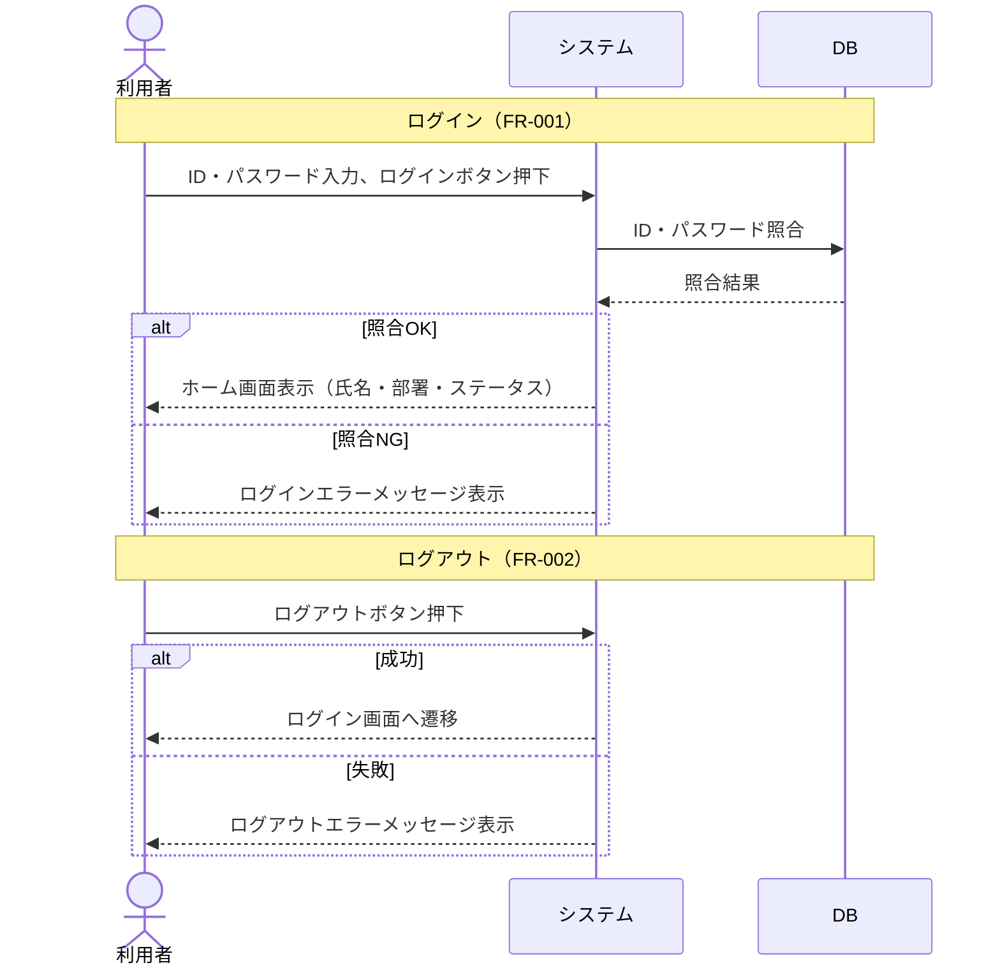
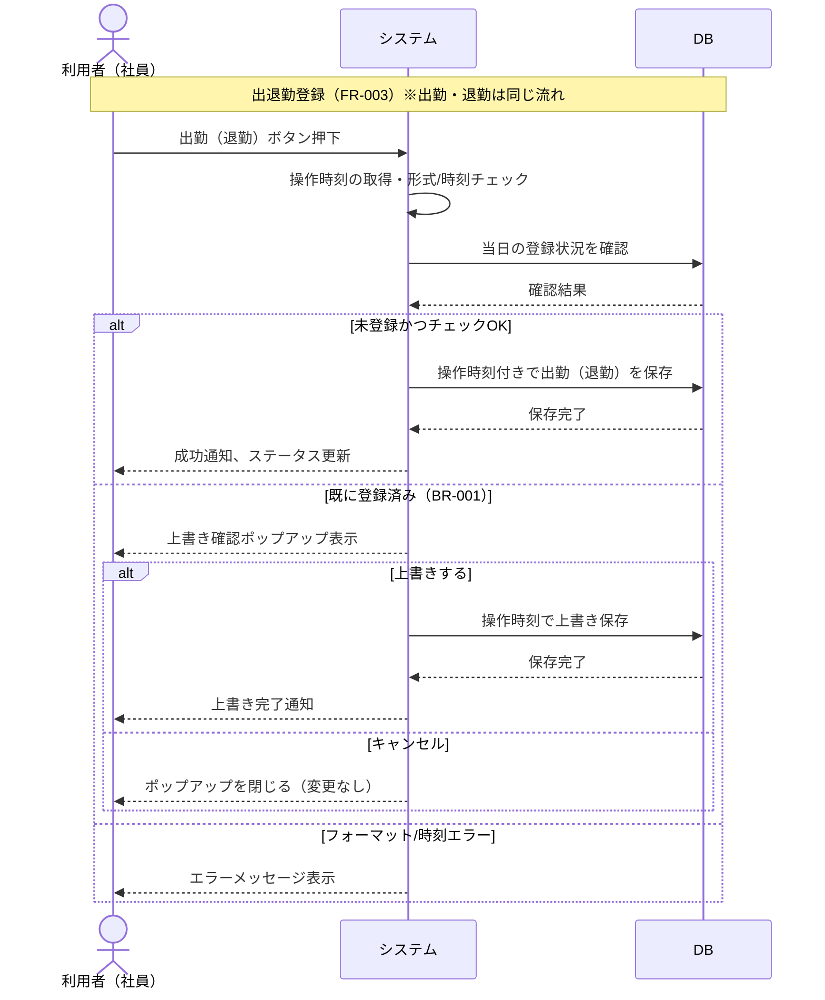
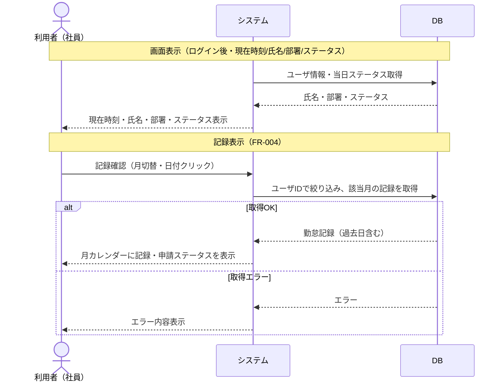
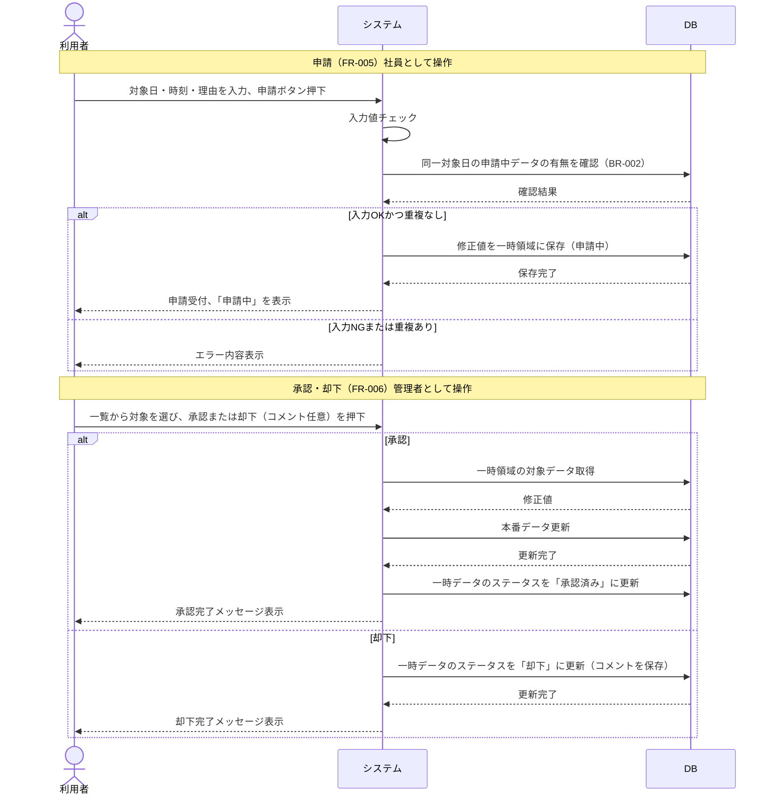
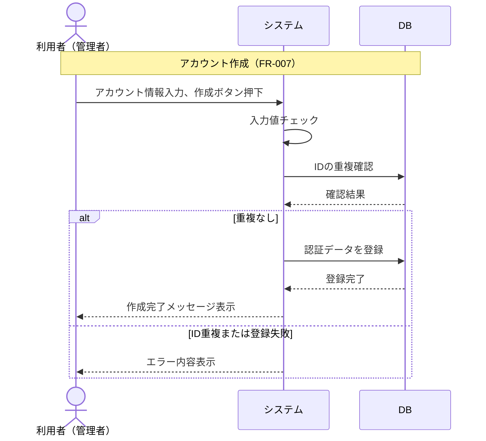

# 勤怠管理システム 開発引継ぎ資料

Oct 1, 2026

## プロジェクト概要

勤怠管理システム。出退勤・休憩の記録、記録の確認、修正/新規登録の申請と承認、残業申請、アカウント管理を行う社内向けWebシステム。

**利用者**

| 利用者 | 行うこと |
| --- | --- |
| 社員 | ログイン・出退勤登録・記録確認・修正/新規登録の申請・簡単残業申請 |
| 管理者 | 上記に加え、アカウント作成・申請の承認/却下 |

**主要機能（FR-001〜FR-008）**

ログイン/ログアウト、出退勤登録、記録表示、修正・新規登録の申請、承認（却下含む）、アカウント作成、残業申請。詳細は本文の機能要件一覧を参照。

## 参照ドキュメント

| ドキュメント | 場所 | 使い方 |
| --- | --- | --- |
| 要件定義ワークブック | アップロード済み `.md`（Step0〜Step8） | 要件の一次ソース。本書の各節はこのワークブックの内容を元に整理・補完している |
| 画面設計モック（Claude Design） | [勤怠管理システム 画面設計モック](https://claude.ai/artifact/4txSoUNwgwGa5Lc9XP72Xa) | 6画面をキャンバス上で実際に操作できるモック。ボタン押下やエラー表示、申請〜承認の画面遷移の挙動確認に使う。状態はJSのみで保持しており、画面間の動作連動やデータ永続化はない |
| Figmaデザイン | [勤怠管理 画面設計ページ](https://www.figma.com/design/ygbn0xyb8D8HJXlboFVK3R?node-id=3-2) | 同じ6画面＋主要な状態（エラー・確認ダイアログ・メニュー展開など）計12フレームを静的なビジュアルとして再現したもの。配色・フォント・余白は色変数24個にまとめてある。実装時の見た目のリファレンスとして使う |

実装の正とすべきは「要件定義ワークブック」。画面モックとFigmaは、未確定箇所を補完した上での見た目・挙動の参考資料であり、本書の「実装時に補完した仕様」と「未確定の論点」を必ず合わせて確認すること。

## 機能要件一覧（FR-001〜FR-008）

| 要件ID | 機能名 | 概要 |
| --- | --- | --- |
| FR-001 | ログイン | IDとパスワードで照合し、ログインができる |
| FR-002 | ログアウト | ログアウトができる |
| FR-003 | 出退勤登録機能 | 操作時刻で登録する |
| FR-004 | 記録表示機能 | DBを参照し、該当ユーザの記録を取得し画面に表示 |
| FR-005 | 申請機能 | 一時領域に保存し、画面にも表示する（申請中がわかるように） |
| FR-006 | 承認機能 | （ワークブック上は概要欄が空欄。本書「実装時に補完した仕様」で仮決めした内容を参照） |
| FR-007 | アカウント作成機能 | 重複しないIDであるかを確認し、アカウントを作成する |
| FR-008 | 残業申請機能 | 退勤がされている日を対象に、標準労働時間終了時刻から退勤時刻までで何時までを申請するかを簡単申請 |

## 業務ルール一覧（BR-001〜BR-007）

| ルールID | 概要 |
| --- | --- |
| BR-001 | 出退勤ボタンが1日に2回以上押下された際は、すぐに反映されず上書き確認のポップアップを出し、上書きするかキャンセルするかを選ばせる |
| BR-002 | 重複して同じ申請ができない（別日ならOK） |
| BR-003 | 勤怠管理はログイン済みユーザのみとする |
| BR-004 | 時間はすべて日本時間を採用する |
| BR-005 | ユーザ毎に勤怠レコードは1個とする |
| BR-006 | （ワークブック上は空欄。発注元への確認が必要） |
| BR-007 | （ワークブック上は空欄。発注元への確認が必要） |

## 画面一覧と遷移

画面要件（ワークブックStep8）に対応する7画面＋状態違い。モック・Figmaでのファイル名も併記する。

| 画面 | 役割 | 遷移元 | 遷移先 | モック/Figmaのファイル名 |
| --- | --- | --- | --- | --- |
| ログイン | ID・パスワード入力 | （未ログイン時の起点） | メイン画面 | Login.dc.html |
| メイン画面 | 現在時刻・出退勤・休憩・簡単残業申請、ハンバーガーメニュー | ログイン、各画面の「メイン画面へ」 | 記録表示、承認（PC/スマホ、管理者のみ）、アカウント作成（管理者のみ）、ログイン（ログアウト時） | Main.dc.html |
| 記録表示・修正申請 | 1か月単位のカレンダー表示、日付クリックで申請ウィンドウ | メイン画面メニュー | （モーダルで申請ウィンドウを開く） | Records.dc.html |
| 承認（PC・リスト型） | 申請の一覧・承認・却下 | メイン画面メニュー（管理者） | （モーダルで却下ダイアログを開く） | Approval.dc.html |
| 承認（スマホ・カード型） | 同上。カード型レイアウト | メイン画面メニュー（管理者） | 同上 | ApprovalMobile.dc.html |
| アカウント作成 | ID重複確認付きのアカウント作成、登録済み一覧 | メイン画面メニュー（管理者） | （作成後は同画面に留まる） | AccountCreate.dc.html |

**モーダル/状態（Figmaのみ再現。すべて静的な見た目）**

- ログインのエラー表示（10）
- メインの上書き確認 BR-001（11）
- メインの簡単残業申請ウィンドウ（12）
- メインのメニュー展開（13）
- 記録表示の申請ウィンドウ（14）
- 承認の却下ダイアログ（15、PCのみ。スマホ版の却下シートは未作成）

## シーケンス図

3ライフライン（利用者／システム／DB）構成。Mermaid記法。[Mermaid Live Editor](https://mermaid.live) に貼ると描画確認できる。

### ① ログイン・ログアウト（FR-001, FR-002）

### ② 出退勤登録（FR-003、BR-001の上書き確認を含む）

### ③ 画面表示・記録表示（FR-004）

### ④ 申請〜承認（FR-005, FR-006、BR-002の重複チェックと却下を含む）

### ⑤ アカウント作成（FR-007）

## 実装時に補完した仕様（要件が未確定・空欄だった箇所）

ワークブックで概要が空欄、または記載が曖昧だったため、画面モックとシーケンス図を作る都合で仮決めした内容。実装前に発注元への確認、または正式な要件としての確定が必要。

| 項目 | 補完した内容 | 根拠・備考 |
| --- | --- | --- |
| FR-006 承認機能の仕様 | 一覧表示（未処理／処理済みタブ）→承認（本番DBへ反映）／却下（コメント任意）の2択とした | ワークブックの概要欄が空欄だったため、Step7業務ルールの「申請の承認」とStep8画面要件の「承認ボタンと却下ボタン、却下の際はコメントも可」から設計 |
| 承認済み・却下後の一時データの扱い | 削除はせず、ステータスを「承認済み」「却下」に更新して処理済みタブに残す方式とした | 履歴として確認できるようにするための仮決め。削除する方式に変更も可能 |
| 簡単残業申請の標準終了時刻 | 18:00固定と仮定 | ワークブックに標準労働時間の具体値の記載がないため |
| 残業の終了時刻の入力範囲 | 「標準終了時刻より後、退勤時刻まで（退勤時刻ちょうどは可）」とした | 画面要件「終了時刻のみを入力。時刻は退勤時刻以降の時刻を指定できない」を、退勤時刻そのものは指定可と解釈 |
| アカウントID・パスワードの形式 | ID：半角英数字・ハイフン・アンダースコアの4〜20文字／パスワード：8文字以上 | ワークブックに桁数・形式の指定がないための仮決め |
| 画面表示機能の異常系 | 画面モック上は未実装（氏名・部署・ステータス取得失敗時のエラー表示は作っていない） | Step6機能詳細には記載があるが、画面要件・機能要件のどちらにも明示がないため優先度を保留 |
| 標準労働時間の設定画面 | 作成していない | ワークブックStep0に「労働時間の設定とその時刻および数パターンのプリセット」が確認事項として挙がっているが、Step8画面要件に該当する画面がないため |

## 未確定のまま残っている論点（発注元への確認が必要）

- **BR-006・BR-007**：ワークブック上で空欄のまま。業務ルールとして何が入るか未定
- **出退勤・退勤以外の登録項目**：休憩、休暇、有給休暇、遅刻/早退などを別途登録する機能を設けるか（Step0の確認事項）
- **労働時間の設定**：標準労働開始/終了時刻の設定機能、および複数パターンのプリセットを持たせるか。持たせる場合、誰が（管理者が個人ごとに／部署ごとに）設定するか
- **強調表示の要否**：出退勤時刻が設定した労働時間と比較して、遅刻・早退・残業などを強調表示するか
- **位置情報・不正登録対策**：出退勤登録時の位置情報取得や、なりすまし登録への対策の要否（Step1で確認事項として挙げられている）
- **勤怠情報の削除**：修正・新規登録の申請はあるが、削除申請の要否は未定
- **他ユーザの記録確認**：社員が自分以外の記録を確認できるか（Step1の確認事項）

## Claude Codeへの申し送り事項

**現状でできていること**

- 要件定義（ワークブック）の整理、機能要件・業務ルールの棚卸し
- 5種類のシーケンス図（Mermaid）
- 6画面＋主要な状態のUIモック（Claude Design、HTML/JSのみで実際に操作可能）
- 同じ6画面＋状態をFigmaに静的に再現（デザイントークン＝色変数24個を整備済み）

**まだ何もしていないこと（技術選定はゼロから）**

- フロントエンド／バックエンドのフレームワーク、言語、インフラの選定
- DB設計（テーブル設計、一時領域＝申請データの持ち方など）
- 認証方式の実装（モックは常にログイン済み扱いで、実際の認証処理はない）
- API設計
- 自動テストの方針

**UIモックを引き継ぐ際の注意点**

- モックのロジックはすべて画面コンポーネント内のJavaScriptで完結しており、サーバーやDBへの通信は一切行っていない（画面ごとに状態が独立しており、例えば記録表示で申請したデータが承認画面に反映されるといった連動はない）
- 氏名・部署・勤怠時刻などの表示データはすべてその場で生成したサンプルデータ
- ボタンの活性/非活性やエラーメッセージの出し分けなど、UI上のロジックはそのまま実装の参考にできるが、これはあくまで画面の挙動であり、サーバー側のバリデーションとして別途実装する必要がある

**次にやるべきことの提案**

1. 「未確定のまま残っている論点」の確認（必要なら発注元へ）
2. 技術スタックの選定
3. DB設計（勤怠レコード、一時領域、アカウントのテーブル設計。BR-005「ユーザ毎に勤怠レコードは1個」の意味の確認を含む）
4. 認証機能の実装（FR-001, FR-002, BR-003）
5. 画面モックのUIロジックを参考に、実データ・API呼び出しへ置き換え
6. 「実装時に補完した仕様」の各項目を、正式な仕様として確定させるか見直す
