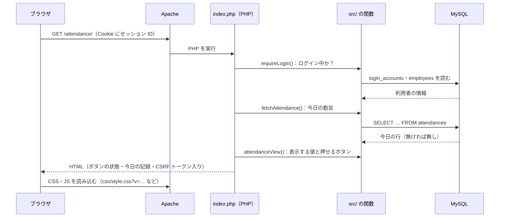
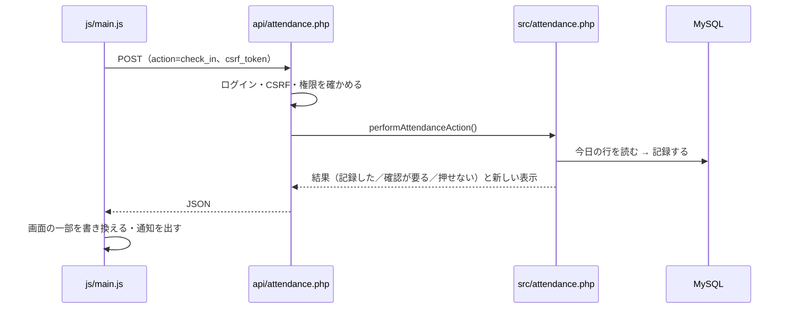

# 1. 全体像

## 1-1. 何をするシステムか

社員が毎日の出勤・退勤・休憩を記録し、間違いがあれば申請して、管理者が承認する。システム管理者は、アカウント・部署・勤務時間を管理する。

| 利用者 | `role` の値 | できること |
| --- | --- | --- |
| 社員 | `employee` | 出退勤・休憩の記録（メイン画面）、記録の確認（記録表示）、修正・新規登録・残業の申請、申請の取り消し |
| 管理者（上司・部長など） | `manager` | 社員と同じこと＋承認範囲の申請の承認・却下（承認画面） |
| システム管理者 | `system_admin` | アカウント管理、部署、勤務設定（出退勤の記録は持たない） |

- 管理者も社員の一人なので、自分の出退勤を記録する。自分の申請は承認できない（D-016）。
- システム管理者は社員ではない（`employees` の表に行が無く、社員コードも無い。D-021）。

## 1-2. 画面の一覧

| 画面 | URL（WSL） | 使える人 | 中心になるファイル |
| --- | --- | --- | --- |
| ログイン | `/attendance/login.php` | だれでも | `login.php` |
| メイン画面 | `/attendance/` | ログインした全員 | `index.php`、`js/main.js` |
| 記録表示 | `/attendance/records/` | 社員・管理者 | `records/index.php`、`js/records.js` |
| 承認 | `/attendance/approvals/` | 管理者 | `approvals/index.php`、`js/approvals.js` |
| アカウント管理 | `/attendance/admin/accounts.php` | システム管理者 | `admin/accounts.php`、`js/admin.js` |
| 部署 | `/attendance/admin/departments.php` | システム管理者 | `admin/departments.php` |
| 勤務設定 | `/attendance/admin/settings.php` | システム管理者 | `admin/settings.php` |

画面のほかに、JavaScript から呼ばれる **API**（結果を JSON で返す PHP）がある。

| API | 呼ぶ画面 | 役割 |
| --- | --- | --- |
| `api/attendance.php` | メイン画面 | 出勤・退勤・休憩のボタン |
| `api/requests.php` | メイン画面・記録表示 | 申請（修正・新規登録、残業）と取り消し |
| `api/approvals.php` | 承認 | 承認・却下 |

## 1-3. フォルダの構成

リポジトリの直下が、そのまま Web のドキュメントルート（`/var/www/html/attendance`）になっている（運用ルール 5章）。Web から見せたくないフォルダは、Apache の設定で拒否している（D-039）。

```
/                       ← Web から見える
├── index.php           メイン画面
├── login.php / logout.php
├── records/  approvals/  admin/   画面（フォルダごとに機能をまとめる）
├── api/                JavaScript から呼ぶ API（JSON を返す）
├── css/  js/           見た目と画面の動き
├── src/                ← Web から見えない（Apache の設定で拒否）
│   ├── functions.php   どこでも使う小さな関数
│   ├── dbconnect.php   DB に接続する（依頼者が書いた）
│   ├── errors.php      想定外のエラーの処理
│   ├── session.php     セッションと CSRF 対策
│   ├── auth.php        ログインと権限
│   ├── attendance.php  出退勤のルール
│   ├── records.php     カレンダーと労働時間
│   ├── holidays.php    祝日の計算
│   ├── requests.php    申請のルール
│   ├── approvals.php   承認のルール
│   ├── admin.php       システム管理者の処理
│   └── queries/        SQL を書いた関数（依頼者が書いた）
├── templates/          画面の上下の共通部分（ヘッダー・メニュー・フッター）← 見えない
├── tests/              自動テスト ← 見えない
└── docs/               資料（この教科書もここ）← 見えない（WSL には置かない）
```

**役割の分け方**（このシステムの一番大事な決まり）：

| 層 | 置き場所 | やること | やらないこと |
| --- | --- | --- | --- |
| 画面・API | `index.php`、`records/`、`api/` など | 入力を受け取る、ログインと権限を確かめる、`src/` の関数を呼ぶ、HTML や JSON を出す | 計算・ルール・SQL |
| ルール | `src/*.php` | 入力の確認、計算、「押せるか」の判断、トランザクション | HTML を出すこと、SQL を直接書くこと |
| SQL | `src/queries/*.php` | 1つの SQL（か、ひと組の SQL）を実行して、結果を返す | ルールの判断 |

こう分けると、たとえば「労働時間の計算」は `src/records.php` だけを見れば分かり、自動テストもしやすい（11章）。

## 1-4. 1回の画面表示で何が起きるか

例：社員がメイン画面（`/attendance/`）を開く。



ボタンを押したときは、画面全体を読み込み直さず、JavaScript が API に送る。



## 1-5. どの PHP ファイルも同じ形で始まる

画面の PHP は、だいたい次の形になっている（`records/index.php` の例）。

```php
include_once(__DIR__ . '/../src/functions.php');   // 1. 共通の関数
include_once(__DIR__ . '/../src/dbconnect.php');   // 2. DB に接続（$pdo ができる）
include_once(__DIR__ . '/../src/auth.php');        // 3. ログインと権限
include_once(__DIR__ . '/../src/records.php');     // 4. この画面のルール

$currentUser = requireLogin($pdo);                         // ログインしていなければ、ログイン画面へ
requireRole($currentUser, [ROLE_EMPLOYEE, ROLE_MANAGER]);  // 権限が無ければ 403

// 5. 必要なデータを集めて、表示する値を組み立てる
// 6. templates/header.php → HTML → templates/footer.php
```

- `include_once` は「まだ読み込んでいなければ読み込む」。同じファイルを2回読み込むと、関数の二重定義でエラーになるため、`_once` を使う。
- `__DIR__` は「このファイルがあるフォルダ」。どこから呼ばれても、正しい場所のファイルを読み込める。

## 1-6. 時刻はすべて日本時間

- PHP：`src/functions.php` の最初で `date_default_timezone_set('Asia/Tokyo')`。
- MySQL：接続のたびに `SET time_zone = '+09:00'`（`src/dbconnect.php`）。`NOW()` や `CURRENT_TIMESTAMP` が日本時間になる。
- ブラウザの時計：`Intl.DateTimeFormat` に `timeZone: 'Asia/Tokyo'` を指定（5章）。

DB の日時の列は `DATETIME`（タイムゾーンの情報を持たない）なので、入れる側と読む側の両方を日本時間にそろえている（BR-004）。

## 試してみる

1. ブラウザで `http://localhost/attendance/src/dbconnect.php` を開く → 403（Apache の設定で、`src/` は見えない）。
2. メイン画面で右クリック →「ページのソースを表示」。`data-csrf-token="…"` や `style.css?v=…` が入っていることを確かめる（2章・10章で説明）。
