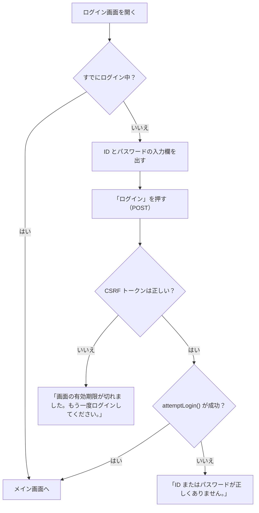

# 3. ログインと権限

主なファイル：`login.php`、`logout.php`、`src/auth.php`、`src/queries/login_accounts.php`

## 3-1. ログインの流れ（`login.php`）



1つの PHP ファイル（`login.php`）が、表示（GET）と送信（POST）の両方を受け持つ。POST のときだけ `if ($_SERVER['REQUEST_METHOD'] === 'POST')` の中を実行する。

CSRF トークンが正しくないとき、ほかの画面は 400 で止めるが、ログイン画面だけは `isValidCsrfToken()` で調べて、同じ画面に文を出す（PR 9。D-069）。ログイン画面を長く開いたままにして、セッションごとトークンが消えたときでも、もう一度入力すればログインできる。

## 3-2. `attemptLogin()`：ID とパスワードを確かめる

```php
function attemptLogin(PDO $pdo, string $loginId, string $password): bool {
    $account = fetchLoginAccount($pdo, $loginId);
    $passwordOk = password_verify($password, $account['password_hash'] ?? DUMMY_PASSWORD_HASH);
    if ($account === null || !$passwordOk || (int) $account['is_active'] !== 1) {
        return false;
    }
    session_regenerate_id(true);
    $_SESSION['user'] = ['login_id' => $account['login_id']];
    unset($_SESSION['timed_out']);
    updateLastLoginAt($pdo, $account['login_id']);
    return true;
}
```

順番に見ていく。

### パスワードは「ハッシュ」で保存している

- DB の `login_accounts.password_hash` には、パスワードそのもの（平文）ではなく、`password_hash()` で作った**ハッシュ**（元に戻せない変換をした文字列）を保存している。例：`$2y$10$Wym.MkHp…`。
- ログインのときは `password_verify(入力されたパスワード, 保存したハッシュ)` で、合っているかだけを確かめる。
- DB の中身が漏れても、パスワードそのものは分からない。同じパスワードでも毎回違うハッシュになる（ソルトという乱数が入る）ので、表を使った推測もされにくい。

### ID が無いときも、わざとパスワードを照合する

`$account` が無い（ID が存在しない）ときは、`DUMMY_PASSWORD_HASH`（何とも一致しないハッシュ）で `password_verify()` を実行している。

- `password_verify()` はわざと時間がかかる（数十〜100 ミリ秒ほど。総当たりで試されにくくするため）。ID が無いときだけすぐに返すと、「返事が速い＝その ID は無い」と分かり、存在する ID を調べられてしまう。
- どちらの場合も同じ時間がかかるようにして、それを防いでいる。

### 失敗の理由を区別しない

ID が無い・パスワードが違う・利用不可（`is_active = 0`）のどれでも、画面には同じ「ID またはパスワードが正しくありません。」を出す。理由を教えると、攻撃者の手がかりになるため。

### `session_regenerate_id(true)`：ログインしたらセッション ID を作り直す

ログイン前の ID をそのまま使うと、攻撃者があらかじめ用意した ID を利用者に使わせ、ログイン後に同じ ID で入り込む攻撃（セッション固定攻撃）ができてしまう。ログインした瞬間に新しい ID に変えて、それを防ぐ。

### セッションに入れるのは「ログイン ID」だけ

`$_SESSION['user'] = ['login_id' => …]` と、ID だけを保存する。氏名や権限は保存しない。理由は次の 3-3。

## 3-3. `currentUser()` と `requireLogin()`：今ログインしているのはだれか

画面を開くたびに、セッションのログイン ID から、DB を読み直して利用者の情報を組み立てる。

```php
function currentUser(PDO $pdo): ?array {
    startAppSession();
    $loginId = $_SESSION['user']['login_id'] ?? null;
    if ($loginId === null) {
        return null;                          // ログインしていない
    }
    $account = fetchLoginAccount($pdo, $loginId);
    if ($account === null || (int) $account['is_active'] !== 1) {
        logoutUser();                         // ログイン中に無効にされた
        return null;
    }
    // 社員・管理者なら、employees から氏名・部署・入社日も読む（fetchEmployeeProfile()）
    …
}
```

- **毎回 DB を読み直す**ので、システム管理者がアカウントを無効にすると、その人はログイン中でも、次の操作でログイン画面に戻される（PR 7 で確認済み）。権限や部署を変えた場合も、すぐに反映される。
- 戻り値は `['login_id', 'employee_id', 'role', 'approval_scope', 'name', 'department_name', 'joined_on', 'department_id']`。システム管理者は `name` が「システム管理者」、`employee_id`・`joined_on`・`department_id` が `null`。

| 関数 | ログインしていないとき | 使う場所 |
| --- | --- | --- |
| `requireLogin($pdo)` | ログイン画面へ移す（`redirect('login.php')`） | 画面（`index.php` など） |
| `currentUser($pdo)` | `null` を返すだけ | API（JSON で 401 を返し、JavaScript がログイン画面へ移す） |

API で画面を移さないのは、JavaScript の `fetch()` が受け取るのは JSON で、HTML のログイン画面が返ってきても困るため。

## 3-4. `requireRole()`：権限を確かめる

```php
requireRole($currentUser, [ROLE_MANAGER]);   // 管理者でなければ 403
```

- 権限の名前は定数（`ROLE_EMPLOYEE`・`ROLE_MANAGER`・`ROLE_SYSTEM_ADMIN`）にしてある。文字列を直接書くと、打ち間違えても気付きにくいため。
- メニューに項目を出さないだけでは不十分。URL を直接入力すれば開けてしまうので、**画面と API の両方で、必ずサーバー側で確かめる**（メニューの出し分けは、使いやすさのため）。

| 画面・API | 確かめていること |
| --- | --- |
| 記録表示 | 社員・管理者（`requireRole`） |
| 承認、`api/approvals.php` | 管理者。さらに申請ごとに承認範囲（8章） |
| 社員の勤怠（`members/`・`members/detail.php`） | 管理者。さらに詳細では、社員ごとに承認範囲・自分でない・在籍中か（`canViewMember()`。だめなら 404。13章） |
| 管理の3画面 | システム管理者 |
| `api/attendance.php`・`api/requests.php` | システム管理者は 403（出退勤の記録が無いため） |

## 3-5. 自動ログアウト

`startAppSession()` が、最後の操作から 2時間を過ぎていたらログイン状態を消し、`$_SESSION['timed_out'] = true` を入れる。ログイン画面はそれを見て「一定時間操作がなかったため、ログアウトしました。」と出す。

## 3-6. ログアウト（`logout.php`）

1. POST 以外は 405 で断る（2-5 の理由）。
2. すでにログイン状態が無ければ（自動ログアウトのあとに押した など）、確かめずにログイン画面へ移す（PR 9。D-069）。前は、トークンも消えているため 400 になっていた。
3. CSRF トークンを確かめる。
4. `logoutUser()`：`$_SESSION` を空にし、Cookie を消し、`session_destroy()` でサーバー側のデータも消す。
5. ログイン画面へ移す。

## 試してみる

1. 2025001 でログインしたまま、別のブラウザで `sysadmin` から 2025001 を無効化する → 2025001 の画面で何か押すと、ログイン画面に戻る。最後に「有効に戻す」。
2. 開発者ツールの Cookie で、ログインの前後に `ATTENDANCE_SESSID` の値が変わることを確かめる（`session_regenerate_id()`）。
