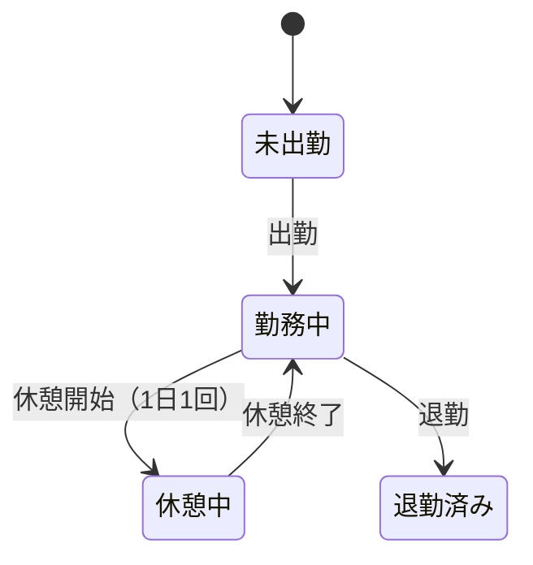
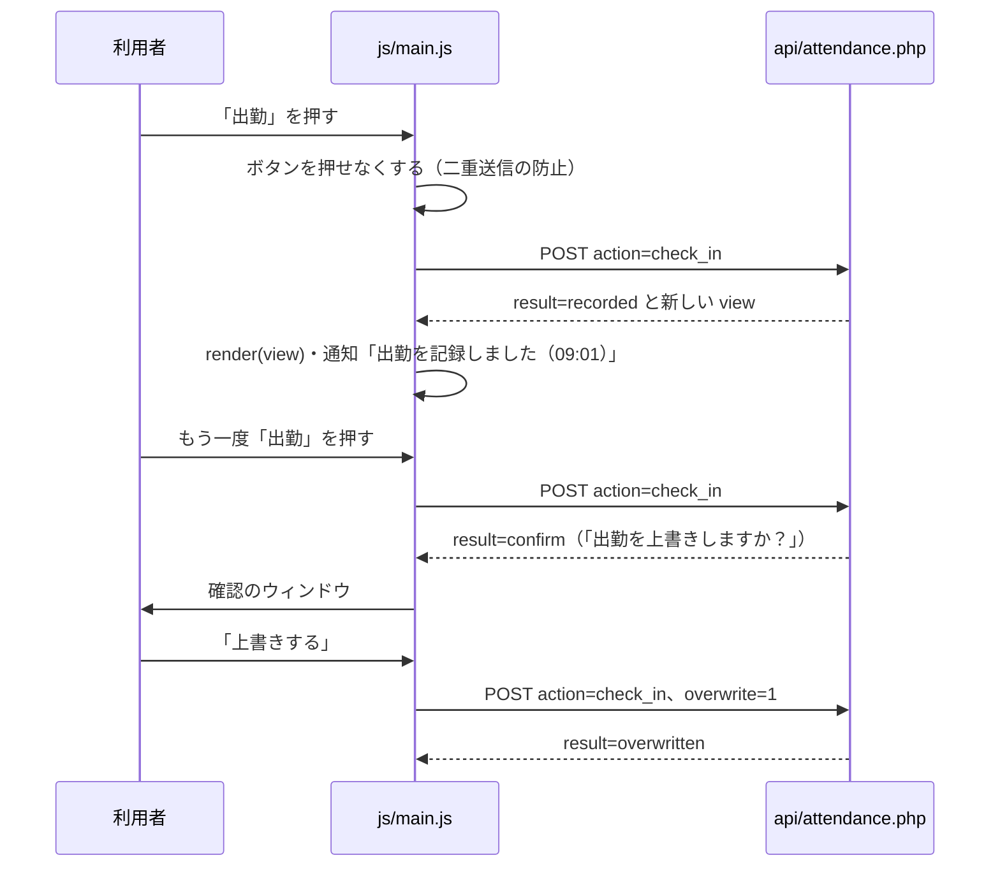

# 5. メイン画面（出退勤）

主なファイル：`index.php`、`js/main.js`、`api/attendance.php`、`src/attendance.php`、`src/queries/attendances.php`

## 5-1. 画面ができるまで（`index.php`）

1. `requireLogin()` でログインを確かめる。
2. 社員・管理者なら、今日の勤怠を読み（`fetchAttendance()`）、`attendanceView()` で「表示する値と、押せるボタン」を作る。
3. 今日の申請中の状態を調べる（`pendingStatesOf()`。SQL は1回）。修正・新規登録が申請中なら打刻を止め（D-063）、残業申請が申請中なら簡単残業申請のボタンを止める（D-069）。
4. HTML を出す。ボタンは、`attendanceView()` の結果で `disabled` を付けたり外したりする。
5. システム管理者なら、ボタンの代わりに管理の画面へのリンクを出す（D-067）。

`attendanceView()` の結果は、JavaScript でも使うので、JSON にして `data-view` に埋め込んでいる。

```php
<div id="attendance" data-api-url="…/api/attendance.php" data-csrf-token="…"
     data-view="<?= h(json_encode($view, …)) ?>">
```

**`data-*` 属性**は、HTML に好きな値を持たせる仕組み。JavaScript からは `element.dataset.view` のように読める。PHP から JavaScript に値を渡すときの、このシステムの決まった方法。

## 5-2. 勤怠の「状態」とボタンのルール（`src/attendance.php`）

今日の行（`attendances` の1行）の中身から、状態を決める（`attendanceStatus()`）。



ボタンを押したときの扱いは、`actionMode()` が3つのどれかを返す。

| 戻り値 | 意味 |
| --- | --- |
| `ACTION_RECORD` | そのまま記録する |
| `ACTION_OVERWRITE` | すでに記録があるので、上書きの確認のあとで記録する（BR-001） |
| `ACTION_UNAVAILABLE` | 今は押せない |

| ボタン | 押せる条件 | 2回目に押すと |
| --- | --- | --- |
| 出勤 | 休憩・退勤より前 | 上書きの確認（休憩・退勤のあとは押せない：時刻の前後が逆になるため。D-059） |
| 退勤 | 出勤済みで、休憩中でない | 上書きの確認 |
| 休憩開始 | 出勤済み・退勤前・まだ休憩していない | 押せない（休憩は1日1回。D-007・D-042） |
| 休憩終了 | 休憩中 | 押せない |

> **押せるかの判断は、サーバーだけが行う。** 画面のボタンの `disabled` は見た目のためで、JavaScript をいじれば押せてしまう。そのため API が受け取ったときにも、必ず `actionMode()` で確かめ直す。

## 5-3. ボタンを押したとき（`js/main.js` → `api/attendance.php`）



### API 側（`api/attendance.php`）がする確認

1. POST 以外は 405。
2. ログインしていなければ 401（JavaScript がログイン画面へ移す）。
3. CSRF トークン。
4. システム管理者は 403。
5. `action` が4つのどれかか（それ以外は 400）。
6. `pendingStatesOf()` で今日の申請中の状態を調べ、`performAttendanceAction()` を呼び、結果を JSON で返す。

### `performAttendanceAction()` の結果

| `result` | いつ | 画面の動き |
| --- | --- | --- |
| `recorded` | 記録した | 通知（緑） |
| `overwritten` | 上書きした | 通知（緑） |
| `confirm` | 上書きの確認が要る | 確認のウィンドウ |
| `unavailable` | 押せない（別の画面で状態が変わっていた、申請中で止めている） | 通知（赤）・表示を最新に |
| `conflict` | 別の画面で、同時に出勤が記録された | 通知（赤）・表示を最新に |

どの結果でも、**最新の `view` を一緒に返し**、画面はそれで書き直す（`render()`）。別のタブで操作していた場合でも、押した時点で正しい表示に戻る。

### 同時に出勤を押したとき（`conflict`）

2つのタブでほぼ同時に「出勤」を押すと、両方が「今日の行は無い」と判断して INSERT しようとする。`attendances` の一意制約（1人1日1行）で、後のほうはエラー 1062 になるので、それを受け止めて `conflict` を返す（4-6 の考え方）。

### 記録する時刻

- `minuteTimestamp()`：秒を切り捨てて、分単位で記録する（09:01:45 → 09:01:00）。
- `workDateOf()`：押した日を勤務日にする（0時で日付が切り替わる）。

## 5-4. 時計（`js/main.js` の前半）

```js
const offset = Number(clock.dataset.serverTime) - Date.now();
…
formatter.formatToParts(new Date(Date.now() + offset))
```

- PC の時計がずれていることがあるので、画面を出したときのサーバーの時刻（`data-server-time`、ミリ秒）との差（`offset`）を覚えておき、その分を足して表示する。
- `Intl.DateTimeFormat` に `timeZone: 'Asia/Tokyo'` を指定して、PC の設定にかかわらず日本時間で出す。
- 次の秒の変わり目に合わせて `setTimeout` し直すので、秒の表示がずれにくい。
- 表示中に日付が変わったら、画面を読み込み直す（新しい日の記録を出すため）。

## 5-5. 簡単残業申請（メイン画面のボタン）

- 押せるのは、今日の退勤が記録済みで、標準終了時刻（勤務設定。初期値 18:00）より後のとき（`overtimeAvailable()`）。
- ただし、今日の残業申請が申請中なら押せない。ボタンの下の案内も「本日分の残業申請は申請中です。」に変わる（`attendanceView()` の `$overtimePending`。PR 9 で追加。D-069）。
- ウィンドウで残業の終了時刻を入れて、`api/requests.php` に `type=overtime` で送る。中身は7章。
- 受け付けられたら、`js/main.js` は画面を読み込み直さずに、ボタンを押せなくし、案内を「申請中です」に変える。申請中の残業申請は1日1件まで（BR-002）で、最後は DB の一意制約が守る。

## 5-6. 申請中は打刻を止める（D-063）

今日の分の修正申請（例：「退勤 19:00」）を出したあとに退勤を押すと、承認されたときに申請の値で上書きされ、押した打刻が消えてしまう。そこで、**今日の修正・新規登録が申請中の間は、4つのボタンをすべて押せなくする**（`attendanceView()` の `$locked`）。打刻したいときは、記録表示で申請を取り消す。

## 試してみる

1. 2025001 で出勤を2回押す → 2回目に確認のウィンドウ。「キャンセル」だと何も変わらない。
2. 開発者ツールの「ネットワーク」で、ボタンを押したときの `attendance.php` の応答（JSON）を見る。`result` と `view` が入っている。
3. 開発者ツールで、押せないボタンの `disabled` を外して押してみる → サーバーが断り、「今は『…』を押せません。」と出る。
4. 標準終了時刻より後に退勤したあとで、簡単残業申請を出す → ボタンが押せなくなり、下の案内が「本日分の残業申請は申請中です。」に変わる。画面を読み込み直しても同じ（D-069）。
