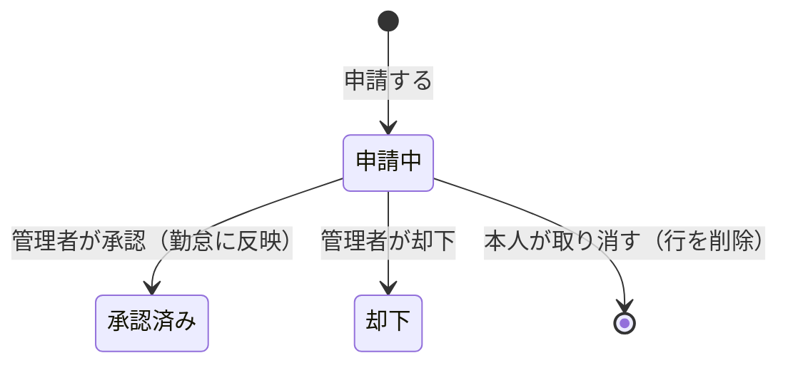

# 7. 申請

主なファイル：`api/requests.php`、`src/requests.php`、`src/queries/attendance_requests.php`、`js/records.js`（申請ウィンドウ）、`js/main.js`（簡単残業申請）

## 7-1. 申請の種類と、DB での持ち方

| 種類 | `request_type` | 出す画面 | 申請する値 |
| --- | --- | --- | --- |
| 修正・新規登録 | `correction` | 記録表示 | 出勤・退勤・休憩開始・休憩終了の4つ（`requested_*`） |
| 簡単残業申請 | `overtime` | メイン画面 | 残業の終了時刻（`requested_overtime_end_at`） |

- 修正か新規登録かは、申請した時点でその日の記録があったかで決まる（画面で選ばせない。D-051）。
- **申請は、承認されるまで勤怠（`attendances`）を変えない**。いったん `attendance_requests`（一時置き場）に入れ、承認されたときに勤怠へ反映する（FR-005、FR-006）。
- 申請した時点の勤怠の値を `original_*` に控えておく。承認で勤怠が書き換わっても、「変更前 → 申請値」をあとから表示できる（D-023）。

申請の状態：



## 7-2. 1つの API で3つの操作（`api/requests.php`）

`type` の値で分ける。

| `type` | 呼ぶ関数 | 成功したら |
| --- | --- | --- |
| `correction` | `submitCorrectionRequest()` | 通知をセッションに入れ（`setFlash`）、画面が読み込み直す |
| `overtime` | `submitOvertimeRequest()` | メイン画面に通知を出す（読み込み直さない） |
| `cancel` | `submitCancelRequest()` | 通知をセッションに入れ、画面が読み込み直す |

結果の形はどれも同じ：成功なら `['ok' => true, 'message' => …]`、入力の誤りなら `['ok' => false, 'errors' => ['項目の名前' => '文']]`。JavaScript は、`errors` の項目の名前を見て、その入力欄の下に文を出す。

## 7-3. 修正・新規登録の入力の確認（`validateCorrection()`）

**入力のルールは、すべてサーバーで確かめる**（画面の `min`・`max` などは、使いやすさのためだけ）。確かめる順番：

1. 対象日：正しい日付で、入社日から今日まで。
2. 時刻の形：`HH:MM`（`parseRequestTime()`。空欄は「なし」＝ `null`）。
3. 出勤は必須。
4. 休憩は、開始と終了の両方を入れるか、両方とも空けるか。
5. 順番：出勤 ＜ 休憩開始 ＜ 休憩終了 ＜ 退勤（入っているものどうし）。
6. 今日の分なら、まだ来ていない時刻は不可。
7. 理由は 500 文字まで（任意。D-041）。
8. 今の記録とまったく同じなら不可（「今の記録から変更がありません。」）。

戻り値の `errors` は、項目ごとの文の配列。1つでも誤りがあれば保存しない。

### 保存と、重複の扱い

```php
try {
    insertCorrectionRequest($pdo, $user['employee_id'], $targetDate, $requested, currentRequestTimes($current), $reason);
} catch (PDOException $e) {
    if (!isDuplicateError($e)) {
        throw $e;
    }
    return ['ok' => false, 'errors' => ['form' => REQUEST_DUPLICATE_CORRECTION]];
}
```

同じ日に申請中の修正がすでにあれば、DB の一意制約（`pending_key`。4-6）で断られるので、「この日には、申請中の申請があります。…」と返す（BR-002）。

## 7-4. 簡単残業申請（`validateOvertime()`・`submitOvertimeRequest()`）

- 対象は今日だけ。今日の退勤が記録済みで、標準終了時刻より後のとき（FR-008、D-062）。
- 残業の終了時刻は、標準終了時刻より後、退勤時刻まで。
- 理由の欄は無い（D-041）。
- 承認されると、`attendances.overtime_end_at` に入る（労働時間の計算には使わない。6-3）。

## 7-5. 申請の取り消し（`submitCancelRequest()`・`deletePendingRequest()`）

```sql
DELETE FROM attendance_requests WHERE id = :id AND employee_id = :employee_id AND status = 'pending'
```

- **本人の申請**（`employee_id`）で、**申請中**（`status = 'pending'`）のものだけを消す。画面を通さずに他人の申請の ID を送っても、条件に合わないので消えない。
- 消せたかどうかは `rowCount()`（消した行の数）で分かる。0 なら「すでに承認・却下されたか、取り消されています。」。
- 管理者が承認するのと、本人が取り消すのが同時だった場合は、先に処理されたほうが有効になる（もう一方は「すでに処理されています」）。

## 7-6. 申請の表示（`requestView()`・`requestChanges()`）

変わった項目だけを「変更前 → 申請値」で出す（D-023、D-064）。

```php
requestChanges($request)
// → [['label' => '退勤', 'before' => '17:30', 'after' => '18:45']]   ← 出勤が同じなら、出勤は出さない
```

`original_*` と `requested_*` を項目ごとに比べ、違うものだけを並べる。新規登録は、変更前がすべて「なし」になる。この関数は、記録表示と承認画面の両方で使う（同じ見え方にするため）。

## 試してみる

1. 記録表示で、昨日の退勤を変える申請を出す → カレンダーに「申請中」のバッジ。同じ日にもう一度申請しようとすると、断られる。
2. 申請を取り消す → バッジが消え、もう一度申請できる。
3. 開発者ツールの「ネットワーク」で、入力を誤ったときの `requests.php` の応答を見る。`{"ok":false,"errors":{"check_out":"…"}}` の形になっている。
