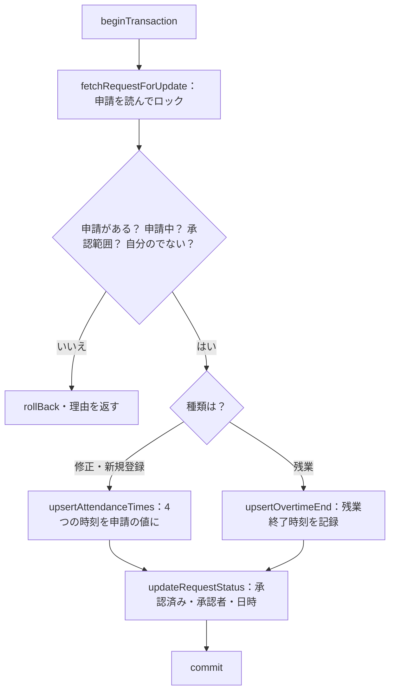

# 8. 承認

主なファイル：`approvals/index.php`、`js/approvals.js`、`api/approvals.php`、`src/approvals.php`、`src/queries/attendance_requests.php`・`attendances.php`

## 8-1. だれの申請を承認できるか（承認範囲。D-024・D-025）

- 承認できるのは管理者（`manager`）だけ。システム管理者は承認しない。
- 管理者ごとに、`login_accounts.approval_scope` で範囲が決まる。
  - `department`：自分の所属部署の社員の申請だけ。
  - `all`：全社員の申請（部長などの幹部）。
- **自分の申請は承認できない**（D-016）。DB の `CHECK` 制約でも止めている。
- 同じ承認範囲は、社員の勤怠（13章）で「どの社員の勤怠を見られるか」にも使う。

```php
function canReview(array $user, array $request): bool {
    if ($user['role'] !== ROLE_MANAGER || $request['employee_id'] === $user['employee_id']) {
        return false;                                       // 管理者でない、または自分の申請
    }
    return $user['approval_scope'] === 'all' || (int) $request['department_id'] === $user['department_id'];
}
```

## 8-2. 一覧（`approvals/index.php`）

| タブ | 中身 | 関数 |
| --- | --- | --- |
| 未処理 | 承認範囲の申請中を、古い順に全部 | `fetchPendingRequests()` |
| 処理済み | 承認範囲の承認・却下済みを、新しい順に 50 件 | `fetchProcessedRequests()` |

承認範囲が「部署」の管理者のときだけ、SQL に部署の条件を足す。

```php
if ($departmentId !== null) {
    $sql .= ' AND e.department_id = :department_id';   // 条件によって SQL を足す
}
…
if ($departmentId !== null) {
    $stmt->bindValue(':department_id', $departmentId, PDO::PARAM_INT);   // 足したときだけ値を渡す
}
```

SQL を足すときも、値は必ずプレースホルダで渡す（文字列をつなげない）。

画面の切り替え：PC（幅 768px 以上）は表の形、スマホはカードの形。同じ HTML を CSS だけで切り替えている（D-052。10章）。

## 8-3. 承認・却下の処理（`reviewRequest()`）

承認は、1つのトランザクションで次の順に行う（4-5）。



- 修正・新規登録の承認では、**4つの時刻をすべて申請の値で置き換える**（申請していない項目も、申請の値＝空欄なら空になる）。申請ウィンドウは今の値が入った状態で開くので、変えなかった項目は今と同じ値になる（DB設計書 P-4）。
- 却下は、勤怠を変えずに、申請を「却下」にする（コメントは任意）。
- 途中で失敗したら `rollBack()` で全部取り消し、例外を投げ直す（2-3 の共通のエラー処理へ）。

### 2人が同時に承認したら

```
管理者A：beginTransaction → FOR UPDATE で申請をロック → 勤怠を更新 → 承認済みに → commit
管理者B：beginTransaction → FOR UPDATE で待たされる …………………… → 読めたときには「承認済み」
                                                                  → 「この申請は、すでに処理されています。」
```

`FOR UPDATE` が無いと、2人とも「申請中」と読んで、2回反映してしまうおそれがある。

### `updateRequestStatus()` の安全装置

```sql
UPDATE attendance_requests SET status = :status, … WHERE id = :id AND status = 'pending'
```

`WHERE` に `status = 'pending'` を付けて、申請中のもの以外は変えないようにしている（ロックと合わせて二重の守り）。

## 8-4. 画面とのやり取り（`js/approvals.js` → `api/approvals.php`）

- 「承認」は確認なしですぐ送る（画面モックのとおり。D-064）。「却下」はコメントのウィンドウのあとで送る。
- 成功したら、通知をセッションに入れ（`setFlash`）、画面を読み込み直す。一覧と件数が最新になる。
- API は、ログイン（401）・CSRF（400）・管理者か（403）・`request_id` と `decision` の形（400）を確かめてから、`reviewRequest()` を呼ぶ。承認範囲は `reviewRequest()` の中で、申請ごとに確かめる。

## 試してみる

1. 2025001 で申請 → 2025002（営業部・部署）で承認 → 2025001 の記録表示で時刻が変わり「承認済み」になる。
2. 2025003（開発部・全社）の申請は、2025002 の一覧に出ない。
3. 同じ申請を、2つのタブで開いておき、片方で承認してから、もう片方で承認を押す → 「すでに処理されています」。
