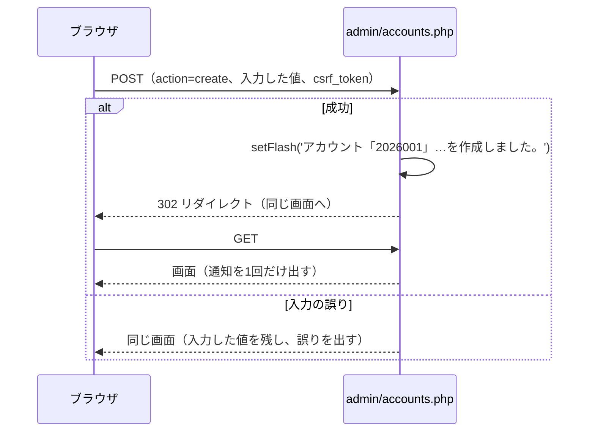

# 9. システム管理者（アカウント管理・部署・勤務設定）

主なファイル：`admin/accounts.php`・`departments.php`・`settings.php`、`js/admin.js`、`src/admin.php`、`src/queries/` の `employee_id_sequences.php`・`departments.php`・`employees.php`・`login_accounts.php`・`work_settings.php`

## 9-1. フォームの送り方：POST → 同じ画面へ戻す（PRG）

承認画面やメイン画面は JavaScript から API に送るが、管理の3画面は**普通のフォーム**（`<form method="post">`）で送る。



- 成功したあとにリダイレクト（POST → Redirect → GET。**PRG** と呼ぶ）するのは、F5 で読み込み直したときに、同じ POST がもう一度送られて二重に作られるのを防ぐため。
- 1つの PHP が、表示（GET）と、いくつかの操作（POST の `action` の値：`create`・`deactivate`・`reactivate`・`reset_password`）を受け持つ。知らない `action` は 400。

```php
$result = match ($action) {
    'create' => createAccount($pdo, $_POST, $now),
    'deactivate' => deactivateAccount($pdo, $employeeId, inputString($_POST, 'left_on'), $today),
    'reactivate' => reactivateAccount($pdo, $employeeId),
    'reset_password' => resetPassword($pdo, $employeeId, inputRaw($_POST, 'password'), inputRaw($_POST, 'password_confirm')),
    default => abort(400, '不正なリクエストです。…'),
};
```

`match` は、値に合う行の式を1つだけ実行して、その結果を返す（`switch` の短い書き方）。

## 9-2. アカウントの作成（`createAccount()`）

### 入力の確認（`validateAccount()`）

| 項目 | ルール |
| --- | --- |
| 氏名 | 必須、100 文字まで（前後の空白は取る） |
| メールアドレス | 必須、メールの形（`filter_var(…, FILTER_VALIDATE_EMAIL)`）、254 文字まで、ほかと重複不可 |
| 部署 | 有効な部署の中から |
| 入社日 | 2000-01-01 〜 今日の1年後 |
| 権限 | 社員か管理者（システム管理者は作れない） |
| 承認範囲 | 管理者のときだけ（社員は既定値の `department` にする） |
| パスワード | 半角の英数字・記号で 8〜64 文字、確認と一致 |

- パスワードの形は正規表現 `/\A[\x21-\x7E]{8,64}\z/`。`\x21`〜`\x7E` は、空白を除いた半角の英数字・記号。上限を 64 にしているのは、`password_hash()` が 72 バイトより後ろを使わないため。
- パスワードだけは `inputRaw()` で受け取る（ほかは `inputString()` で前後の空白を取るが、パスワードの空白は、取らずに「形の誤り」として扱う）。

### 社員コードの採番（D-013、D-067）

社員コード＝ログイン ID。「作成年＋通番」で、システムが決める。

| 通番 n | 社員コード |
| --- | --- |
| 1〜999 | `2026001`〜`2026999` |
| 1000〜1098 | `2026A01`〜`2026A99` |
| 1099〜 | `2026B01`〜 … 上限 `2026Z99`（1年に 3,573 人） |

```php
$pdo->beginTransaction();
$number = nextEmployeeNumber($pdo, $year);        // その年の通番を1つ進める
$employeeId = formatEmployeeId($year, $number);   // 通番 → 社員コード
insertEmployee(…);                                 // employees に追加
insertLoginAccount(…);                             // login_accounts に追加
$pdo->commit();
```

`nextEmployeeNumber()` の SQL（依頼者が書いた部分）：

```sql
INSERT INTO employee_id_sequences (year, last_number) VALUES (:year, 1) AS new
  ON DUPLICATE KEY UPDATE last_number = employee_id_sequences.last_number + 1;   -- 無ければ 1、あれば +1
SELECT last_number FROM employee_id_sequences WHERE year = :year;                -- 進めたあとの値を読む
```

- 行を作った・増やした時点で、その行はトランザクションが終わるまでロックされる。2人が同時に作っても、もう1人は待たされ、続きの番号になる（重複しない）。
- 最初の案の「`SELECT … FOR UPDATE` で読んでから +1」は、**その年の最初の1人**を同時に作ると、どちらも「行が無い」と判断してエラー（デッドロック）になることを、テストで確かめたため変えた（D-067）。

### 途中で失敗したら

- メールアドレスが重複していたら、`insertEmployee()` が一意制約のエラーになる。`rollBack()` するので、**通番も元に戻る**（番号が飛ばない）。エラーの文の中に `uq_employees_email`（一意制約の名前）があるかで、メールの重複だと判断して「このメールアドレスは、すでに使われています。」を返す。
- パスワードのハッシュは、トランザクションの前に作る（`password_hash()` は時間がかかるので、通番の行のロックを長く持たないため）。

## 9-3. 無効化・有効に戻す・パスワード再設定

| 操作 | `employees` | `login_accounts` |
| --- | --- | --- |
| 無効化（退職） | `employment_status = 'retired'`、`left_on = 退社日` | `is_active = 0` |
| 有効に戻す | `employment_status = 'active'`、`left_on = NULL` | `is_active = 1` |
| パスワード再設定 | － | `password_hash` を新しいハッシュに |

- 無効化・有効に戻すは、2つの表を1つのトランザクションで変える（`runInTransaction()`）。
- アカウントは削除しない（D-015）。勤怠や申請の記録が、社員を参照しているため（外部キー）。
- 操作の対象は `findManagedAccount()` で確かめる：社員コードの形が正しいか、存在するか、システム管理者でないか。画面を通さずに `sysadmin` を送っても、対象にならない。
- 無効にされた人は、ログイン中でも次の操作で締め出される（3-3）。

## 9-4. 部署と勤務設定

**部署**（`addDepartment()` など）：

- 部署名は 50 文字まで、重複不可（DB の一意制約のエラーを「同じ名前の部署があります。」に変える）。
- 無効にしても、所属している社員はそのまま。アカウント作成の選択欄に出なくなるだけ（D-067）。
- 在籍人数は `fetchDepartments()` の GROUP BY で数える（4-3）。

**勤務設定**（`saveWorkSettings()`）：

- ルール：始業 ＜ 終業、昼休憩の開始 ＜ 終了、昼休憩は始業から終業の間。
- 変更の履歴は持たない（全社共通の1行）。変えると、過去の日の労働時間も新しい昼休憩で計算し直される（画面に注意の文を出している）。
- `updated_at` は DB が自動で今の日時にする（`ON UPDATE CURRENT_TIMESTAMP`）。

## 9-5. 確認のウィンドウ（`js/admin.js`）

「無効化」などのボタンには、`data-*` 属性で対象の情報を持たせている。

```html
<button data-open="deactivate-dialog" data-employee-id="2025001" data-target="2025001　山田 太郎"
        data-left-on="2026-10-22" data-min="2025-04-01" data-max="2026-10-22">無効化</button>
```

`js/admin.js` は、押されたボタンの `data-*` の値を、ウィンドウの中の `data-text`（文字として入れる）・`data-value`（入力欄の値にする）が付いた場所に入れてから、`dialog.showModal()` で開く。1つの関数（`openDialog()`）で、すべての確認のウィンドウを扱える。

ウィンドウからの送信で誤りがあったとき（例：退社日が範囲外）は、PHP が `data-reopen` を付けて画面を返し、JavaScript が同じウィンドウを開き直して、誤りを中に出す。

## 試してみる

1. `sysadmin` でアカウントを2つ作る → 2026001、2026002 になる。メールアドレスをわざと重複させると、通番は進まない（次は 2026002 のまま）。
2. mysql で `SELECT * FROM employee_id_sequences;` を見る。
3. 作ったアカウントでログインし、無効化 → 有効に戻す。終わったら [DB構築手順書.md](../DB構築手順書.md) の 5-5 で消す。
