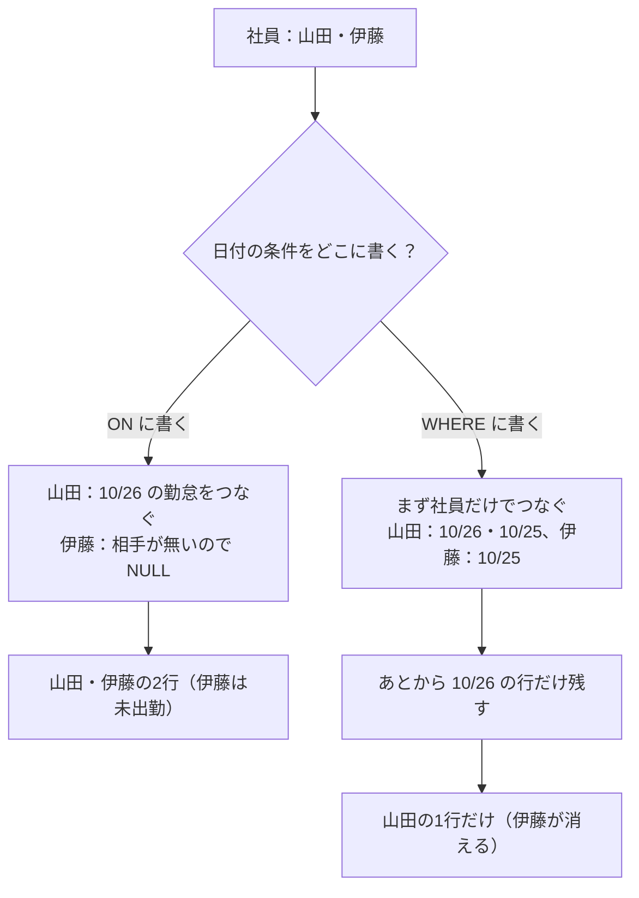
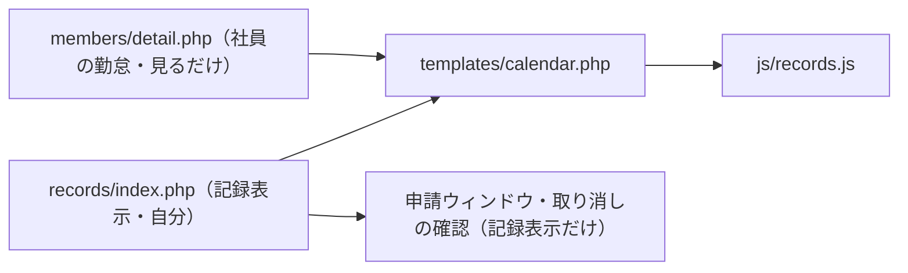

# 13. 社員の勤怠

主なファイル：`members/index.php`・`members/detail.php`、`src/members.php`、`src/queries/employees.php`（`fetchMemberAttendances()`。依頼者が書いた）、`templates/calendar.php`、`src/records.php`（`calendarDays()`）、`js/records.js`

管理者が、**対象社員の今日の勤怠を一覧で見て**、「詳細」から**1人の月の記録を見る**機能（PR 10。D-070）。決定事項の「未決定」にあった「他ユーザの記録確認」のうち、管理者が見る分にあたる（社員どうしで見合う機能は作らない）。

## 13-1. だれが、だれの勤怠を見られるか

- 使えるのは**管理者（`manager`）だけ**。社員とシステム管理者は、一覧も詳細も 403。メニューの「承認」の下に「社員の勤怠」が出るのも管理者だけ。
- 見られる社員は、**承認範囲と同じ**（8-1。D-025）。
  - 承認範囲が「部署」：自分の部署の社員。
  - 承認範囲が「全社」：全社員（ほかの管理者も、社員の一人なので出る）。
- **自分は出さない**（自分の記録は記録表示で見る）。**退職した社員は出さない**（ログイン不可でも、在籍中なら出る）。

テストデータでの例：

| ログインする管理者 | 一覧に出る社員 |
| --- | --- |
| 2025002 佐藤（営業部・承認範囲は部署） | 2025001 山田（営業部） |
| 2025003 鈴木（開発部・承認範囲は全社） | 2025001 山田、2025002 佐藤、2025004 高橋（ログイン不可だが在籍中） |

詳細の画面で「見てよいか」を決めるのは `canViewMember()`（`src/members.php`）。承認の `canReview()`（8-1）とほぼ同じ形で、在籍中かの確認が1つ増えている。

```php
function canViewMember(array $user, array $profile): bool {
    if ($user['role'] !== ROLE_MANAGER || $profile['employee_id'] === $user['employee_id']) {
        return false;
    }
    // 在籍状態を取得していない（列が無い）ときも、見せない
    if (($profile['employment_status'] ?? null) !== 'active') {
        return false;
    }
    return $user['approval_scope'] === 'all' || (int) $profile['department_id'] === $user['department_id'];
}
```

- `'active'` のときだけ通し、列が無い（`null`）ときや知らない値のときは見せない。**分からないときは、見えない側に倒す**。
- 一覧の SQL の条件（13-2）と、この関数の条件は**同じ社員を選ぶ**ようにしてある。DB のテスト（`tests/MembersDbTest.php`）で、テストデータの全員について2つが一致することを確かめている（11章）。

## 13-2. 一覧の取得（`fetchMemberAttendances()`）と、LEFT JOIN の ON

一覧は「社員」の一覧に、その日の勤怠を付けたもの。**依頼者が書いた関数**（Claude が置いた枠の `TODO` コメントに沿って書いた）。SQL は次のとおり（PHP の文字列から取り出したもの）。

```sql
SELECT e.employee_id, e.name, d.name AS department_name,
    a.check_in_at, a.check_out_at, a.break_start_at, a.break_end_at
FROM employees e
JOIN departments d ON d.id = e.department_id
LEFT JOIN attendances a ON a.employee_id = e.employee_id AND a.work_date = :work_date
WHERE e.employment_status = 'active' AND e.employee_id <> :manager_id
```

承認範囲が「部署」のときだけ、部署の条件を足す（`fetchPendingRequests()` と同じ。8-2）。

```php
    if ($departmentId !== null) {
        $sql .= ' AND e.department_id = :department_id';
    }
    $sql .= ' ORDER BY d.id, e.employee_id';
    $stmt = $pdo->prepare($sql);
    $stmt->bindValue(':work_date', $workDate, PDO::PARAM_STR);
    $stmt->bindValue(':manager_id', $managerId, PDO::PARAM_STR);
    if ($departmentId !== null) {
        $stmt->bindValue(':department_id', $departmentId, PDO::PARAM_INT);
    }
```

- 並び順は `ORDER BY d.id, e.employee_id`（部署の作成順 → 社員コードの順）。`ORDER BY` は、条件を全部足したあとに付ける。
- `:department_id` の値は、SQL に足したときだけ渡す（SQL に無いプレースホルダに値を渡すとエラー）。部署 ID は数なので `PDO::PARAM_INT`、日付と社員 ID は `PDO::PARAM_STR`。
- 勤怠は `LEFT JOIN`。今日打刻していない社員は、勤怠の行が無いが、一覧には出したい。相手が無いときは、`a.` の列が `NULL` になる（4-3）。

### なぜ日付の条件を `WHERE` ではなく `ON` に書くのか

例：今日は 10/26。山田さんは今日出勤している。伊藤さんは今日は打刻しておらず、前の日（10/25）の勤怠だけがある。



| 書き方 | 結果 | 一覧 |
| --- | --- | --- |
| `LEFT JOIN … ON … AND a.work_date = :work_date` | 山田（10/26 の時刻）、伊藤（勤怠の列は `NULL`） | 2人とも出る。伊藤さんは「未出勤」 |
| `LEFT JOIN … ON a.employee_id = e.employee_id` ＋ `WHERE a.work_date = :work_date` | 山田（10/26 の時刻）だけ | **伊藤さんが消える** |

- `ON` は「**どの行をつなぐか**」の条件。合う相手がいなくても、左の表（社員）の行は残る。
- `WHERE` は「**つないだあとの行**」から選ぶ条件。相手がいなかった行は `a.work_date` が `NULL` で、`NULL = '2026-10-26'` は「正しい」にならないので、行ごと消える。前の日の勤怠がつながった行も、日付が違うので消える。
- だから、**`LEFT JOIN` の右の表（勤怠）への条件は `ON` に**、左の表（社員）への条件（在籍中・自分以外・部署）は `WHERE` に書く。部署の画面の在籍人数（`fetchDepartments()`。4-3）も、同じ理由で在籍の条件を `ON` に書いている。

## 13-3. 一覧の1行の表示（`memberRowView()`）

- 状態（未出勤・勤務中・休憩中・退勤済み）と時刻の表示は、メイン画面と同じ `attendanceView()` で作る。状態のバッジも、ヘッダーと同じクラス（`status-badge--working` など）なので、色もそろう。
- 労働時間は、記録表示と同じ `dailyWorkMinutes()`（6-3）で計算し、**退勤済みの人だけ**出す（ほかは `--`）。
- 今日の勤怠は、画面を開いた（読み込み直した）時点のもの。自動では更新しない。

| 勤怠 | 状態 | 休憩 | 労働時間 |
| --- | --- | --- | --- |
| 無し | 未出勤 | `--:--` | `--` |
| 出勤 9:01、休憩開始 15:00 | 休憩中 | `15:00–休憩中` | `--` |
| 出勤 9:00、退勤 18:30、休憩 15:00〜15:15 | 退勤済み | `15:00–15:15` | `8時間15分` |

画面の切り替え：PC（幅 768px 以上）は表（1行に1人）、スマホはカード型。承認画面と同じく、同じ HTML を CSS だけで切り替えている（D-052。10章）。

## 13-4. 詳細：記録表示のカレンダーを、見るだけで使い回す

詳細（`members/detail.php?id=2025001&month=2026-09`）は、記録表示と**同じ月カレンダー**を出す。そのために PR 10 で、記録表示のカレンダーの HTML を部品 `templates/calendar.php` に移し、2つの画面から読み込むようにした（記録表示の見た目と動きは変えていない）。



画面ごとの違いは、読み込む前に用意する変数で渡す。

| 変数 | 記録表示 | 社員の勤怠の詳細 |
| --- | --- | --- |
| `$monthQuery`（月のリンクの前半） | `'?'` | `'?id=2025001&'`（見ている社員のまま月が変わる） |
| `$monthHeading`（月の見出し） | `'h1'` | `'h2'`（氏名が `<h1>`） |
| `$readOnly`（見るだけか） | `false` | `true` |

「見るだけ」は、3か所で重ねて守っている。

1. **値**：`calendarDays($calendar, true)`（`src/records.php`）が、申請できるか（`canRequest`）・申請中の案内（`pendingCorrection`）・取り消せるか（`canCancel`）を全部 `false` にする。記録と申請の中身（変わった項目・理由・却下コメント）は、そのまま見せる。
2. **HTML**：部品が、「申請」ボタン・申請の API の URL・CSRF トークンを出さず、`#calendar` に `data-readonly="true"` を付ける。申請ウィンドウと取り消しの確認は、記録表示の `records/index.php` にしか無い。
3. **JavaScript**：`js/records.js` は `data-readonly` を見て、日付を押したときのウィンドウだけを用意し、申請ウィンドウと取り消しの部分に進まない。

```js
    // 見るだけの画面には、申請ウィンドウと取り消しの確認が無い（その日の記録と申請の表示だけ）
    if (readOnly) {
        return;
    }
```

そして最後の守りとして、申請の API（`api/requests.php`）は今までどおり**ログイン中の本人の分しか受け付けない**（7章）。画面をいじって送っても、ほかの社員の申請はできない。

- 月の範囲は、**その社員の**入社した月から今月まで（D-061。6-2）。
- 記録も申請も無い日を押すと、記録表示では申請ウィンドウが開くが、詳細では「記録はありません。」のウィンドウが出る（`canRequest` が `false` のため）。

## 13-5. 見られない社員は 404（理由を区別しない）

| 開いた人・URL | 応答 |
| --- | --- |
| 社員・システム管理者が `members/` か `members/detail.php` を開く | 403「この画面を使う権限がありません。」（`requireRole()`） |
| 管理者が、範囲の外の社員・存在しない社員 ID・自分・退職した社員の詳細を開く | 404「この社員の勤怠は表示できません。」 |
| `?id=` が無い、`?id[]=…`（配列）で送られた | 404（同じ文） |

```php
$memberId = isset($_GET['id']) && is_string($_GET['id']) ? $_GET['id'] : '';
$member = $memberId === '' ? null : fetchEmployeeProfile($pdo, $memberId);
if ($member === null || !canViewMember($currentUser, $member)) {
    abort(404, MEMBER_NOT_VIEWABLE_MESSAGE);
}
```

- 「詳細」のリンクは一覧に出た社員にしか無いが、URL の `id` は書き換えられる。だから**詳細でも、一覧と同じ条件を毎回確かめる**（承認の API が、申請ごとに `canReview()` で確かめ直すのと同じ。8-4）。
- 理由ごとに文や番号を変えると、範囲の外の管理者に「この社員 ID は存在する」「この人は退職した」ことが分かってしまう。だから**全部同じ 404 と同じ文**にしている（ログインの失敗の理由を区別しないのと同じ考え方。3章）。
- 権限そのものが無い（社員・システム管理者）ときは 403、権限はあるが「この社員」は見られないときは 404、と分けている。

## 13-6. 依頼者が書いたもの

| 関数 | 中身 |
| --- | --- |
| `fetchMemberAttendances()`（新規） | 13-2 の SQL。部署の条件を足す、`ORDER BY`、`bindValue`（`:work_date`・`:manager_id` は `PDO::PARAM_STR`、`:department_id` は足したときだけ `PDO::PARAM_INT`） |
| `fetchEmployeeProfile()`（列の追加） | 取得する列に `e.employment_status` を足した（詳細で `canViewMember()` が使う） |

- Claude が置いた枠（`TODO` のコメント）は、書いたあとも残してある。最後の `// throw new RuntimeException(…)` も、コメントにして残すのがこのプロジェクトの書き方（ほかの SQL の関数と同じ）。
- Claude が、書き換えずに DB のテスト（`tests/MembersDbTest.php`）とブラウザの確認（`docs/検証スクリプト/pr10.js`）で確かめた。コードの読み方は [コードを読む/src_queries_employees_login_accounts.md](./コードを読む/src_queries_employees_login_accounts.md) の2章・6章。
- もし `fetchEmployeeProfile()` が在籍状態を返さなかったら、詳細はだれを開いても 404 になる（在籍状態が分からないので、見せない側に倒れる。13-1）。

## 試してみる

テストデータ：2025001（山田・営業部・社員）、2025002（佐藤・営業部・管理者・承認範囲は部署）、2025003（鈴木・開発部・管理者・承認範囲は全社）、2025004（高橋・開発部・社員・ログイン不可）。パスワードは `Test1234`。

1. 2025001 でログインして出勤を押す（ログアウトする）。
2. 2025002 でログイン →「≡」→「社員の勤怠」→ 山田さんだけが出て、状態が「勤務中」、出勤の時刻が出る（自分（佐藤）と開発部の人は出ない）。
3. 山田さんの「詳細」→ 記録表示と同じカレンダーで、山田さんの記録が出る。前の月にも移れる（URL が `?id=2025001&month=…` になる）。日付を押すと、その日の記録と申請が出て、「修正」「申請する」「取り消す」のボタンは出ない。
4. 2025003（全社）でログイン →「社員の勤怠」→ 山田・佐藤・高橋さんが出る（自分は出ない。高橋さんはログイン不可だが在籍中なので出る）。打刻していない人は「未出勤」。
5. 2025002 で、URL を `members/detail.php?id=2025003` に書き換えて開く →「この社員の勤怠は表示できません。」。`id=9999999`（存在しない社員）でも、同じ文になる。
6. 2025001（社員）で `members/` を開くと、使えない（403）。メニューにも「社員の勤怠」が出ない。
7. 開発者ツールの「スマホの形」で幅を 390px にして、一覧がカード型になることを見る。詳細のページのソースに `data-readonly="true"` があり、`data-csrf-token` が無いことも確かめる。
