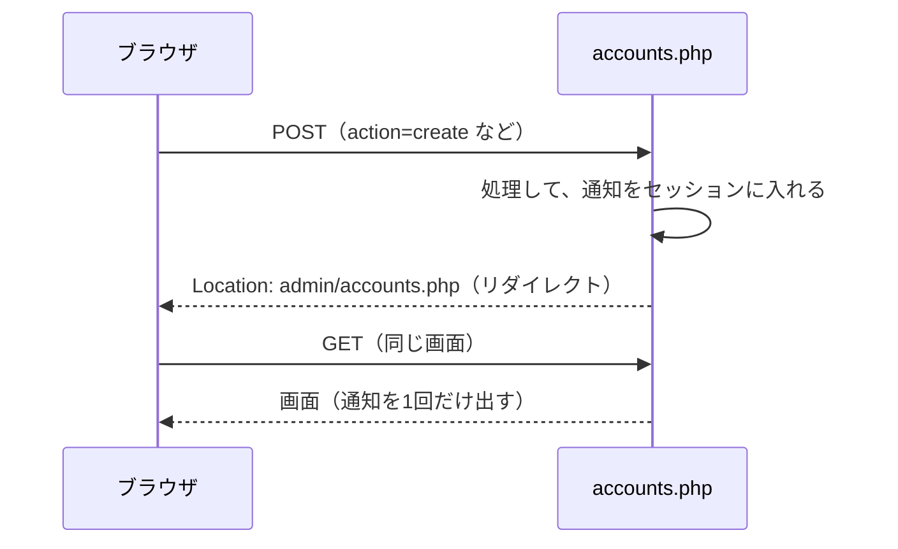

# `admin/accounts.php` を読む（アカウント管理の画面）

## このファイルの役割

システム管理者が、**社員・管理者のアカウントを作り、一覧から無効化・有効に戻す・パスワード再設定をする**画面。1つの PHP ファイルが、表示（GET）と更新（POST）の両方を受け持つ。

- 入力の確認や DB への書き込みは、このファイルでは行わない。`src/admin.php` の関数（`createAccount()`・`deactivateAccount()` など）を呼んで、結果（`['ok' => …]` の配列）を受け取るだけ。
- 送信は、画面を切り替える普通のフォーム（POST）。成功したら同じ画面にリダイレクトして、通知を出す（PRG パターン）。
- ウィンドウ（`<dialog>`）を開く・閉じるのは `js/admin.js` が受け持つ。PHP は、そのための値を `data-*` 属性に書いておく。

## 全体の構成

| 行のあたり | 中身 |
| --- | --- |
| 先頭 | 読み込みと、ログイン・権限の確認 |
| 変数の準備 | `$form`（入力欄の初期値）・`$errors`・`$reopen` |
| POST の処理 | `match` で4つの操作に振り分け、成功ならリダイレクト、失敗なら誤りを残す |
| 表示の準備 | 部署の一覧・アカウントの一覧・通知・最初の誤り |
| HTML（上） | 通知、作成のフォーム（カード） |
| HTML（中） | 登録済みアカウントの表と、操作のボタン |
| HTML（下） | 3つのウィンドウ（無効化・有効に戻す・パスワード再設定）と、`js/admin.js` の読み込み |

PHP の部分は「受け付けて、結果を見て、表示の材料をそろえる」だけ。**中身の判断はすべて `src/admin.php` にある**ので、まずこのファイルで流れをつかみ、細かいルールは [src_admin.md](./src_admin.md) で読むとよい。

---

## 1. 読み込みと、権限の確認

```php
include_once(__DIR__ . '/../src/functions.php');
include_once(__DIR__ . '/../src/dbconnect.php');
include_once(__DIR__ . '/../src/auth.php');
include_once(__DIR__ . '/../src/admin.php');

$currentUser = requireLogin($pdo);
requireRole($currentUser, [ROLE_SYSTEM_ADMIN]);
```

- `__DIR__` は「このファイルがあるフォルダ」（`admin/`）。`/../src/…` で1つ上の `src/` を指す。どこから呼ばれても同じファイルを読める。
- `include_once` は、同じファイルを2回読まない。`src/admin.php` の中でも `auth.php` などを読むが、重ねて読んでも関数の二重定義にならない。
- `requireLogin()` は、ログインしていなければログイン画面へ移し、ログイン中なら利用者の情報を返す（[src_auth.md](./src_auth.md)）。
- `requireRole()` は、権限が一覧に無ければ 403 で止める。**システム管理者以外は、この画面を一切使えない**。URL を直接打っても、POST を手で送っても、ここで止まる。

## 2. 変数の準備

```php
$now = time();
$today = date('Y-m-d', $now);
// 入力欄の値（初期値。入社日は今日）
$form = ['name' => '', 'email' => '', 'department_id' => '', 'joined_on' => $today, 'role' => ROLE_EMPLOYEE, 'approval_scope' => 'department'];
$errors = [];
// ウィンドウからの送信で誤りがあったときに、開き直すウィンドウ（['id' => …, 'employeeId' => …, 'error' => …]）
$reopen = null;
```

- `$now` を最初に1回だけ取り、あとはこれを使い回す。処理の途中で日付が変わっても、「今日」が食い違わない。
- `$form` は作成フォームに出す値。最初は空（入社日だけ今日、権限は社員）。入力に誤りがあったときは、送られた値で上書きして、もう一度表示する。
- `$reopen` は、**一覧のウィンドウから送って誤りがあったとき**に、そのウィンドウを開き直すための情報。誤りが無ければ `null` のまま。

## 3. POST の受付：`match` で操作を振り分ける

```php
if ($_SERVER['REQUEST_METHOD'] === 'POST') {
    requireValidCsrfToken();
    $action = inputString($_POST, 'action');
    $employeeId = inputString($_POST, 'employee_id');
    $result = match ($action) {
        'create' => createAccount($pdo, $_POST, $now),
        'deactivate' => deactivateAccount($pdo, $employeeId, inputString($_POST, 'left_on'), $today),
        'reactivate' => reactivateAccount($pdo, $employeeId),
        'reset_password' => resetPassword($pdo, $employeeId, inputRaw($_POST, 'password'), inputRaw($_POST, 'password_confirm')),
        default => abort(400, '不正なリクエストです。画面を開き直して、もう一度お試しください。'),
    };
```

- `requireValidCsrfToken()`：フォームに埋め込んだ CSRF トークンと、セッションのトークンが一致しなければ 400 で止める（[src_session.md](./src_session.md)）。**更新の処理より前に**確かめる。
- 4つのフォームはすべて同じ URL に送り、隠し項目 `action` の値（`create`・`deactivate` など）で、どの操作かを見分ける。
- `match` 式（PHP 8.0 以降）は、`switch` に似ているが、次の点が違う。
  - **値を返す式**なので、`$result = match (…) { … };` と、結果をそのまま変数に入れられる。
  - 比べ方は `===`（型も比べる）。`switch` の `==` のような思わぬ一致が起きない。
  - どれにも当てはまらず `default` も無いと、例外（`UnhandledMatchError`）になる。ここでは `default` で 400 を返す。
- `abort()` は戻り値の型が `never`（必ず `exit` して、戻ってこない）。だから `match` の腕に書いても、`$result` に変な値が入ることはない。
- パスワードだけは `inputString()`（前後の空白を取る）ではなく `inputRaw()`（そのまま）で取り出す。理由は [src_admin.md](./src_admin.md) の 2章。

> **ここが重要**：`action` は画面の隠し項目なので、利用者がブラウザの開発ツールで書き換えられる。**知らない値は `default` で必ず止める**。「来るはずの値しか来ない」と考えて書くと、想定外の値で思わぬ処理が動く。

## 4. 結果の扱い：成功はリダイレクト、失敗は2通り

```php
    if ($result['ok']) {
        setFlash($result['message']);
        redirect('admin/accounts.php');
    }
    if ($action === 'create') {
        $errors = $result['errors'];
        $form = $result['values'];
    } else {
        $dialogIds = ['deactivate' => 'deactivate-dialog', 'reactivate' => 'reactivate-dialog', 'reset_password' => 'password-dialog'];
        $reopen = ['id' => $dialogIds[$action], 'employeeId' => $employeeId, 'error' => $result['error']];
    }
}
```

### 成功したとき（PRG パターン）



- `setFlash()` で、通知の文をセッションに入れる。`redirect()` は `Location` ヘッダーを送って `exit` する。
- ブラウザは自動で同じ画面を GET し直す。その表示で `takeFlash()` が通知を取り出して消すので、通知は**1回だけ**出る。
- これを **PRG（Post → Redirect → Get）パターン**と呼ぶ。最後の画面は GET で表示したものなので、利用者が画面を読み込み直しても、POST が送り直されない（同じアカウントを2回作ってしまうことがない）。

### 失敗したとき

失敗の返し方は、操作によって2通りある。

| 操作 | 結果の形 | 画面での出し方 |
| --- | --- | --- |
| 作成（`create`） | `'errors' => [項目 => 文]`、`'values' => 確認した値` | カードの上に最初の誤りを出し、入力した値を残す。誤りの欄に `aria-invalid` を付ける |
| 一覧の操作（ほかの3つ） | `'error' => 文` | ページの上に誤りを出し、`js/admin.js` が同じウィンドウを開き直して、中にも誤りを出す |

- 作成フォームは項目が多いので、項目ごとの誤りが要る。一覧の操作は対象が1人で、誤りは1つで足りる。
- `$dialogIds[$action]` は、操作の名前からウィンドウの `id` を引く表。ここまで来るのは、`match` を通った（知っている）操作だけなので、表に無い値で読みに行くことはない。

> **ここが重要**：失敗したときは**リダイレクトしない**。リダイレクトすると、入力した値や誤りを次の画面に渡すために、セッションに入れる手間が増える。失敗のときは、そのまま同じリクエストの中で画面を作り直せば、`$form` や `$errors` をそのまま使える。

## 5. 表示の準備

```php
$departments = activeDepartments(fetchDepartments($pdo));
$accounts = array_map('accountView', fetchAccounts($pdo));
$flash = takeFlash();
$firstError = $errors === [] ? null : reset($errors);
$invalid = fn (string $field) => isset($errors[$field]) ? ' aria-invalid="true"' : '';
```

- `activeDepartments()`：部署の一覧から、有効な部署だけを選ぶ。無効にした部署は、作成フォームの選択欄に出さない。
- `array_map('accountView', …)`：DB の行を1行ずつ `accountView()` に通して、表示用の形（`'employeeId'`・`'status'` など）に変える。関数の名前を文字列で渡すと、その関数が呼ばれる（callable）。
- `reset($errors)`：配列の**最初の要素の値**を返す。PHP の配列は入れた順を覚えているので、確認した順（氏名 → メールアドレス → 部署 → …）の最初の1つになる。画面には、誤りを1つだけ出す。
- `$invalid` は**アロー関数**（`fn (…) => 式`、PHP 7.4 以降）。外の変数 `$errors` を、`use` を書かなくても自動で使える。HTML の中で `<?= $invalid('name') ?>` と書くと、その欄に誤りがあるときだけ ` aria-invalid="true"` が出る。同じ三項演算子を7回書かずに済む。

> **ここが重要**：一覧は、**POST の処理のあとで**読む。無効化などに失敗して同じ画面を出すときも、その時点の DB の状態が表に出る。

## 6. `<main>` と、開き直すウィンドウの情報

```php
<main class="admin" id="admin"<?php if ($reopen !== null): ?> data-reopen="<?= h($reopen['id']) ?>" data-reopen-employee="<?= h($reopen['employeeId']) ?>" data-reopen-error="<?= h($reopen['error']) ?>"<?php endif; ?>>
    <?php if ($flash !== null): ?>
        <div class="toast" id="toast" role="status" aria-live="polite"><?= h($flash) ?></div>
    <?php endif; ?>
    <?php if ($reopen !== null): ?>
        <p class="alert alert--error" role="alert"><?= h($reopen['error']) ?></p>
    <?php endif; ?>
```

- 一覧の操作に失敗したときだけ、`<main>` に `data-reopen`（どのウィンドウか）・`data-reopen-employee`（どの社員か）・`data-reopen-error`（誤りの文）を付ける。`js/admin.js` はこれを読んで、ウィンドウを開き直す（[js_admin.md](./js_admin.md) の 6章）。
- **PHP から JavaScript に値を渡すのに、`data-*` 属性を使っている**。`<script>` の中に PHP で値を書き込むより安全で、`h()` でエスケープするだけでよい。
- 誤りの文は、ウィンドウの中だけでなく、ページの上（`role="alert"`）にも出す。JavaScript が動かなくても、誤りは利用者に見える。
- 通知（`toast`）の `role="status"`・`aria-live="polite"` は、画面読み上げソフトに「この文が出た」と伝えるための属性。

## 7. 作成のフォーム

```php
            <?php if ($departments === []): ?>
                <p class="alert alert--info" role="status">先に部署を登録してください。<a href="<?= h(appUrl('admin/departments.php')) ?>">部署へ</a></p>
            <?php endif; ?>
            <form class="admin__fields" method="post" action="<?= h(appUrl('admin/accounts.php')) ?>" novalidate>
                <input type="hidden" name="csrf_token" value="<?= h(csrfToken()) ?>">
                <input type="hidden" name="action" value="create">
```

- 有効な部署が1つも無いときは、部署の画面への案内を出し、作成ボタンも `disabled` にする（下の `<button>`）。部署が無いと、社員を作れないため。
- `novalidate`：ブラウザの入力チェック（`required` や `type="email"` の吹き出し）を止める。**作成フォームの確認は、すべてサーバーで行い、誤りの出し方をそろえる**ため。`required` は付けたままなので、画面読み上げソフトには「必須」と伝わる。
- `csrf_token` と `action` は隠し項目（`type="hidden"`）。すべてのフォームに必ず入れる。

```php
                        <input class="form-field__input" type="text" id="name" name="name" value="<?= h($form['name']) ?>" maxlength="<?= h(ADMIN_NAME_MAX_LENGTH) ?>" autocomplete="off" required<?= $invalid('name') ?>>
```

- `value="<?= h($form['name']) ?>"`：誤りで画面を作り直したとき、入力した値を残す。**利用者が入力した値なので、必ず `h()` でエスケープする**（`"` や `<` が入っていても、HTML が壊れない）。
- `maxlength` の数字は、`src/admin.php` の定数 `ADMIN_NAME_MAX_LENGTH`（100）から出す。サーバーの確認と画面の上限が、同じ定数でそろう。

```php
                            <?php foreach ($departments as $department): ?>
                                <option value="<?= h($department['id']) ?>"<?= (string) $department['id'] === $form['department_id'] ? ' selected' : '' ?>><?= h($department['name']) ?></option>
                            <?php endforeach; ?>
```

- 部署の `id` は DB から来る値で、`$form['department_id']` は画面から来た文字列。`(string)` で文字列にそろえてから `===` で比べる（型の違いで一致しない、ということを防ぐ）。
- 選択欄の値は `id`、見えるのは部署名。送られてくるのは `id` だけなので、サーバーでは「その `id` の部署が本当にあって、有効か」を確かめる（[src_admin.md](./src_admin.md) の 5章）。

```php
                        <input class="form-field__input" type="date" id="joined_on" name="joined_on" value="<?= h($form['joined_on']) ?>" min="<?= h(ADMIN_JOINED_ON_MIN) ?>" max="<?= h(date('Y-m-d', strtotime($today . ' +1 year'))) ?>" required<?= $invalid('joined_on') ?>>
```

- `type="date"` の `min`・`max` で、カレンダーで選べる範囲を 2000-01-01 〜 今日の1年後にする（D-067）。`strtotime('2026-10-22 +1 year')` のように、日付の文字に「+1 year」を付けると、1年後の時刻が得られる。
- 画面の範囲は使いやすさのためだけ。サーバーでも同じ範囲を確かめる。

```php
                            <?php foreach (ACCOUNT_ROLE_LABELS as $role => $label): ?>
                                <option value="<?= h($role) ?>"<?= $role === $form['role'] ? ' selected' : '' ?>><?= h($label) ?></option>
                            <?php endforeach; ?>
                        </select>
                    </div>
                    <fieldset class="form-field form-grid__wide admin__scope" id="scope-field"<?= $form['role'] === ROLE_MANAGER ? '' : ' hidden' ?>>
                        <legend class="form-field__label">承認範囲</legend>
```

- 権限の選択肢は、定数 `ACCOUNT_ROLE_LABELS`（社員・管理者の2つ）から作る。**システム管理者は選択肢に無い**（システム管理者は画面では作らない。D-066）。サーバーも同じ定数で確かめるので、手で `role=system_admin` を送っても通らない。
- 承認範囲（`<fieldset>`）は、権限が管理者のときだけ見せる。最初の表示は PHP が `hidden` を付けるかどうかで決め、選び直したときは `js/admin.js` が切り替える。誤りで作り直したときも、選んでいた権限に合った表示になる。
- `<fieldset>` と `<legend>` は、ラジオボタンのまとまりと、その見出しを表す。

```php
                        <input class="form-field__input" type="password" id="password" name="password" maxlength="64" autocomplete="new-password" required<?= $invalid('password') ?>>
```

- パスワードの欄には `value` を書かない。**誤りで作り直したとき、パスワードは入力し直してもらう**（パスワードを HTML に書き戻さない）。
- `autocomplete="new-password"`：ブラウザに「新しいパスワードの欄」だと伝える。管理者自身の保存済みパスワードが、勝手に入らないようにするため。

## 8. 登録済みアカウントの表

```php
                            <?php foreach ($accounts as $account): ?>
                                <tr class="<?= $account['active'] ? '' : 'admin-table__inactive' ?>" data-employee="<?= h($account['employeeId']) ?>">
```

- `$account` は `accountView()` が作った表示用の配列。HTML の中では、DB の列名ではなく、表示用の名前（`'employeeId'`・`'status'` など）だけを使う。
- 無効のアカウントの行には、`admin-table__inactive`（薄く表示する CSS のクラス）を付ける。

```php
                                            <button class="button button--outline button--small" type="button" data-open="password-dialog" data-employee-id="<?= h($account['employeeId']) ?>" data-target="<?= h($account['employeeId'] . '　' . $account['name']) ?>">パスワード再設定</button>
                                            <?php if ($account['active']): ?>
                                                <?php $range = leftOnRange($account['joinedOn'], $today); ?>
                                                <button class="button button--reject button--small" type="button" data-open="deactivate-dialog" data-employee-id="<?= h($account['employeeId']) ?>" data-target="<?= h($account['employeeId'] . '　' . $account['name']) ?>" data-left-on="<?= h($range['max']) ?>" data-min="<?= h($range['min']) ?>" data-max="<?= h($range['max']) ?>">無効化</button>
                                            <?php else: ?>
                                                <button class="button button--outline button--small" type="button" data-open="reactivate-dialog" …>有効に戻す</button>
                                            <?php endif; ?>
```

- 操作のボタンは `type="button"`（押してもフォームを送らない）。押すと `js/admin.js` が、`data-open` に書いた `id` のウィンドウを開く。
- ボタンに、**ウィンドウに入れる値を `data-*` で持たせている**。
  - `data-employee-id`：対象の社員コード（ウィンドウの隠し項目 `employee_id` に入る）
  - `data-target`：ウィンドウの見出しの下に出す「社員コード　氏名」
  - `data-left-on`・`data-min`・`data-max`：退社日の初期値と、選べる範囲
- パスワード再設定は、在籍・退職に関係なく、すべての行に出る。無効化と有効に戻すは、状態によってどちらか一方だけを出す。
- 退社日の範囲は `leftOnRange()`（入社日 〜 今日。入社日が先の日付なら入社日まで）で、行ごとに計算する。初期値は範囲の最後（ふつうは今日）。

> **ここが重要**：ウィンドウを1人ずつ作らず、**ウィンドウは3つだけ置いて、開くときに対象の値を入れ替える**。社員が100人いても HTML は増えない。値の入れ替えは `js/admin.js` の `openDialog()` が行う。

## 9. 3つのウィンドウ（`<dialog>`）

無効化のウィンドウを例に読む（ほかの2つも同じ形）。

```php
    <dialog class="dialog" id="deactivate-dialog" aria-labelledby="deactivate-title">
        <form class="dialog__body" method="post" action="<?= h(appUrl('admin/accounts.php')) ?>">
            <input type="hidden" name="csrf_token" value="<?= h(csrfToken()) ?>">
            <input type="hidden" name="action" value="deactivate">
            <input type="hidden" name="employee_id" data-value="employeeId">
            <h2 class="dialog__title" id="deactivate-title">アカウントを無効にします</h2>
            <p class="dialog__subtitle" data-text="target"></p>
            <p class="alert alert--error" data-dialog-error role="alert" hidden></p>
            <div class="form-field">
                <label class="form-field__label" for="left_on">退社日</label>
                <input class="form-field__input" type="date" id="left_on" name="left_on" data-value="leftOn" data-min-from="min" data-max-from="max" required>
            </div>
```

- `<dialog>` は、HTML の標準のウィンドウ。JavaScript で `showModal()` を呼ぶと、画面の真ん中に開き、後ろの画面を操作できなくなる。Esc キーで閉じる。
- ウィンドウの中は、普通の `<form method="post">`。送信すると、画面全体が切り替わる（3章の POST の処理に入る）。
- 空の欄に付けた印が、`js/admin.js` への指示になっている。
  - `data-value="employeeId"`：押したボタンの `data-employee-id` の値を、この欄の値にする
  - `data-text="target"`：ボタンの `data-target` の値を、文字として入れる
  - `data-min-from="min"`・`data-max-from="max"`：ボタンの `data-min`・`data-max` を、日付の範囲にする
  - `data-dialog-error`：誤りの文を入れる場所（ふだんは `hidden`）
- このフォームには `novalidate` が無い。退社日やパスワードが空のときは、ブラウザが送信を止めて知らせる（作成フォームと違い、欄が少ないので、ブラウザの確認で足りる）。もちろん、サーバーでも確かめる。

パスワード再設定のウィンドウの欄は、`id` が `new_password` で、`name` が `password` になっている。

```php
                <input class="form-field__input" type="password" id="new_password" name="password" maxlength="64" autocomplete="new-password" required>
```

- `id` は1つのページの中で重ならないようにする決まりがあるので、作成フォームの `password` と分けている。送る名前（`name`）は同じ `password` なので、サーバーは作成と同じ名前で受け取れる。

## 10. JavaScript の読み込み

```php
<script src="<?= h(assetUrl('js/admin.js')) ?>" defer></script>
```

- `defer`：HTML を最後まで読んでから、スクリプトを動かす。`js/admin.js` が `document.getElementById('admin')` を探すとき、要素がもうある。
- `assetUrl()` は、URL の後ろにファイルを変えた日時（`?v=…`）を付ける。ファイルを変えると URL が変わるので、ブラウザが古いファイルを使い続けない（D-068）。

---

## まとめ：このファイルから学べること

| 書き方 | このファイルでの例 |
| --- | --- |
| 1つのファイルで GET と POST を受け持つ | `$_SERVER['REQUEST_METHOD'] === 'POST'` のときだけ更新する |
| 操作の振り分けは `match` | 知らない `action` は `default` で 400 |
| 成功したら PRG | `setFlash()` → `redirect()` → `takeFlash()` で1回だけ通知 |
| 失敗したらリダイレクトしない | `$form`・`$errors`・`$reopen` を使って、同じリクエストで作り直す |
| 権限と CSRF は最初に確かめる | `requireRole()`・`requireValidCsrfToken()` |
| 出力は必ずエスケープ | `<?= h(…) ?>`。入力した値を書き戻すときも |
| PHP から JS へは `data-*` で渡す | `data-open`・`data-employee-id`・`data-reopen` |
| ウィンドウは使い回す | 3つの `<dialog>` に、開くたびに対象の値を入れる |
| 画面の制限とサーバーの確認を同じ定数で | `maxlength`・`min`・選択肢と、`src/admin.php` の確認 |

## 関連するファイル

- 処理と確認：`src/admin.php`（[src_admin.md](./src_admin.md)）
- ウィンドウの開閉・承認範囲の出し分け：`js/admin.js`（[js_admin.md](./js_admin.md)）
- 同じ形の画面：`admin/departments.php`・`admin/settings.php`（[admin_departments_settings.md](./admin_departments_settings.md)）
- ログイン・権限：`src/auth.php`（[src_auth.md](./src_auth.md)）、CSRF・通知：`src/session.php`（[src_session.md](./src_session.md)）
- `h()`・`appUrl()`・`redirect()`・`abort()`：`src/functions.php`（[src_functions.md](./src_functions.md)）
- ヘッダー・フッター：`templates/header.php`・`templates/footer.php`（[templates.md](./templates.md)）
- SQL：`src/queries/employees.php`・`src/queries/login_accounts.php`（[src_queries_employees_login_accounts.md](./src_queries_employees_login_accounts.md)）
- 画面の動きの確認：`docs/検証スクリプト/pr7.js`
