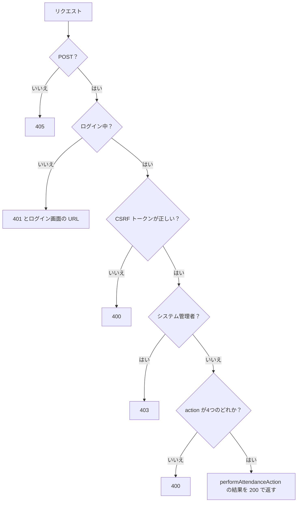

# `api/attendance.php` を読む（出退勤ボタンの受け口）

## このファイルの役割

メイン画面の出勤・退勤・休憩開始・休憩終了のボタンを押したときに、**JavaScript（`js/main.js`）から呼ばれる API**。画面（HTML）は出さず、結果を **JSON** で返す。

- このファイルがするのは「受け付けてよいリクエストかを確かめる」ことだけ。押せるかの判断と記録は、`src/attendance.php` の `performAttendanceAction()` に任せる（[src_attendance.md](./src_attendance.md)）。
- 全部で40行ほどの短いファイル。**上から順に「門番」が並び、全部を通ったリクエストだけが最後の1行にたどり着く**形になっている。

## 全体の構成

| 行のあたり | 中身 |
| --- | --- |
| 先頭 | 使うファイルの読み込み |
| 門番 1 | POST 以外は 405 |
| 門番 2 | ログインしていなければ 401 |
| 門番 3 | CSRF トークンが正しくなければ 400 |
| 門番 4 | システム管理者は 403 |
| 門番 5 | `action` が4つの操作のどれでもなければ 400 |
| 最後 | 申請中かを調べて、`performAttendanceAction()` の結果を JSON で返す |

流れを図にすると、次のとおり。



---

## 1. 使うファイルの読み込み

```php
include_once(__DIR__ . '/../src/functions.php');
include_once(__DIR__ . '/../src/dbconnect.php');
include_once(__DIR__ . '/../src/auth.php');
include_once(__DIR__ . '/../src/queries/work_settings.php');
include_once(__DIR__ . '/../src/requests.php');
```

- `__DIR__` は「このファイルがあるフォルダ」（`…/attendance/api`）。`/../src/…` で1つ上の `src` を指す。`__DIR__` を付けておくと、どこから呼ばれても同じファイルを読める。
- `src/attendance.php` は直接読んでいない。`src/requests.php` の中で `include_once(__DIR__ . '/attendance.php');` しているので、それで読み込まれる。`include_once` は「すでに読んだファイルは、もう読まない」ので、同じファイルを何か所から読んでも、関数の二重定義にならない。
- `src/requests.php` を読むのは、最後に使う `pendingStatesOf()`（今日の修正・残業申請が申請中か）がそこにあるため（[src_requests.md](./src_requests.md)）。
- `dbconnect.php` を読んだ時点で DB に接続し、`$pdo` ができる。接続できなければ、そこで「データベースに接続できません。」を出して終わる。

## 2. 門番 1：POST だけを受け付ける

```php
if ($_SERVER['REQUEST_METHOD'] !== 'POST') {
    header('Allow: POST');
    jsonResponse(405, ['message' => 'この操作は、メイン画面のボタンから行ってください。']);
}
```

- アドレス欄に URL を入れて開く（GET）と、ここで止まる。記録を変える操作は POST だけにする、という Web の決まりごとに従っている。
- `405 Method Not Allowed` のときは、`Allow` ヘッダーで「使える方法」を知らせるのが HTTP の決まり。
- `jsonResponse()` は `src/functions.php` の関数で、状態コードを付けて JSON を出し、**`exit` で処理を終える**。

```php
function jsonResponse(int $status, array $data): never {
    http_response_code($status);
    header('Content-Type: application/json; charset=UTF-8');
    header('Cache-Control: no-store');
    exit(json_encode($data, JSON_UNESCAPED_UNICODE | JSON_THROW_ON_ERROR));
}
```

- 戻り値の型 `never`（PHP 8.1 以降）は「この関数は戻ってこない（必ず終わる）」という意味。だから呼ぶ側に `else` や `return` を書かなくても、`if` の後ろには進まない。
- `JSON_UNESCAPED_UNICODE` は、日本語を `\u3053…` のような記号の形（エスケープ）にせず、そのまま出す指定。`Cache-Control: no-store` は、結果をブラウザに保存させない指定。

## 3. 門番 2：ログインしているか

```php
// ログインしていない（自動ログアウトを含む）場合は、画面側でログイン画面へ移す
$currentUser = currentUser($pdo);
if ($currentUser === null) {
    jsonResponse(401, ['message' => 'ログインしてください。', 'redirect' => appUrl('login.php')]);
}
```

- 画面のファイル（`index.php` など）は `requireLogin()` を使い、ログインしていなければログイン画面へ**移す**（リダイレクト）。API は `currentUser()` を使い、ログインしていなければ `null` を受け取って、**401 を返すだけ**にする（[src_auth.md](./src_auth.md)）。
- API でリダイレクトすると、`fetch()` がログイン画面の HTML を受け取ってしまい、JavaScript は JSON として読めない。だから API は「401」という分かりやすい答えを返し、移るかどうかは画面側（`js/main.js`）が決める。`js/main.js` は 401 を受け取ると、`data-login-url` の URL へ移る。

> **ここが重要**：**ログインの確認を、CSRF の確認より先にしている**。CSRF トークンはセッションの中にあるので、自動ログアウトでセッションが消えると、トークンの確認は必ず失敗する。順番が逆だと、ログインが切れただけの人に「不正なリクエストです」（400）を返してしまい、ログイン画面へ案内できない。先に 401 を返せば、画面がログイン画面へ移してくれる。

## 4. 門番 3：CSRF トークンを確かめる

```php
requireValidCsrfToken();
```

- `src/session.php` の関数。POST で送られた `csrf_token` が、セッションに入っているトークンと同じかを `hash_equals()` で比べ、違えば `abort(400, …)` で止める（[src_session.md](./src_session.md)）。
- トークンは、メイン画面を開いたときに `index.php` が `data-csrf-token` に埋め込み、`js/main.js` が `FormData` に入れて送ってくる。ほかのサイトに仕込まれたフォームからは、このトークンが分からないので、勝手に打刻させられない（CSRF 対策）。
- なお `abort()` は JSON ではなく、ふつうの文字（`text/plain`）を返す。`js/main.js` は JSON として読めなかったとき「エラーが発生しました。画面を読み込み直して…」を出すので、利用者には読み込み直しが案内される。

## 5. 門番 4：システム管理者は打刻できない

```php
// システム管理者は社員ではないため、出退勤の記録はない
if ($currentUser['role'] === ROLE_SYSTEM_ADMIN) {
    jsonResponse(403, ['message' => 'システム管理者には、出退勤の記録はありません。']);
}
```

- システム管理者は社員ではなく、社員コード（`employee_id`）が `null`。メイン画面にもボタンは出ない（`index.php` はボタンの代わりに管理画面へのリンクを出す）。
- それでも API に直接 POST されることはあり得るので、ここでも断る。**画面に出さないことと、API で断ることは別**で、両方必要。

## 6. 門番 5：`action` を確かめる

```php
$action = $_POST['action'] ?? '';
if (!is_string($action) || !isset(ATTENDANCE_ACTION_LABELS[$action])) {
    jsonResponse(400, ['message' => '不正なリクエストです。画面を開き直して、もう一度お試しください。']);
}
$overwrite = ($_POST['overwrite'] ?? '') === '1';
```

- `ATTENDANCE_ACTION_LABELS` は `src/attendance.php` の定数で、`check_in`・`check_out`・`break_start`・`break_end` の4つ。`isset(配列[$action])` で、この4つのどれかを確かめる（受け付けてよい操作の一覧を兼ねている。[src_attendance.md](./src_attendance.md) 1章）。
- **`is_string($action)` を先に調べている**のがポイント。`action[]=x` のように送ると、`$_POST['action']` は文字列ではなく**配列**になる。配列を配列のキーに使うと PHP がエラー（500）になるので、先に「文字列か」を確かめて、400 で断る。`||` は左が `true` なら右を調べない（短絡評価）ので、配列のときに `isset(…[$action])` まで進まない。
- `$overwrite` は、上書きの確認で「上書きする」を押したあとの2回目の POST にだけ付く `overwrite=1` を見る。`=== '1'` と厳密に比べるので、`'1'` 以外（無い・`'yes'`・配列など）はすべて `false` になる。

> **ここが重要**：`$_POST` の値は、**画面が送るはずの形で来るとは限らない**。ブラウザの開発者ツールや、ほかのプログラムからは、どんな形でも送れる。「無い」「文字列でない」「知らない値」の3つを考えて、受け取ってすぐに確かめる。

## 7. 申請中かを調べて、処理を任せる

```php
$now = time();
// 今日の修正・新規登録が申請中なら打刻しない（D-063）。残業申請が申請中なら、簡単残業申請のボタンを押せなくして返す（D-069）
$pending = pendingStatesOf($pdo, $currentUser['employee_id'], workDateOf($now));
jsonResponse(200, performAttendanceAction($pdo, $currentUser['employee_id'], $action, $overwrite, $now, fetchWorkSettings($pdo)['standard_end'], $pending['correction'], $pending['overtime']));
```

- `pendingStatesOf()`：今日の申請を DB から1回だけ読み、`['correction' => …, 'overtime' => …]` を返す（[src_requests.md](./src_requests.md)）。
- `$pending['correction']`：今日の分の修正・新規登録が申請中なら `true`。申請中に打刻すると、承認されたときに申請の値で上書きされ、押した打刻が消えてしまうので、打刻を止める（D-063）。
- `$pending['overtime']`：今日の残業申請が申請中なら `true`。打刻には関係しないが、返す表示（`view`）で簡単残業申請のボタンを押せないままにするために渡す（D-069）。渡さないと、打刻のあとに返る表示でボタンが押せる状態に戻ってしまう。
- `fetchWorkSettings($pdo)['standard_end']`：勤務設定の標準終了時刻（`'18:00:00'` など）。打刻のあとに返す表示で、簡単残業申請のボタンを押せるか（`buttons.overtime`）を決めるのに使う。
- `performAttendanceAction()` が返す配列（`result`・`message`・`view` など）を、そのまま JSON にして 200 で返す。上書きの確認（`confirm`）や、押せない（`unavailable`）のときも 200 で返し、どうなったかは `result` で伝える。中身は [src_attendance.md](./src_attendance.md) 7章。

> **ここが重要**：**`time()` を1回だけ呼び、同じ `$now` を両方に渡している**。申請中かを調べるときと、記録するときに別々に `time()` を呼ぶと、23:59:59 と 0:00:00 のように、日付をまたいでずれることがある（申請中かは前の日、記録は次の日を見てしまう）。「今」を1回だけ決めて使い回すと、このずれが起きない。`performAttendanceAction()` が `$now` を引数で受け取るのは、テストで好きな日時を渡せるようにするためでもある。

---

## まとめ：このファイルから学べること

| 書き方 | このファイルでの例 |
| --- | --- |
| 門番を上から並べる | 405 → 401 → 400 → 403 → 400 の順に確かめ、通ったものだけ処理する |
| 戻らない関数で止める | `jsonResponse()` の戻り値の型 `never` |
| API はリダイレクトしない | ログイン切れは 401 を返し、移るのは画面側 |
| 確認の順番に意味がある | ログインの確認を CSRF の確認より先にする |
| 画面で隠しても API で断る | システム管理者のボタンは出さないが、API でも 403 |
| 受け取った値を疑う | `is_string()`・`isset(一覧[…])`・`=== '1'` |
| 「今」は1回だけ決める | `$now = time();` を使い回す |
| ルールは別のファイルに任せる | 判断と記録は `performAttendanceAction()` |

## 関連するファイル

- 呼ぶ側：`js/main.js` の `send()`（[js_main.md](./js_main.md)）
- 処理を任せる先：`src/attendance.php` の `performAttendanceAction()`（[src_attendance.md](./src_attendance.md)）
- 申請中かの判断：`src/requests.php` の `pendingStatesOf()`（[src_requests.md](./src_requests.md)）
- ログイン・CSRF：`src/auth.php` の `currentUser()`（[src_auth.md](./src_auth.md)）、`src/session.php` の `requireValidCsrfToken()`（[src_session.md](./src_session.md)）
- 共通の関数：`src/functions.php` の `jsonResponse()`・`appUrl()`（[src_functions.md](./src_functions.md)）
- 同じ形の API：`api/requests.php`（[api_requests.md](./api_requests.md)）
