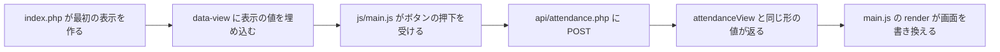

# `index.php` を読む（メイン画面）

## このファイルの役割

ログインしたあとに最初に開く**メイン画面**を作るファイル。現在時刻と、本日の出勤・退勤・休憩、ボタン（出勤・退勤・休憩開始・休憩終了・簡単残業申請）を出す。

- このファイルがするのは**最初の表示だけ**。ボタンを押したあとの処理は、`js/main.js` が API（`api/attendance.php`・`api/requests.php`）に送り、返ってきた値で画面を書き換える。画面の読み込み直しは起きない。
- 「どのボタンを押せるか」などの判断はしない。判断は `src/attendance.php` の `attendanceView()` に任せて、その答えを HTML にするだけ（[src_attendance.md](./src_attendance.md)）。
- システム管理者には出退勤の記録が無いので、ボタンの代わりに管理の画面へのボタンを出す。

## 全体の構成

| 行のあたり | 中身 |
| --- | --- |
| 1〜8行 | 共通の部品を読み込む |
| 10〜25行 | ログインの確認と、画面に出す値の準備（PHP の処理） |
| 27〜28行 | 画面の名前を決めて、共通の上部（ヘッダー）を出す |
| 30〜34行 | 時計 |
| 36〜42行 | システム管理者：管理の画面へのボタン |
| 43〜115行 | 社員・管理者：本日の記録、打刻のボタン、簡単残業申請、確認のウィンドウ |
| 117〜119行 | JavaScript の読み込みと、共通の下部 |

前半（`?>` まで）で値をすべて用意し、後半の HTML では**用意した値を出すだけ**にしている。HTML の中で DB を読んだり、判断をしたりしない。

ボタンを押したあとの流れを、先に示す。



---

## 1. 共通の部品を読み込む

```php
<?php
// メイン画面（FR-003、FR-008）：現在時刻と、本日の出勤・退勤・休憩、簡単残業申請
// ボタンを押すと、js/main.js が api/attendance.php（出退勤）・api/requests.php（残業申請）に送る
include_once(__DIR__ . '/src/functions.php');
include_once(__DIR__ . '/src/dbconnect.php');
include_once(__DIR__ . '/src/auth.php');
include_once(__DIR__ . '/src/queries/work_settings.php');
include_once(__DIR__ . '/src/requests.php');
```

- `__DIR__` は「このファイルがあるフォルダ」の絶対パス。`__DIR__ . '/src/…'` と書くと、どこから実行しても同じファイルを指す（`'./src/…'` のような相対パスは、実行の仕方によって基準が変わることがある）。
- `include_once` は、同じファイルを2回目以降は読み込まない。いろいろなファイルが同じ部品を読み込んでも、関数の二重定義のエラーにならない。
- 読み込むものと、ここで使う関数：

| ファイル | ここで使うもの |
| --- | --- |
| `src/functions.php` | `h()`・`appUrl()`・`assetUrl()`・`formatTime()` |
| `src/dbconnect.php` | `$pdo`（DB の接続） |
| `src/auth.php` | `requireLogin()`・`ROLE_SYSTEM_ADMIN`・`ADMIN_MENU_ITEMS`（`src/session.php` も一緒に読み込まれ、`csrfToken()` が使える） |
| `src/queries/work_settings.php` | `fetchWorkSettings()`（標準終了時刻） |
| `src/requests.php` | `isCorrectionPending()`。このファイルが `src/attendance.php` も読み込むので、`attendanceView()`・`workDateOf()`・`ATTENDANCE_ACTION_LABELS` なども使える |

## 2. ログインの確認と、画面に出す値の準備

```php
$currentUser = requireLogin($pdo);
$isEmployee = $currentUser['role'] !== ROLE_SYSTEM_ADMIN;
```

- `requireLogin()` は、ログインしていなければログイン画面へ移して、**そこで処理を終える**。戻ってきたなら、ログイン中の利用者の配列（氏名・権限など）が入っている（[src_auth.md](./src_auth.md)）。
- `$isEmployee` は「出退勤の記録がある人か」。権限は社員・管理者・システム管理者の3つで、システム管理者以外（社員と管理者）が `true` になる。

```php
$now = time();
$weekdays = ['日', '月', '火', '水', '木', '金', '土'];
$dateLabel = date('Y年n月j日', $now) . '（' . $weekdays[(int) date('w', $now)] . '）';
```

- `time()` を1回だけ呼んで `$now` に入れ、以降はこれを使う。何度も `time()` を呼ぶと、0時ちょうどをまたいだときに、日付と曜日が別の日になるおそれがある。
- `date('w')` は曜日を `'0'`（日曜）〜`'6'`（土曜）の**文字列**で返す。`(int)` で数値にして、配列 `$weekdays` の番号に使う。
- `n`・`j` は「月・日を、0 を付けずに」出す書式（`10月5日`）。`年`・`月`・`日` は書式の文字ではないので、そのまま出る。

```php
$view = null;
if ($isEmployee) {
    $standardEnd = fetchWorkSettings($pdo)['standard_end'];
    $today = workDateOf($now);
    // 今日の修正・新規登録が申請中なら、打刻を止める（D-063）
    $locked = isCorrectionPending($pdo, $currentUser['employee_id'], $today);
    $view = attendanceView(fetchAttendance($pdo, $currentUser['employee_id'], $today), $standardEnd, $locked);
    $headerStatus = $view;
}
```

- 社員・管理者のときだけ、DB を読んで表示の値を作る。システム管理者のときは `$view` が `null` のまま。
- `fetchWorkSettings($pdo)['standard_end']`：関数の戻り値（配列）に、そのまま `['…']` を付けて1つの値を取り出せる。`'18:00:00'` のような標準終了時刻が入る。
- `$locked`：今日の分の修正・新規登録の申請が「申請中」なら `true`。申請が承認されると、勤怠の行が申請の値で上書きされ、その間に押した打刻が消えてしまう。だから申請中は打刻を止める（D-063）。
- `attendanceView()` の戻り値は、状態・本日の記録・押せるボタンをまとめた配列（`'status'`・`'statusLabel'`・`'checkIn'`・`'checkOut'`・`'break'`・`'buttons'`・`'locked'`）。標準終了時刻を渡しているので、`'buttons'` には簡単残業申請の `'overtime'` も入る。
- `$headerStatus = $view;`：共通の上部（`templates/header.php`）は、`$headerStatus` があれば状態バッジ（「勤務中」など）を出す。メイン画面だけが、これを用意する（[templates.md](./templates.md)）。

> **ここが重要**：`$standardEnd` は `if ($isEmployee)` の中でしか作られない。後半の HTML でも `$standardEnd` を使うが、それは `<?php else: ?>`（社員・管理者）の側だけなので、未定義の変数を読むことはない。**前半の `if` と、後半の `if` の条件をそろえている**のがポイント。

## 3. 共通の上部を出す

```php
$pageTitle = 'メイン';
include(__DIR__ . '/templates/header.php');
?>
```

- `include` で読み込んだファイルは、**読み込んだ側と同じ変数を使える**。`templates/header.php` は、ここで用意した `$pageTitle`・`$currentUser`・`$headerStatus` を使って、`<head>` と画面上部のヘッダーを出す（タイトルは「メイン｜勤怠管理」になる）。
- `?>` から先は、PHP の外（HTML）。HTML の中で値を出すところだけ `<?= … ?>` や `<?php … ?>` を書く。

## 4. 時計

```php
<section class="clock" id="clock" aria-label="現在時刻" data-server-time="<?= h((string) (int) floor(microtime(true) * 1000)) ?>">
    <div class="clock__date" id="clock-date"><?= h($dateLabel) ?></div>
    <div class="clock__time" id="clock-time"><?= h(date('H:i:s', $now)) ?></div>
</section>
```

- `<?= … ?>` は `<?php echo … ?>` の短い書き方。**出す値は、必ず `h()` を通す**（XSS 対策。[src_functions.md](./src_functions.md)）。
- 最初の表示の時刻は PHP が出す。そのあと1秒ごとの更新は、`js/main.js` が行う。
- `data-server-time`：サーバーの今の時刻を、ミリ秒（1970年からの経過）で埋め込む。`microtime(true)` は秒を小数で返すので、`* 1000` してミリ秒にし、`floor()` で小数を切り捨てる。`floor()` の戻り値は小数の型（float）なので、`(int)` で整数にしてから `(string)` で文字列にしている。float を文字にすると、値によっては `1.0E+15` のような指数の形になることがあるが、整数にしてからなら、必ず数字だけの文字列になる。
- `js/main.js` は「サーバーの時刻 − パソコンの時刻」の差を計算して、表示に足す。**利用者のパソコンの時計がずれていても、サーバーと同じ時刻を表示できる**。打刻はサーバーの時刻で記録されるので、画面の時計もサーバーに合わせておく。

## 5. システム管理者：管理の画面へのボタン

```php
<?php if (!$isEmployee): ?>
    <!-- システム管理者：出退勤の記録は無いので、管理の画面へのボタンを並べる（D-067） -->
    <nav class="admin-links" aria-label="管理の画面">
        <?php foreach (ADMIN_MENU_ITEMS as $item): ?>
            <a class="admin-links__item" href="<?= h(appUrl($item['path'])) ?>"><?= h($item['label']) ?></a>
        <?php endforeach; ?>
    </nav>
<?php else: ?>
```

- `if (…):` 〜 `else:` 〜 `endif;`、`foreach (…):` 〜 `endforeach;` は、PHP の**もう1つの書き方**（コロン構文）。`{ }` の代わりに使う。HTML の中に PHP を混ぜるときは、どこで閉じているかが分かりやすいので、この書き方を使う。
- `ADMIN_MENU_ITEMS` は `src/auth.php` の定数（アカウント管理・部署・勤務設定の3つ）。ハンバーガーメニュー（`templates/menu.php`）も同じ定数を使う。**画面の一覧を1か所にまとめている**ので、管理の画面を増やすときは定数だけ直せば、メニューとこのボタンの両方に出る。
- `appUrl($item['path'])` で、`'admin/accounts.php'` → `/attendance/admin/accounts.php` のような URL にする。

## 6. 社員・管理者：JavaScript との約束（`data-*` 属性）

```php
<div id="attendance"
    data-api-url="<?= h(appUrl('api/attendance.php')) ?>"
    data-request-api-url="<?= h(appUrl('api/requests.php')) ?>"
    data-login-url="<?= h(appUrl('login.php')) ?>"
    data-csrf-token="<?= h(csrfToken()) ?>"
    data-view="<?= h(json_encode($view, JSON_UNESCAPED_UNICODE | JSON_THROW_ON_ERROR)) ?>">
```

- `data-…` は、HTML に自由な値を持たせるための属性。JavaScript からは `attendance.dataset.apiUrl` のように読める（`data-api-url` → `dataset.apiUrl`。`-` の次の文字が大文字になる）。
- ここに入れているもの：

| 属性 | 中身 | `js/main.js` での使い道 |
| --- | --- | --- |
| `data-api-url` | 出退勤の API の URL | ボタンを押したときの送り先 |
| `data-request-api-url` | 申請の API の URL | 簡単残業申請の送り先 |
| `data-login-url` | ログイン画面の URL | API が 401（ログイン切れ）を返したときに移る先 |
| `data-csrf-token` | CSRF トークン | POST に `csrf_token` として付ける |
| `data-view` | `attendanceView()` の値を JSON にしたもの | 最初の「今の表示」として `JSON.parse()` する |

- URL を JavaScript に直接書かず、PHP の `appUrl()` で作って渡している。アプリを置く場所が変わっても、JavaScript を直さなくてよい。
- `json_encode()`：PHP の配列を JSON の文字列にする。`JSON_UNESCAPED_UNICODE` は、日本語を `\u52e4` のような記号の形（エスケープ）にせず、`勤` のまま出す指定。`JSON_THROW_ON_ERROR` は、変換に失敗したら `false` を返す代わりに例外を投げる指定（失敗に気付ける）。`|` で2つの指定を組み合わせている。
- JSON を `h()` に通すのは、JSON の `"` が属性の `"…"` を閉じてしまわないようにするため。`"` は `&quot;` になり、ブラウザが属性を読むときに `"` に戻すので、JavaScript には元の JSON が届く。

> **ここが重要**：`data-view` の値と、API が返す `view` の値は、**どちらも `attendanceView()` で作った同じ形**。`js/main.js` は、最初はこの `data-view` を、ボタンを押したあとは API の `view` を、同じ `render()` に渡すだけ。表示の作り方が PHP の1か所にあるので、最初の表示と、押したあとの表示が食い違わない。

## 7. 本日の記録と、打刻を止めているときの案内

```php
<dl class="today">
    <div class="today__item">
        <dt>本日の出勤</dt>
        <dd id="today-check-in"><?= h($view['checkIn']) ?></dd>
    </div>
    …
</dl>

<p class="alert alert--info punch-lock" id="punch-lock" role="status"<?= $view['locked'] ? '' : ' hidden' ?>>
    <?= h(PUNCH_LOCKED_MESSAGE) ?>
    <a href="<?= h(appUrl('records/')) ?>">記録表示へ</a>
</p>
```

- `$view['checkIn']` などは、`attendanceView()` が `'09:01'` や `'--:--'` の形にしてある。ここでは出すだけ。
- `id="today-check-in"` などの `id` は、`js/main.js` が書き換える場所の目印。
- `hidden` 属性：付いていると、その要素は表示されない。申請中（`locked` が `true`）のときだけ、`hidden` を付けずに案内を出す。`js/main.js` も、`hidden` を付け外しして同じ案内を出し入れする。
- 案内の文は定数 `PUNCH_LOCKED_MESSAGE`（`src/attendance.php`）。API が「押せません」と返すときも同じ定数を使うので、文が食い違わない。

## 8. 打刻のボタン

```php
<div class="punch">
    <?php foreach (ATTENDANCE_ACTION_LABELS as $action => $label): ?>
        <button class="punch__button punch__button--<?= h(str_replace('_', '-', $action)) ?>" type="button" data-action="<?= h($action) ?>" <?= $view['buttons'][$action] ? '' : 'disabled' ?>><?= h($label) ?></button>
    <?php endforeach; ?>
</div>
```

- `foreach (配列 as $キー => $値)`：`ATTENDANCE_ACTION_LABELS` の4つ（`'check_in' => '出勤'` など）を順に取り出し、ボタンを4つ作る。ボタンを1つずつ HTML に書かないので、操作の一覧（定数）とボタンが必ず一致する。
- `str_replace('_', '-', $action)`：`check_in` → `check-in`。CSS のクラス名（`punch__button--check-in`）は `-` でつなぐ決まりに合わせている。
- `data-action`：`js/main.js` は、押されたボタンのこの値（`'check_in'` など）を、そのまま API の `action` として送る。
- `disabled`：`$view['buttons'][$action]` が `false` なら付けて、押せなくする。三項演算子 `条件 ? A : B` で、付けるか付けないかを1行で書いている。
- `type="button"`：`<button>` は、何も書かないとフォームの送信ボタン（`type="submit"`）として扱われる。ここは JavaScript で処理するので、`button` を明示する。

> **ここが重要**：`disabled` は**見た目と、うっかり押すのを防ぐため**のもの。ブラウザの開発ツールを使えば `disabled` は外せるので、これで守ったことにはならない。API（`api/attendance.php`）が、押されるたびに `actionMode()` で押せるかを確かめ直す（[src_attendance.md](./src_attendance.md)）。

## 9. 簡単残業申請のボタン

```php
<div class="overtime">
    <button class="overtime__button" type="button" id="overtime-open" <?= $view['buttons']['overtime'] ? '' : 'disabled' ?>>簡単残業申請</button>
    <p class="overtime__note">退勤済みで、退勤が <?= h(formatTime($standardEnd)) ?> より後の場合に申請できます</p>
</div>
```

- 押せるかどうかは、`attendanceView()` が入れた `'overtime'`（退勤が記録済みで、標準終了時刻より後か）で決める。
- `formatTime($standardEnd)`：`'18:00:00'` → `'18:00'`（[src_functions.md](./src_functions.md)）。標準終了時刻は勤務設定の画面で変えられるので、文の中の時刻も DB の値から出す。

## 10. 通知と、2つのウィンドウ

```php
<div class="toast" id="toast" role="status" aria-live="polite" hidden></div>
```

- 「出勤を記録しました（09:01）」のような通知を出す場所。最初は空で `hidden`。`js/main.js` が文を入れて表示し、数秒で隠す。
- `aria-live="polite"`：中身が変わったら、画面の読み上げソフトが（今の読み上げが終わってから）読み上げる。

### 上書きの確認

```php
<dialog class="dialog" id="confirm-dialog" aria-labelledby="confirm-title">
    <form method="dialog" class="dialog__body">
        <h2 class="dialog__title" id="confirm-title"></h2>
        <p class="dialog__text" id="confirm-text"></p>
        <div class="dialog__actions">
            <button class="button button--outline" type="submit" value="cancel">キャンセル</button>
            <button class="button button--primary" type="submit" value="ok">上書きする</button>
        </div>
    </form>
</dialog>
```

- `<dialog>` は、HTML の標準のウィンドウ。JavaScript の `showModal()` で開くと、後ろの画面は押せなくなり、Esc キーで閉じられる。
- `<form method="dialog">`：この中のボタンで送信すると、サーバーには送らず、**ウィンドウを閉じるだけ**になる。押したボタンの `value`（`'ok'` か `'cancel'`）が、`dialog.returnValue` に入る。`js/main.js` は、閉じたときに `returnValue` が `'ok'` なら、`overwrite=1` を付けてもう一度 API に送る。
- 題名と本文は空にしてある。API が返した確認の文（`confirm.title`・`confirm.body`）を、`js/main.js` が入れる。

### 簡単残業申請

```php
<!-- 簡単残業申請（FR-008）。理由の欄は無い（D-041） -->
<dialog class="dialog" id="overtime-dialog" aria-labelledby="overtime-title">
    <form class="dialog__body" id="overtime-form" novalidate>
        <h2 class="dialog__title" id="overtime-title">簡単残業申請</h2>
        <p class="alert alert--error" id="overtime-error-form" role="alert" hidden></p>
        …
        <div class="form-field">
            <label class="form-field__label" for="overtime-end">残業の終了時刻</label>
            <input class="form-field__input" type="time" id="overtime-end" name="overtime_end" step="60" required>
            <p class="form-field__error" id="overtime-error-overtime_end" hidden></p>
            <p class="dialog__help"><?= h(formatTime($standardEnd)) ?> より後、退勤時刻までの時刻を指定できます。</p>
        </div>
        …
    </form>
</dialog>
```

- `novalidate`：ブラウザの入力チェック（`required` の吹き出しなど）を止める。誤りの文は、サーバー（`api/requests.php`）が返したものを、このウィンドウの中に出す形にそろえている。
- `type="time"` と `step="60"`：時刻の入力欄。`step="60"` は 60 秒刻み、つまり秒を入力させない指定。
- 誤りを出す場所の `id` は `overtime-error-<名前>` の形。API は誤りを `['form' => …]` や `['overtime_end' => …]` の形で返し、`js/main.js` はこの名前から `id` を作って、文を入れる場所を決める。入力欄の `name="overtime_end"` と、誤りの名前と、`id` の後ろの部分をそろえておくのが約束。
- 理由の欄は無い（簡単残業申請は理由なし。D-041）。

## 11. JavaScript の読み込みと、共通の下部

```php
</main>
<script src="<?= h(assetUrl('js/main.js')) ?>" defer></script>
<?php include(__DIR__ . '/templates/footer.php'); ?>
```

- `assetUrl()`：URL の後ろに、ファイルを最後に変えた日時（`?v=…`）を付ける。`js/main.js` を変えると URL が変わり、ブラウザが古いファイル（キャッシュ）を使わなくなる（D-068）。
- `defer`：HTML を最後まで読んでから、スクリプトを実行する。スクリプトの中で `document.getElementById('attendance')` などを探すとき、その要素がもう作られている。
- `js/main.js` は、システム管理者の画面でも読み込む。時計を動かすため。`#attendance` が無ければ、ボタンの処理は行わずに終わる作りになっている。
- 最後に `templates/footer.php` で `</body></html>` を閉じる。

---

## まとめ：このファイルから学べること

| 書き方 | このファイルでの例 |
| --- | --- |
| 準備と表示を分ける | 前半の PHP で値を用意し、HTML では出すだけ |
| 出す値は必ずエスケープ | `<?= h(…) ?>`。JSON を属性に入れるときも `h()` |
| 判断はほかに任せる | 押せるかは `attendanceView()` の答えを使う |
| PHP と JS の約束を1つにする | `data-view` と API の `view` が同じ形 |
| URL は PHP で作って渡す | `data-api-url` などを `appUrl()` で作る |
| 一覧の定数からループで作る | 打刻のボタンは `ATTENDANCE_ACTION_LABELS`、管理の画面は `ADMIN_MENU_ITEMS` |
| `disabled` を信用しない | API で確かめ直す |
| 時刻は1回だけ取る | `$now = time();` を使い回す |

## 関連するファイル

- 読み込む部品：[src_functions.md](./src_functions.md)、[src_dbconnect.md](./src_dbconnect.md)、[src_auth.md](./src_auth.md)、[src_session.md](./src_session.md)、[src_attendance.md](./src_attendance.md)（`attendanceView()`）、[src_requests.md](./src_requests.md)（`isCorrectionPending()`）、[src_queries_departments_sequences_work_settings.md](./src_queries_departments_sequences_work_settings.md)（`fetchWorkSettings()`）
- 共通の上部・下部：[templates.md](./templates.md)
- 画面の動き：[js_main.md](./js_main.md)（時計、`render()`、ボタンの送信、上書きの確認、簡単残業申請）
- 送り先の API：[api_attendance.md](./api_attendance.md)（出退勤）、[api_requests.md](./api_requests.md)（簡単残業申請）
