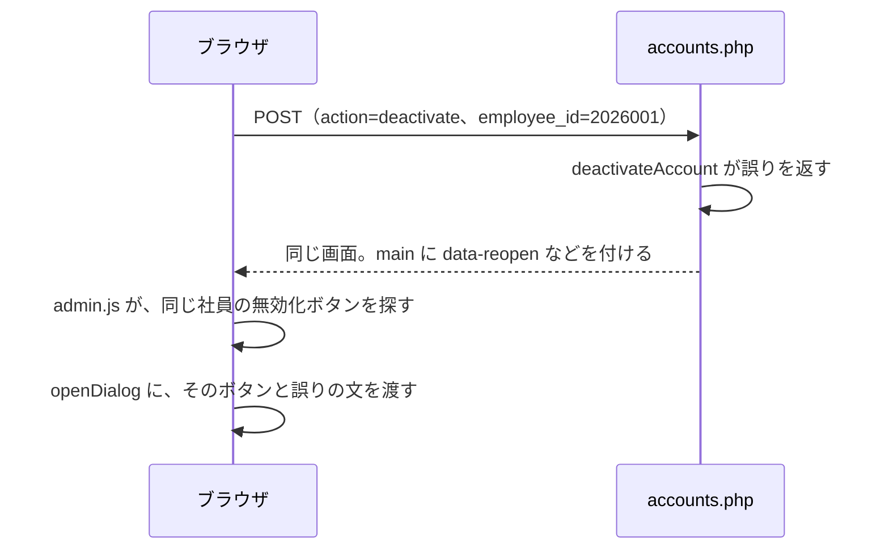

# `js/admin.js` を読む（システム管理者の画面の動き）

## このファイルの役割

システム管理者の3つの画面（アカウント管理・部署・勤務設定）で、**ブラウザの中だけで完結する動き**を受け持つファイル。

- 通知（トースト）を、5秒たったら消す。
- アカウント作成で、権限が「管理者」のときだけ、承認範囲の欄を出す。
- 一覧のボタンを押したら、確認のウィンドウ（`<dialog>`）を開き、押したボタンの値をウィンドウに入れる。
- 送信したら、ボタンを押せなくする（二重送信を防ぐ）。
- ウィンドウからの送信で誤りがあったら、同じウィンドウを開き直して、誤りを出す。

**サーバーとの通信（`fetch`）はしない**。送信は普通のフォーム（POST）で、画面全体が切り替わる。メイン画面の `js/main.js` のように、API の答えで画面を書き換えることはない。入力の確認や登録は、すべてサーバーが行う。ただし、一覧の操作のウィンドウはこのファイルが開くので、JavaScript が動かないと、無効化・名前の変更などのウィンドウは開けない（作成・追加のフォームと勤務設定は、そのまま送れる）。

## 全体の構成

| 行のあたり | 中身 |
| --- | --- |
| 先頭 | 即時関数で全体を包む。`#admin` が無い画面では何もしない |
| 通知 | 5秒後に `hidden` にする |
| 承認範囲 | 権限の選択欄が変わったら、承認範囲の欄を出す・隠す |
| `openDialog()` | ウィンドウを開き、ボタンの `data-*` の値を中に入れる（このファイルの中心） |
| 開閉の結び付け | `data-open` のボタン、`data-close` のボタン、背景のクリック |
| 二重送信の防止 | 送信したら、そのフォームのボタンを `disabled` にする |
| 開き直し | `<main>` の `data-reopen` を見て、ウィンドウを開き直す |

3つの画面で同じファイルを使う。**画面に要素が無ければ、その部分は何もしない**ように書いてあるので、勤務設定の画面（ウィンドウが無い）でも、そのまま読み込める。

---

## 1. 全体を包む関数と、`'use strict'`

```js
(() => {
    'use strict';

    const root = document.getElementById('admin');
    if (!root) {
        return;
    }
    …
})();
```

- `(() => { … })();` は、**作ってすぐ呼ぶ関数**（即時関数）。中で作った変数（`root`・`toast` など）は、この関数の中だけで使える。ほかのスクリプトの変数と名前がぶつからない。
- `'use strict';` は、JavaScript を厳しいモードで動かす指示。宣言していない変数への代入などを、エラーにしてくれる（打ち間違いに気付ける）。
- `root` は、3つの画面の `<main id="admin">`。見つからなければ、何もせずに終わる。`return` で関数を抜けるだけなので、エラーにはならない。

## 2. 通知を消す

```js
    const toast = document.getElementById('toast');
    if (toast) {
        setTimeout(() => {
            toast.hidden = true;
        }, 5000);
    }
```

- 通知は、PHP が成功のあとの表示でだけ出す（`<div class="toast" id="toast">`。[admin_accounts.md](./admin_accounts.md) の 6章）。無い画面では `toast` が `null` なので、何もしない。
- `setTimeout(関数, ミリ秒)`：指定した時間がたったら、関数を1回呼ぶ。5000 ミリ秒＝5秒。
- `toast.hidden = true`：要素の `hidden` 属性を付ける。付いた要素は表示されない。

## 3. 承認範囲の出し分け

```js
    // 権限が「管理者」のときだけ、承認範囲を出す（D-066）
    const role = document.getElementById('role');
    const scopeField = document.getElementById('scope-field');
    if (role && scopeField) {
        role.addEventListener('change', () => {
            scopeField.hidden = role.value !== 'manager';
        });
    }
```

- `addEventListener('change', 関数)`：選択欄の値が変わったときに、関数を呼ぶ。
- `role.value !== 'manager'` は、管理者以外なら `true`（隠す）、管理者なら `false`（出す）。条件の結果をそのまま `hidden` に入れているので、`if … else` が要らない。
- `'manager'` は、PHP の `ROLE_MANAGER` の値と同じ文字列。PHP と JavaScript で同じ値を使う約束になっている。
- 最初の表示で出すか隠すかは PHP が決めている（`hidden` を付けるかどうか）。JavaScript は、**選び直したときだけ**切り替える。
- 隠した欄の値も、フォームを送るといっしょに送られる。社員を選んだときの承認範囲は、サーバー（`validateAccount()`）が `'department'` に決め直す。

## 4. `openDialog()`：ウィンドウを開いて、値を入れる（このファイルの中心）

```js
    // ウィンドウを開く。押したボタンの data-* の値を、ウィンドウの中に入れる
    //   data-text="名前"：文字として入れる。data-value="名前"：入力欄の値にする。data-min-from・data-max-from：日付の範囲にする
    function openDialog(button, error = '') {
        const dialog = document.getElementById(button.dataset.open);
        const form = dialog.querySelector('form');
        form.reset();
```

- `error = ''` は**引数の既定値**。ボタンを押して開くときは `openDialog(button)` と1つだけ渡すので、`error` は空。開き直すとき（7章）だけ、誤りの文を渡す。
- `button.dataset.open`：ボタンの `data-open` 属性の値（例：`'deactivate-dialog'`）。この `id` のウィンドウを開く。
- `form.reset()`：フォームの入力欄を、HTML に書いた最初の状態に戻す。前に開いたときに入力したパスワードや日付が、残らない。

### `dataset` の名前の決まり

`data-*` 属性は、JavaScript では `要素.dataset` で読める。名前は次のように変わる。

| HTML の属性 | JavaScript |
| --- | --- |
| `data-open` | `dataset.open` |
| `data-employee-id` | `dataset.employeeId` |
| `data-left-on` | `dataset.leftOn` |
| `data-min-from` | `dataset.minFrom` |
| `data-reopen-employee` | `dataset.reopenEmployee` |

- `data-` を取り、`-` のあとの文字を大文字にしてつなぐ（キャメルケース）。PHP 側の HTML ではハイフン、JavaScript 側ではキャメルケースで書く。

### 印の付いた要素に、ボタンの値を入れる

```js
        dialog.querySelectorAll('[data-text]').forEach((element) => {
            element.textContent = button.dataset[element.dataset.text] ?? '';
        });
        dialog.querySelectorAll('[data-value]').forEach((element) => {
            element.value = button.dataset[element.dataset.value] ?? '';
        });
        dialog.querySelectorAll('[data-min-from]').forEach((element) => {
            element.min = button.dataset[element.dataset.minFrom] ?? '';
        });
        dialog.querySelectorAll('[data-max-from]').forEach((element) => {
            element.max = button.dataset[element.dataset.maxFrom] ?? '';
        });
```

ここがこのファイルでいちばん工夫したところ。無効化のウィンドウの退社日の欄で、順に追ってみる。

```html
<!-- 押したボタン -->
<button … data-open="deactivate-dialog" data-employee-id="2026001" data-target="2026001　山田 太郎" data-left-on="2026-10-22" data-min="2026-04-01" data-max="2026-10-22">無効化</button>
<!-- ウィンドウの中の欄 -->
<input type="date" id="left_on" name="left_on" data-value="leftOn" data-min-from="min" data-max-from="max" required>
```

1. `querySelectorAll('[data-value]')` で、`data-value` 属性を持つ要素を全部探す。退社日の欄が見つかる。
2. `element.dataset.value` は `'leftOn'`。これは「ボタンのどの値を使うか」という**名前**。
3. `button.dataset['leftOn']` で、ボタンの `data-left-on` の値 `'2026-10-22'` を読み、欄の値にする。
4. 同じように、`data-min-from="min"` → ボタンの `data-min` → 欄の `min`、`data-max-from="max"` → ボタンの `data-max` → 欄の `max`。

- `button.dataset[…]` のように `[ ]` で書くと、**変数に入った名前で**プロパティを読める（`button.dataset.leftOn` と同じ意味）。
- `?? ''`（null 合体演算子）：ボタンにその値が無ければ（`undefined`）、空の文字にする。
- `textContent` は、文字として入れる（HTML としては解釈しない）。社員の氏名に `<` などが入っていても、タグにはならない。**値を画面に入れるときは、`innerHTML` ではなく `textContent` を使う**。

> **ここが重要**：この関数には、「社員コード」「退社日」「部署名」といった、個々の項目の名前が1つも出てこない。**どの値をどこに入れるかは、HTML の側の印（`data-text`・`data-value` など）が決めている**。だから、アカウント管理の3つのウィンドウも、部署の3つのウィンドウも、同じ `openDialog()` 1つで開ける。ウィンドウや項目を増やすときも、HTML に印を付けるだけで、JavaScript は直さなくてよい。

### 誤りの欄と、送信ボタン

```js
        const errorElement = dialog.querySelector('[data-dialog-error]');
        errorElement.textContent = error;
        errorElement.hidden = error === '';
        form.querySelectorAll('[type=submit]').forEach((submit) => {
            submit.disabled = false;
        });
        dialog.showModal();
    }
```

- 誤りの文があれば出し、空なら隠す。ふつうに開くときは空なので、前に出ていた誤りが消える。
- 送信ボタンの `disabled` を外す。6章で送信したときに押せなくしたボタンが、残っていることがあるため（たとえば、ブラウザの「戻る」で、送信したときの状態のまま画面が出た場合）。開くたびに、必ず押せる状態から始める。
- `dialog.showModal()`：ウィンドウを**モーダル**で開く。画面の真ん中に出て、後ろの画面は操作できなくなり、背景は CSS の `::backdrop` で暗くなる。Esc キーで閉じられる。

## 5. ボタンとウィンドウを結び付ける

```js
    root.querySelectorAll('[data-open]').forEach((button) => {
        button.addEventListener('click', () => openDialog(button));
    });
```

- `data-open` を持つボタン（一覧の「無効化」「名前の変更」など）を全部探し、押したら `openDialog()` を呼ぶようにする。
- アロー関数 `() => openDialog(button)` は、`forEach` の中の `button`（その回のボタン）を覚えている。だから、どのボタンを押しても、押したボタン自身が `openDialog()` に渡る。

```js
    root.querySelectorAll('dialog').forEach((dialog) => {
        dialog.querySelectorAll('[data-close]').forEach((button) => {
            button.addEventListener('click', () => dialog.close());
        });
        dialog.addEventListener('click', (event) => {
            if (event.target === dialog) {
                dialog.close();
            }
        });
    });
```

- 「キャンセル」（`data-close`）を押したら、`dialog.close()` で閉じる。
- **背景（ウィンドウの外）をクリックしても閉じる**。`event.target` は、実際にクリックされた要素。
  - CSS で、`<dialog>` の余白を 0 にして、中の `<form>` がウィンドウ全体を埋めている。だから、ウィンドウの中をクリックすると `event.target` は `<form>` かその中の要素になり、`<dialog>` そのものにはならない。
  - 背景（`::backdrop`）をクリックしたときだけ、`event.target` が `<dialog>` になる。それを見分けて閉じる。

## 6. 二重送信を防ぐ

```js
    // 二重送信を防ぐ（送信したら、そのフォームのボタンを押せなくする）
    root.querySelectorAll('form[method=post]').forEach((form) => {
        form.addEventListener('submit', () => {
            setTimeout(() => {
                form.querySelectorAll('[type=submit]').forEach((submit) => {
                    submit.disabled = true;
                });
            });
        });
    });
```

- 作成のフォームも、ウィンドウの中のフォームも、勤務設定のフォームも、すべて `method="post"` なので、ここで全部に付く。
- 送信ボタンを続けて2回押すと、同じ POST が2回送られる（アカウントが2つできる、など）。`submit` イベント（フォームが送られるとき）で、ボタンを `disabled` にして、2回目を押せなくする。
- `setTimeout(関数)` と、時間を書かずに呼んでいる。これは「今の処理（送信を始める処理）が終わってから、すぐに呼ぶ」という意味。送信が始まったあとでボタンを押せなくするための、よく使われる書き方（送信の途中でボタンを無効にして、送信そのものに影響させないため）。
- ウィンドウのフォームは `novalidate` が無いので、空の欄があるとブラウザが送信を止める。このとき `submit` イベントは起きないので、ボタンは押せないままにならない。

> **ここが重要**：この防止は、使いやすさのためのもの。JavaScript を止めれば、何度でも送れる。**本当の守りはサーバー側**にある。成功したら PRG でリダイレクトするので、読み込み直しても送り直されない。「すでに無効です」の確認や、DB の一意制約もある（[src_admin.md](./src_admin.md)）。

## 7. 誤りのときに、ウィンドウを開き直す

```js
    // ウィンドウからの送信で誤りがあったときは、同じウィンドウを開き直して、誤りを出す
    const reopen = root.dataset.reopen;
    if (reopen) {
        const key = root.dataset.reopenEmployee !== undefined ? 'employeeId' : 'departmentId';
        const id = root.dataset.reopenEmployee ?? root.dataset.reopenDepartment;
        const button = Array.from(root.querySelectorAll(`[data-open="${reopen}"]`)).find((b) => b.dataset[key] === id);
        if (button) {
            openDialog(button, root.dataset.reopenError);
        }
    }
})();
```

PHP とのやり取りを、無効化の退社日が範囲の外だった場合で追う。



- PHP は、誤りのときだけ `<main>` に `data-reopen`（ウィンドウの `id`）と、対象の ID と、誤りの文を付ける（[admin_accounts.md](./admin_accounts.md) の 4章・6章）。誤りが無ければ `root.dataset.reopen` は `undefined` なので、何もしない。
- アカウント管理は `data-reopen-employee`、部署は `data-reopen-department` を使う。どちらが付いているかで、ボタンのどの値（`employeeId` か `departmentId`）と比べるかを決める。1つのファイルで、2つの画面に対応している。
- `` `[data-open="${reopen}"]` `` は**テンプレートリテラル**（バッククォートで囲んだ文字列）。`${…}` の中に変数を埋め込める。`'[data-open="deactivate-dialog"]'` のような CSS セレクターになる。
- `querySelectorAll()` が返すのは配列ではない（`NodeList`）ので、`Array.from()` で配列にしてから、`find()` で「対象の ID が一致する最初のボタン」を探す。
- 見つかったボタンを、ユーザーが押したときと同じように `openDialog()` に渡す。そのとき、2つ目の引数に誤りの文を渡す。**ボタンを押して開くのと同じ関数を使う**ので、開き直したウィンドウにも、社員コードや範囲が正しく入る。

開き直したときの、細かい動き：

- ウィンドウの中の値は、ボタンの `data-*` から入れ直す。利用者が入力した値ではない。たとえば退社日は初期値（ふつうは今日）に、部署名の変更は今の名前に戻り、パスワードは空になる。
- ボタンが見つからないときは、開き直さない。たとえば「すでに無効です」の誤りのときは、その行のボタンが「有効に戻す」に変わっていて、無効化のボタンが無い。それでも、誤りの文は PHP がページの上にも出しているので、利用者には伝わる。

---

## まとめ：このファイルから学べること

| 書き方 | このファイルでの例 |
| --- | --- |
| 即時関数で包む | 変数を外に漏らさない。`'use strict'` で打ち間違いに気付く |
| 要素が無ければ何もしない | `if (toast)`・`if (role && scopeField)` で、3つの画面に同じファイルを使う |
| どこに何を入れるかを HTML の印で決める | `data-text`・`data-value`・`data-min-from`・`data-max-from` |
| 名前を変数で持ってプロパティを読む | `button.dataset[element.dataset.value]` |
| 値は `textContent` で入れる | HTML として解釈させない（XSS を防ぐ） |
| 標準の `<dialog>` を使う | `showModal()`・`close()`、Esc キー、背景のクリック |
| 同じ関数を、押したときと開き直しで使う | `openDialog(button)` と `openDialog(button, error)` |
| 画面の防止は補助、守りはサーバー | 二重送信の防止と、PRG・サーバーの確認 |

## 関連するファイル

- 読み込む画面：`admin/accounts.php`（[admin_accounts.md](./admin_accounts.md)）、`admin/departments.php`・`admin/settings.php`（[admin_departments_settings.md](./admin_departments_settings.md)）
- サーバーの処理：`src/admin.php`（[src_admin.md](./src_admin.md)）
- ウィンドウの見た目：`css/style.css`（`.dialog`・`.dialog__body`・`.dialog::backdrop`）
- 画面の動きの確認：`docs/検証スクリプト/pr7.js`
