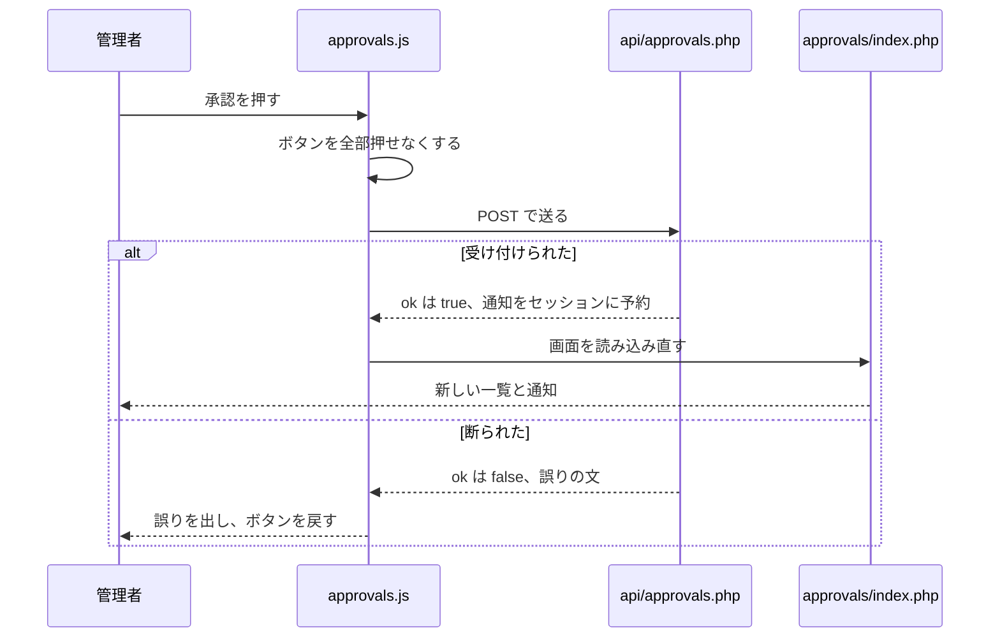

# `js/approvals.js` を読む（承認画面の動き）

## このファイルの役割

承認画面（`approvals/index.php`）の**ボタンを押したときの動き**を書いたファイル。

- 「承認」は、押したらすぐ API（`api/approvals.php`）に送る（確認のウィンドウは出さない。D-064）。
- 「却下」は、コメント（任意）のウィンドウを開き、「却下する」で送る。
- 受け付けられたら、**画面を読み込み直す**。一覧も通知も、サーバー（PHP）が作り直して出す。断られたら、その文を画面に出す。
- 「押せるか」「処理してよいか」の判断はしない。それはすべてサーバーが行う。ここは、送って、結果を見せるだけ。

## 全体の構成

| 行のあたり | 中身 |
| --- | --- |
| 先頭 | 全体を囲む関数、画面の部品を探す |
| 通知 | 出ている通知を 5 秒後に隠す |
| `send()` | API に送り、結果を「true か、誤りの文」にして返す |
| 小さな関数 | `setBusy()`（ボタンを押せなくする）、`showError()`（誤りを出す） |
| 承認 | 「承認」のボタンに、押したときの動きを付ける |
| 却下 | 「却下」のボタン、ウィンドウの開け閉め、「却下する」の送信 |

全体の流れ（承認の場合）：



---

## 1. 全体を囲む関数と、部品を探す

```js
(() => {
    'use strict';

    const root = document.getElementById('approvals');
    if (!root) {
        return;
    }
```

- `(() => { … })();`：アロー関数を作って、**その場ですぐ呼ぶ**書き方（即時実行関数）。中で作った変数（`root` など）は、この関数の中だけのものになり、ほかのファイルの変数とぶつからない。
- `'use strict';`：厳しいモード。宣言していない変数に代入するなどの誤りを、エラーにしてくれる。
- `root`：画面の `<main id="approvals">`。見つからなければ何もしない（承認画面でないところで読み込まれても、エラーにならない）。

```js
    const element = (id) => document.getElementById(id);
    const dialog = element('reject-dialog');
    const form = element('reject-form');
    const submitButton = element('reject-submit');
    const actionButtons = root.querySelectorAll('[data-approve], [data-reject]');
    let rejectId = null;
```

- `element`：`document.getElementById` を何度も書かずに済むよう、短い名前の関数にしている。
- `querySelectorAll('[data-approve], [data-reject]')`：CSS と同じ書き方で、部品をまとめて探す。`[data-approve]` は「`data-approve` の属性を持つもの」。`,` は「または」。一覧の「承認」「却下」のボタンが全部取れる。
- `let rejectId`：今開いている却下のウィンドウが、**どの申請のものか**を覚えておく変数。値が変わるので `const` ではなく `let`。

## 2. 通知を 5 秒後に隠す

```js
    const toast = element('toast');
    if (toast && !toast.hidden) {
        setTimeout(() => {
            toast.hidden = true;
        }, 5000);
    }
```

- PHP が通知（「○○ さんの申請を承認し、…」）を出しているとき（`hidden` でないとき）だけ、5000 ミリ秒（5 秒）後に隠す。
- `toast.hidden = true`：HTML の `hidden` 属性を付けるのと同じ。

## 3. `send()`：API に送る

```js
    // 送る。受け付けられたら true（画面を読み込み直す）、誤りなら文を返す
    async function send(requestId, decision, comment) {
        const body = new FormData();
        body.append('csrf_token', root.dataset.csrfToken);
        body.append('request_id', String(requestId));
        body.append('decision', decision);
        body.append('comment', comment);
```

- `async function`：中で `await`（終わるまで待つ）を使える関数。通信のように時間がかかる処理を、上から順に読める形で書ける。`async` の関数は、戻り値を **Promise**（あとで値が届く約束）にして返すので、呼ぶ側も `await` で受け取る。
- `FormData`：フォームと同じ形の送るデータ。PHP 側では、ふつうのフォームと同じく `$_POST['request_id']` などで読める。
- `root.dataset.csrfToken`：HTML の `data-csrf-token` の値。CSRF トークンを毎回一緒に送る。

```js
        try {
            const response = await fetch(root.dataset.apiUrl, {
                method: 'POST',
                body,
                credentials: 'same-origin',
                headers: { Accept: 'application/json' },
            });
```

- `fetch(URL, 設定)`：画面を切り替えずに、サーバーへリクエストを送る。
- `body,` は `body: body,` の短い書き方（キーと変数の名前が同じとき）。
- `credentials: 'same-origin'`：同じサイトへの通信には、Cookie（ログインのセッション）を付けて送る。`fetch()` の既定の値も `'same-origin'` なので、書かなくても同じ動きになるが、ここでは明示している。
- `Accept: 'application/json'`：「JSON で返してほしい」と伝える。

```js
            if (response.status === 401) {
                window.location.href = root.dataset.loginUrl;
                return true;
            }
```

- 401（ログインしていない）なら、ログイン画面へ移す。無操作で時間切れになったときに、ここに来る。
- `true` を返すのは、「誤りの文を出さなくてよい」という意味。画面はもう移っていくので、文を出しても意味が無い。

```js
            const data = await response.json().catch(() => null);
            if (!response.ok || data === null) {
                return data?.message ?? 'エラーが発生しました。画面を読み込み直して、もう一度お試しください。';
            }
```

- `response.json()`：返ってきた中身を、JSON として読んで、オブジェクトにする。中身が JSON でなければ失敗するので、`.catch(() => null)` で `null` にしておく。API は、CSRF の誤り（400）や想定外の例外（500）のときは、JSON ではなくただの文を返す（[api_approvals.md](./api_approvals.md)）。それでもこの行で止まらない。
- `response.ok`：HTTP の状態が 200 番台なら `true`。
- 200 番台でない、または JSON でなかったときは、誤りの文を返す。
  - `data?.message`：`?.`（オプショナルチェーン）は、`data` が `null` なら、`.message` を読みに行かずに `undefined` にする。`null.message` のエラーにならない。
  - `?? '…'`：左が `null` か `undefined` なら、右の決まった文を使う。
  - つまり「API が JSON で `message` を返していれば（403 の「管理者だけができます」など）それを、無ければ決まった文を」出す。

```js
            if (data.ok) {
                window.location.reload();
                return true;
            }
            return data.errors.form ?? data.errors.comment;
```

- `ok: true` なら、画面を読み込み直す。API がセッションに入れておいた通知を、PHP が取り出して出す。
- `ok: false` なら、断られた理由の文を返す。ふつうは `errors.form`（「すでに処理されています」など）、コメントが長すぎるときは `errors.comment`。

```js
        } catch (error) {
            return '通信できませんでした。接続を確かめて、もう一度お試しください。';
        }
    }
```

- `fetch()` が失敗するのは、**通信そのものができなかったとき**（ネットがつながらない など）だけ。404 や 500 が返ってきても、`fetch()` は失敗にならない（だから上で `response.ok` を調べている）。ここでは、通信できなかったときの文を返す。

> **ここが重要**：`send()` の戻り値を、**「`true`（もう何もしなくてよい）」か「出す文（文字列）」の2通り**にまとめている。HTTP の番号、JSON かどうか、`ok`、通信の失敗、と分かれ道は多いが、呼ぶ側は `if (result !== true)` の1つで済む。分かれ道の多い処理を1つの関数に閉じ込め、外には単純な答えだけを返す作り。

## 4. 小さな関数

```js
    function setBusy(busy) {
        actionButtons.forEach((button) => {
            button.disabled = busy;
        });
    }

    function showError(id, message) {
        const error = element(id);
        error.textContent = message;
        error.hidden = false;
    }
```

- `setBusy(true)`：一覧の「承認」「却下」のボタンを**全部**押せなくする。送っている間に、同じボタンをもう一度押したり、別の申請を押したりできないようにする。
- `showError()`：誤りの文を入れて、見えるようにする。
- `textContent` に入れているのがポイント。`innerHTML` と違い、文の中に `<` などがあっても HTML として解釈されず、文字のまま出る。サーバーから来た文を出すときも、この書き方なら安全。

## 5. 承認：押したらすぐ送る

```js
    // 承認：確認なしで、すぐ反映する（D-064）
    root.querySelectorAll('[data-approve]').forEach((button) => {
        button.addEventListener('click', async () => {
            setBusy(true);
            element('approval-error').hidden = true;
            const result = await send(button.dataset.approve, 'approve', '');
            if (result !== true) {
                showError('approval-error', result);
                setBusy(false);
            }
        });
    });
```

- 「承認」のボタン1つずつに、押したとき（`click`）の動きを付ける。
- `button.dataset.approve`：そのボタンの `data-approve` の値（申請の ID）。ボタンごとに違う ID を持っているので、どの申請の承認かが分かる。
- 押したら、ボタンを全部止め、前の誤りの文を隠してから送る。コメントは無いので `''`。
- 断られたら、誤りを出して、ボタンを戻す。受け付けられたときは、画面が読み込み直されるので、ボタンは止めたままでよい。
- 承認に確認のウィンドウを出さないのは、画面モックのとおりの決定（D-064）。

> **ここが重要**：ボタンを押せなくするのは、**二重に押したときの見た目の守り**でしかない。本当の守りはサーバーにある。2回送られても、`reviewRequest()` が申請の行をロックして状態を確かめるので、2回目は「すでに処理されています」になる。画面の守りとサーバーの守りは、役目が違う。

## 6. 却下：ウィンドウを開いてから送る

### ウィンドウを開く

```js
    // 却下：コメント（任意）のウィンドウを開く
    root.querySelectorAll('[data-reject]').forEach((button) => {
        button.addEventListener('click', () => {
            rejectId = button.dataset.reject;
            form.reset();
            element('reject-target').textContent = button.dataset.target;
            element('reject-error').hidden = true;
            submitButton.disabled = false;
            dialog.showModal();
        });
    });
```

- 押されたボタンの申請の ID を、`rejectId` に覚えておく。「却下する」を押したときに使う。
- `form.reset()`：前に書きかけたコメントを消す。別の申請のウィンドウに、前のコメントが残らないようにする。
- `button.dataset.target`：PHP が作っておいた「山田 太郎 さん・修正（10/14（水））」の文を、ウィンドウの見出しの下に入れる。ここも `textContent`。
- 前の誤りの文を隠し、「却下する」のボタンを押せる状態に戻す。
- `dialog.showModal()`：`<dialog>` を、後ろの画面を押せない形（モーダル）で開く。Esc キーで閉じる動きは、ブラウザが最初から持っている。

> **ここが重要**：ウィンドウは1つだけで、どの申請の却下でも使い回す。だから開くたびに、**中身（ID・見出し・コメント・誤りの文・ボタンの状態）を全部初めの状態に戻す**。どれか1つでも戻し忘れると、前の申請の内容が残ったまま送ってしまう。

### ウィンドウを閉じる

```js
    element('reject-cancel').addEventListener('click', () => dialog.close());
    dialog.addEventListener('click', (event) => {
        if (event.target === dialog) {
            dialog.close();
        }
    });
```

- 「キャンセル」で閉じる。`() => dialog.close()` は、1つの式だけのアロー関数（`{ }` を省ける）。
- ウィンドウの外側（暗くなった背景）を押しても閉じる。`event.target` は「実際に押された部品」。ウィンドウの中身はフォーム（`.dialog__body`）が埋めているので、中を押すと `event.target` はフォームやその中の部品になる。`<dialog>` 自身になるのは、外側の背景を押したときだけ、という作りを使っている。

### 「却下する」で送る

```js
    form.addEventListener('submit', async (event) => {
        event.preventDefault();
        submitButton.disabled = true;
        const result = await send(rejectId, 'reject', element('reject-comment').value);
        if (result !== true) {
            showError('reject-error', result);
            submitButton.disabled = false;
        }
    });
})();
```

- ボタンの `click` ではなく、フォームの `submit` を受けている。「却下する」は `type="submit"` なので、押すとフォームの `submit` が起きる。
- `event.preventDefault()`：フォームの既定の動き（画面を切り替えて送る）を止める。代わりに `send()` で、画面を切り替えずに送る。
- 送っている間は「却下する」を押せなくする（二重に送らない）。
- 覚えておいた `rejectId` と、コメント欄の値を送る。コメントの前後の空白は、サーバーが取る。
- 断られたら、**ウィンドウの中に**誤りの文を出し、ボタンを戻す。ウィンドウを閉じないので、書いたコメントは消えない。コメントが長すぎると言われても、直してもう一度送れる。

---

## まとめ：このファイルから学べること

| 書き方 | このファイルでの例 |
| --- | --- |
| 変数を外に漏らさない | 全体を `(() => { … })();` で囲む |
| 判断はサーバーに任せる | ここは送って、結果を見せるだけ |
| 分かれ道を1つの関数に閉じ込める | `send()` は `true` か「出す文」だけを返す |
| `fetch()` の失敗と HTTP の誤りを分ける | 通信の失敗は `catch`、4xx・5xx は `response.ok` |
| JSON でない返事にも備える | `response.json().catch(() => null)` |
| `?.` と `??` で「無いとき」を短く書く | `data?.message ?? '…'` |
| 文は `textContent` で入れる | `showError()`、却下の見出し |
| 送っている間はボタンを止める | `setBusy(true)`、`submitButton.disabled = true` |
| 使い回すウィンドウは開くたびに初めに戻す | `form.reset()` と、ID・誤り・ボタンの戻し |
| 結果の表示はサーバーに作り直させる | 成功したら `window.location.reload()` |

## 関連するファイル

- 画面（ボタン・ウィンドウ・`data-*` の値）：[approvals_index.md](./approvals_index.md)
- 送り先：[api_approvals.md](./api_approvals.md)
- 承認・却下の処理：[src_approvals.md](./src_approvals.md)
- 似た作りの JavaScript：[js_main.md](./js_main.md)（メイン画面。`fetch()` で送って、結果で画面を書き換える）
- テスト：`docs/検証スクリプト/pr6.js`（Playwright で、承認・却下・キャンセル・すでに処理された申請・スマホの幅などを確かめる）
