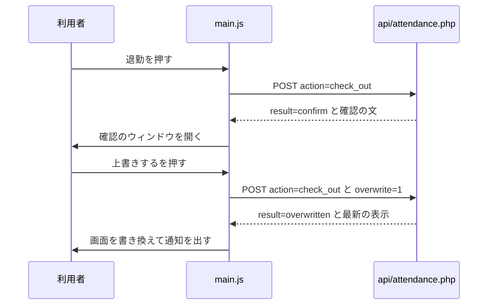

# `js/main.js` を読む（メイン画面の時計・ボタン・簡単残業申請）

## このファイルの役割

メイン画面（`index.php`）の動きを受け持つ JavaScript。次の3つをする。

1. **時計**：サーバーの時刻に合わせて、日本時間の日付と時刻を1秒ごとに書き換える。
2. **出退勤・休憩のボタン**：押されたら `api/attendance.php` に送り、返ってきた結果で画面を書き換える。上書きの確認のウィンドウも出す。
3. **簡単残業申請**：ウィンドウを開き、入力された終了時刻を `api/requests.php` に送る。

先頭のコメントにあるとおり、**押せるか・上書きの確認が要るかは、サーバーが判断する。JavaScript は、結果で画面を書き換えるだけ**。ルールは1つも書いていない（ルールは [src_attendance.md](./src_attendance.md)・[src_requests.md](./src_requests.md)）。

## 全体の構成

| 行のあたり | 中身 |
| --- | --- |
| 先頭 | 全体を `(() => { … })();` で包む |
| 時計 | `tick()`：サーバーとの時刻の差を足して表示し、次の秒の変わり目にもう一度呼ぶ |
| ボタンの準備 | 要素を探し、`data-view` から最初の表示を読む |
| 小さな関数 | `render()`（画面を書き換える）・`showToast()`（通知）・`setBusy()`（送信中） |
| 送信 | `send()`：`api/attendance.php` に POST して、結果を画面に出す |
| 上書きの確認 | ウィンドウが閉じたら、「上書きする」ならもう一度 `send()` |
| 簡単残業申請 | ウィンドウを開く・閉じる・送る |

この JavaScript は、`index.php` の HTML にある **`id` と `data-…` 属性**を手がかりに動く。HTML 側の主なものは次のとおり。

| HTML の要素 | 使い道 |
| --- | --- |
| `#clock`（`data-server-time`） | 時計。サーバーの時刻（ミリ秒）を持つ |
| `#attendance`（`data-api-url`・`data-request-api-url`・`data-login-url`・`data-csrf-token`・`data-view`） | ボタンのまとまり。送り先の URL・CSRF トークン・最初の表示を持つ |
| `[data-action]` のボタン | 出勤・退勤・休憩開始・休憩終了 |
| `#confirm-dialog` | 上書きの確認のウィンドウ |
| `#overtime-open`・`#overtime-dialog` | 簡単残業申請のボタンとウィンドウ |
| `#overtime-note`・`#overtime-pending` | 簡単残業申請のボタンの下の案内（申請できる条件／申請中です。どちらか1つを出す） |
| `#punch-lock` | 今日の修正が申請中で、打刻できないことの案内 |
| `#toast` | 通知（数秒で消える） |

---

## 1. 全体を包む

```js
(() => {
    'use strict';
    …
})();
```

- `(() => { … })();` は、**作ってすぐに呼ぶ関数**（即時実行関数）。中で作った変数（`clock`・`buttons` など）は、この関数の中だけで使える。ほかの JavaScript の変数と名前がぶつからない。
- `'use strict';` は、JavaScript を厳しいモードにする。宣言していない変数に代入するなどの誤りを、エラーにしてくれる。
- `index.php` は `<script src="…js/main.js" defer>` で読み込んでいる。`defer` を付けると、HTML を最後まで読んでから実行されるので、`document.getElementById()` で要素が必ず見つかる。

## 2. 時計

```js
    const clock = document.getElementById('clock');
    if (!clock) {
        return;
    }
    const clockDate = document.getElementById('clock-date');
    const clockTime = document.getElementById('clock-time');
    const offset = Number(clock.dataset.serverTime) - Date.now();
```

- 時計の要素が無ければ、何もせずに終わる（このファイルを、ほかの画面で読んでしまっても壊れない）。
- `clock.dataset.serverTime` は、HTML の `data-server-time` 属性の値。`data-` の後ろの `server-time` が、`dataset` では `serverTime`（ハイフンの次を大文字）になる。値は文字列なので、`Number()` で数にする。
- `index.php` は、ページを作った時点のサーバーの時刻を、ミリ秒で埋め込んでいる（`floor(microtime(true) * 1000)`）。`Date.now()` は利用者のパソコンの時刻（ミリ秒）。その差が `offset`。
- 以後、`Date.now() + offset` で「サーバーの時計での今」を求める。**パソコンの時計がずれていても、サーバーの時刻に近い時刻を表示できる**。

```js
    const formatter = new Intl.DateTimeFormat('ja-JP', {
        timeZone: 'Asia/Tokyo',
        year: 'numeric',
        month: '2-digit',
        day: '2-digit',
        weekday: 'short',
        hour: '2-digit',
        minute: '2-digit',
        second: '2-digit',
        hourCycle: 'h23',
    });
```

- `Intl.DateTimeFormat` は、日時を、国や言語に合わせた形にする仕組み（ブラウザに組み込まれている）。
- `timeZone: 'Asia/Tokyo'`：パソコンのタイムゾーンが日本でなくても、日本時間で表示する（時刻はすべて日本時間。BR-004）。
- `weekday: 'short'` は `'ja-JP'` なら `月`・`火` のような1文字。`hourCycle: 'h23'` は、0〜23 時で表す指定。

```js
    function tick() {
        const parts = {};
        for (const part of formatter.formatToParts(new Date(Date.now() + offset))) {
            parts[part.type] = part.value;
        }
        clockDate.textContent = `${parts.year}年${Number(parts.month)}月${Number(parts.day)}日（${parts.weekday}）`;
        clockTime.textContent = `${parts.hour}:${parts.minute}:${parts.second}`;
```

- `formatToParts()` は、日時を `[{type: 'year', value: '2026'}, {type: 'literal', value: '/'}, …]` のような**部品の配列**にして返す。`for…of` で回して、`parts.year`・`parts.month` のように取り出せる形にしている。部品で受け取れば、区切りの文字を自分で決めて並べられる。
- `` `…${式}…` `` は**テンプレートリテラル**。文字列の中に `${ }` で値を埋め込める。
- `month: '2-digit'` なので `parts.month` は `'01'` のような2桁。日付の表示では `Number('01')` → `1` にして、`2026年1月5日` のように 0 を付けずに出す。

```js
        // 表示中に日付が変わったら、新しい日の記録を表示するため、画面を読み込み直す
        const date = `${parts.year}-${parts.month}-${parts.day}`;
        if (shownDate === null) {
            shownDate = date;
        } else if (date !== shownDate) {
            window.location.reload();
            return;
        }
        // 次の秒の変わり目で、もう一度表示する
        setTimeout(tick, 1000 - ((Date.now() + offset) % 1000) + 5);
    }
    tick();
```

- 最初の1回で、表示している日付を `shownDate` に覚える。0時を過ぎて日付が変わったら、画面を読み込み直す。勤務日は押した日（0時で切り替え。D-059）なので、読み込み直すと、新しい日の記録（まだ何も無い）とボタンの状態が表示される。
- `setTimeout(tick, ミリ秒)` で、決めた時間のあとに `tick()` をもう一度呼ぶ。`tick()` の最後で次の `tick()` を予約するので、ずっと動き続ける。
- 待つ時間は `1000 - (今のミリ秒の端数)` ＝「**次の秒の変わり目まで**」。`+ 5` は、変わり目の少しあとに呼ぶための余裕。`setInterval(tick, 1000)` で1秒ごとに呼ぶと、少しずつずれて、秒の変わり目から遅れて表示が変わることがある。毎回、変わり目に合わせ直せばずれない。

> **ここが重要**：この時計は**表示のためだけ**。記録する時刻は、ボタンが押されたときにサーバーが `time()` で決める（[api_attendance.md](./api_attendance.md) 7章）。JavaScript から時刻を送らないので、パソコンの時計をいじっても、記録の時刻は変えられない。

## 3. ボタンの準備

```js
    const attendance = document.getElementById('attendance');
    if (!attendance) {
        return; // システム管理者（ボタンなし）
    }
    const buttons = attendance.querySelectorAll('[data-action]');
    const statusBadge = document.getElementById('status-badge');
    const toast = document.getElementById('toast');
    const dialog = document.getElementById('confirm-dialog');
    const overtimeButton = document.getElementById('overtime-open');
    let currentView = JSON.parse(attendance.dataset.view);
    let pendingAction = null;
    let toastTimer = null;
```

- システム管理者のメイン画面には、ボタンのまとまり（`#attendance`）が無い。ここで `return` するので、システム管理者は**時計だけ**が動く（時計の `tick()` は、すでに上で動き出している）。
- `querySelectorAll('[data-action]')`：`data-action` 属性を持つ要素（4つのボタン）を全部取り出す。
- `statusBadge` は、ヘッダーにある状態のバッジ（「勤務中」など。`templates/header.php`）。
- `JSON.parse(attendance.dataset.view)`：`index.php` が `data-view` に埋め込んだ JSON（`attendanceView()` の戻り値）を、オブジェクトに戻す。これが「今の表示」。
- `let` は、あとで値を入れ直す変数。`const` は入れ直さない変数。
  - `currentView`：最後にサーバーから受け取った表示。
  - `pendingAction`：上書きの確認のウィンドウを開いている間、どのボタンの確認かを覚えておく。
  - `toastTimer`：通知を消すタイマー。

## 4. `render()`：表示を画面に反映する

```js
    function render(view) {
        currentView = view;
        document.getElementById('today-check-in').textContent = view.checkIn;
        document.getElementById('today-check-out').textContent = view.checkOut;
        document.getElementById('today-break').textContent = view.break;
        if (statusBadge) {
            statusBadge.textContent = view.statusLabel;
            statusBadge.className = `status-badge status-badge--${view.status.replace('_', '-')}`;
        }
        buttons.forEach((button) => {
            button.disabled = !view.buttons[button.dataset.action];
        });
        overtimeButton.disabled = !view.buttons.overtime;
        // 今日の残業申請が申請中のときは、案内を「申請中」に変える（D-069）
        document.getElementById('overtime-note').hidden = view.overtimePending;
        document.getElementById('overtime-pending').hidden = !view.overtimePending;
        // 今日の修正・新規登録が申請中のときは、打刻できないことを出す（D-063）
        document.getElementById('punch-lock').hidden = !view.locked;
    }
```

- 引数の `view` は、PHP の `attendanceView()` が作った形（`status`・`statusLabel`・`checkIn`・`checkOut`・`break`・`buttons`・`locked`・`overtimePending`）。この形は PHP と JavaScript の「約束の形」になっている（[src_attendance.md](./src_attendance.md) 6章）。
- `textContent` に入れると、文字はそのまま文字として表示される（HTML として解釈されない）。`innerHTML` を使わないので、もし値に `<script>` が入っていても動かない。
- 状態のバッジは、CSS のクラス名も書き換えて色を変える。`'not_started'` → `'status-badge--not-started'`。文字列の `replace()` は**最初の1つだけ**を置き換えるが、状態の名前には `_` が1つまでしかないので、これで足りる。
- 各ボタンの `data-action`（`check_in` など）をキーにして、`view.buttons` の `true`／`false` を読み、`disabled` を決める。
- `hidden` 属性を `true` にすると、その要素は表示されない。
- `overtimePending`（今日の残業申請が申請中か）で、ボタンの下の2つの案内のどちらを出すかを決める。片方に `view.overtimePending`、もう片方に `!view.overtimePending` を入れるので、必ずどちらか1つだけが出る（D-069）。

> **ここが重要**：最初の表示は PHP（`index.php`）が HTML で作り、ボタンを押したあとの表示は、この `render()` が作る。**どちらも同じ `attendanceView()` の値を使う**ので、最初と押したあとで表示が食い違わない。また `render()` は、ボタンの `disabled` を「サーバーの答えのとおり」にするだけで、自分では判断しない。

## 5. `showToast()`・`setBusy()`

```js
    function showToast(message, isError) {
        clearTimeout(toastTimer);
        toast.textContent = message;
        toast.classList.toggle('toast--error', isError);
        toast.hidden = false;
        toastTimer = setTimeout(() => {
            toast.hidden = true;
        }, isError ? 8000 : 4000);
    }
```

- 数秒だけ出て消える通知（トースト）を出す。
- `clearTimeout(toastTimer)`：前の通知を消すタイマーが残っていたら止める。続けて押したときに、新しい通知が前のタイマーで早く消えてしまうのを防ぐ。
- `classList.toggle('toast--error', isError)`：2つ目の引数が `true` ならクラスを付け、`false` なら外す。エラーのときだけ赤い見た目にする。
- エラーは 8 秒、ふつうの通知は 4 秒で消す。エラーの文は長く、読む時間が要るため。

```js
    // 送信中は、二重に押せないようにする
    function setBusy(busy) {
        if (busy) {
            buttons.forEach((button) => {
                button.disabled = true;
            });
        } else {
            render(currentView);
        }
    }
```

- 送信中は4つのボタンを全部押せなくする。終わったら、`render(currentView)` で、最後に受け取った表示のとおりに戻す（押せるボタンだけ押せる状態）。「元の状態を覚えておいて戻す」のではなく、「今の表示からもう一度作る」ので、戻し間違いが起きない。

## 6. `send()`：ボタンの操作をサーバーに送る

```js
    async function send(action, overwrite) {
        setBusy(true);
        const body = new FormData();
        body.append('csrf_token', attendance.dataset.csrfToken);
        body.append('action', action);
        if (overwrite) {
            body.append('overwrite', '1');
        }
```

- `async function` は、中で `await` を使える関数。`await` は「結果が返ってくるまで、この関数の続きを待つ」という意味で、通信のように時間がかかる処理を、上から順に読める形で書ける。待っている間も、画面（時計など）は止まらない。
- `FormData` は、フォームの送信と同じ形（`multipart/form-data`）のデータを作る。`append(名前, 値)` で1つずつ足す。PHP 側は、ふつうのフォームと同じく `$_POST['action']` で受け取れる。
- `csrf_token` は、`index.php` が `data-csrf-token` に埋め込んだもの。これが無いと、API は 400 で断る（[api_attendance.md](./api_attendance.md) 4章）。
- `overwrite=1` は、上書きの確認で「上書きする」を押したあとの2回目の送信にだけ付ける。

```js
        let response;
        try {
            response = await fetch(attendance.dataset.apiUrl, {
                method: 'POST',
                body,
                credentials: 'same-origin',
                headers: { Accept: 'application/json' },
            });
        } catch (error) {
            setBusy(false);
            showToast('通信できませんでした。接続を確かめて、もう一度お試しください。', true);
            return;
        }
```

- `fetch()` は、ページを移らずにサーバーと通信する関数。`await` で、返事（`response`）が来るまで待つ。
- `{ method: 'POST', body, … }` の `body,` は、`body: body,` の省略形（変数の名前とキーが同じとき）。
- `credentials: 'same-origin'`：同じサイトへの通信なら、Cookie（ログインのセッション）を付けて送る。これでサーバーは、誰が押したかが分かる。
- `fetch()` が**失敗（例外）になるのは、通信そのものができなかったときだけ**（ネットが切れた など）。サーバーが 400 や 500 を返しても、`fetch()` は成功として `response` を返す。だから、ここの `catch` は「通信できなかった」ときの処理だけ。

```js
        // ログインが切れていたら（自動ログアウトなど）、ログイン画面へ
        if (response.status === 401) {
            window.location.href = attendance.dataset.loginUrl;
            return;
        }

        let data = null;
        try {
            data = await response.json();
        } catch (error) {
            data = null;
        }
        if (!response.ok || data === null) {
            setBusy(false);
            showToast(data?.message ?? 'エラーが発生しました。画面を読み込み直して、もう一度お試しください。', true);
            return;
        }
```

- 401（ログインしていない）なら、ログイン画面へ移る。移り先は、`index.php` が `data-login-url` に埋め込んだ URL。
- `response.json()` で、返ってきた本文を JSON として読む。CSRF の誤りや、サーバーの想定外のエラー（500）のときは、本文が JSON ではなく、ふつうの文字なので読めずに例外になる。そのときは `data = null` にする。
- `response.ok` は、状態コードが 200〜299 なら `true`。
- `data?.message ?? '…'`：
  - `?.`（オプショナルチェーン）：`data` が `null` なら、エラーにせず `undefined` にする。
  - `??`（null 合体演算子）：左が `null` か `undefined` なら、右を使う。
  - つまり「JSON に `message` があればそれを出し（403 の「システム管理者には…」など）、無ければ決まった文を出す」。

エラーの扱いを段に分けると、次のとおり。

| 起きたこと | どこで気付くか | 画面の動き |
| --- | --- | --- |
| 通信できない | `fetch()` の `catch` | 「通信できませんでした…」 |
| ログインが切れた（401） | `response.status === 401` | ログイン画面へ移る |
| JSON で返らない（CSRF の誤り・500 など） | `response.json()` の `catch` | 「エラーが発生しました…」 |
| JSON の誤り（403・405・400） | `!response.ok` | JSON の `message` を出す |
| 処理できた（200） | ここまで来たら | 次のコードへ |

```js
        render(data.view);
        if (data.result === 'confirm') {
            pendingAction = action;
            document.getElementById('confirm-title').textContent = data.confirm.title;
            document.getElementById('confirm-text').textContent = data.confirm.body;
            dialog.showModal();
        } else {
            showToast(data.message, data.result === 'unavailable' || data.result === 'conflict');
        }
    }
```

- 200 のときは、`result` が何であっても、まず `render(data.view)` で**サーバーの最新の表示**に書き換える。ここで送信中の状態も終わる（ボタンが、表示のとおりに戻る）。
  - 例えば、別のタブで退勤を押したあとに、こちらのタブで「休憩開始」を押すと、サーバーは `unavailable`（押せない）と、最新の表示を返す。画面は最新の状態になり、「今は「休憩開始」を押せません。表示を最新の状態にしました。」が出る。
- `result` が `confirm`（上書きの確認が要る）なら、どの操作かを `pendingAction` に覚えて、確認のウィンドウを開く。題と本文は、サーバーが作った文（`data.confirm.title`・`data.confirm.body`）をそのまま入れる。
- それ以外は通知を出す。`unavailable`（押せない）と `conflict`（別の画面で同時に出勤が記録された）はエラーの見た目、`recorded`・`overwritten` はふつうの見た目。

## 7. ボタンと、上書きの確認のウィンドウ

```js
    buttons.forEach((button) => {
        button.addEventListener('click', () => send(button.dataset.action, false));
    });
```

- 4つのボタンそれぞれに、押されたら `send()` を呼ぶ処理を付ける。`button.dataset.action` は、HTML の `data-action`（`check_in` など）。
- `() => send(…)` のアロー関数は、`forEach` の中の `button` を覚えている（クロージャ）。だから、どのボタンを押しても、そのボタンの `action` で送られる。

上書きの確認のウィンドウは、`index.php` にこう書いてある。

```html
        <dialog class="dialog" id="confirm-dialog" aria-labelledby="confirm-title">
            <form method="dialog" class="dialog__body">
                …
                    <button class="button button--outline" type="submit" value="cancel">キャンセル</button>
                    <button class="button button--primary" type="submit" value="ok">上書きする</button>
```

- `<dialog>` は、ブラウザに組み込まれたウィンドウの要素。`showModal()` で開くと、後ろの画面は押せなくなり、Esc キーで閉じられる。
- 中のフォームが `method="dialog"` だと、送信ボタンを押したときに、サーバーへは送らずにウィンドウを閉じる。押したボタンの `value`（`'ok'` か `'cancel'`）が、`dialog.returnValue` に入る。

```js
    // 上書き確認：「上書きする」なら、もう一度送る（今の時刻で上書き）。キャンセル・Esc なら何もしない
    dialog.addEventListener('close', () => {
        const action = pendingAction;
        pendingAction = null;
        if (dialog.returnValue === 'ok' && action !== null) {
            send(action, true);
        }
        dialog.returnValue = '';
    });
```

- `close` は、ウィンドウが閉じたときに起きるイベント。「上書きする」「キャンセル」「Esc キー」のどれで閉じても起きるので、`returnValue` で見分ける。
- Esc キーで閉じたときは、ボタンを押していないので `returnValue` は変わらない。そこで、閉じるたびに最後で `''` に戻しておく。こうしないと、前回の `'ok'` が残り、次に Esc で閉じたときに上書きしてしまう。
- `pendingAction` は、先に別の変数に移してから `null` に戻す。覚えた操作を、1回だけ使うため。
- 「上書きする」なら、同じ操作を `overwrite = true` で**もう一度送る**。



> **ここが重要**：上書きの確認は、**サーバーとの2往復**で作られている。JavaScript は「確認が要るか」を自分で決めず、1回目の答えが `confirm` だったときだけウィンドウを出す。サーバーも「確認を出したか」を覚えず、2回目に付いてくる `overwrite=1` と、その時点の DB の状態だけで判断する（[src_attendance.md](./src_attendance.md) 7章）。どちらも状態を持たないので、作りが単純になる。

## 8. 簡単残業申請のウィンドウ

```js
    const overtimeDialog = document.getElementById('overtime-dialog');
    const overtimeForm = document.getElementById('overtime-form');
    const overtimeEnd = document.getElementById('overtime-end');
    const overtimeSubmit = document.getElementById('overtime-submit');
    const overtimeErrors = ['form', 'overtime_end'].map((name) => document.getElementById(`overtime-error-${name}`));
```

- `overtimeErrors` は、誤りの文を出す2つの場所（ウィンドウ全体の `#overtime-error-form` と、入力欄の下の `#overtime-error-overtime_end`）。`map()` で、名前の配列から要素の配列を作っている。
- 誤りの文を出す場所の `id` は、`overtime-error-` に、API が返す `errors` のキー（`form`・`overtime_end`）を付けた形にそろえてある。

```js
    function showOvertimeErrors(errors) {
        overtimeErrors.forEach((error) => {
            error.hidden = true;
            error.textContent = '';
        });
        overtimeEnd.removeAttribute('aria-invalid');
        Object.entries(errors).forEach(([name, message]) => {
            const error = document.getElementById(`overtime-error-${name}`) ?? overtimeErrors[0];
            error.textContent = message;
            error.hidden = false;
            if (name === 'overtime_end') {
                overtimeEnd.setAttribute('aria-invalid', 'true');
                overtimeEnd.focus();
            }
        });
    }
```

- まず全部の誤りを消してから、受け取った誤りだけを出す。`showOvertimeErrors({})` と空のオブジェクトを渡せば、「全部消す」になる。
- `Object.entries(errors)` は、`{overtime_end: '…'}` を `[['overtime_end', '…']]` のような組の配列にする。`([name, message]) =>` は、組を2つの変数に分けて受け取る書き方（分割代入）。
- キーに合う場所が無ければ（`getElementById()` が `null`）、`?? overtimeErrors[0]` で、ウィンドウ全体の場所に出す。API が知らないキーを返しても、文が消えてしまわない。
- `aria-invalid="true"` は、画面読み上げソフトに「この欄は誤り」と伝える属性。誤りの欄にカーソルを移す（`focus()`）。

```js
    overtimeButton.addEventListener('click', () => {
        overtimeForm.reset();
        showOvertimeErrors({});
        // 退勤時刻は、最新の表示の値。最初は退勤時刻を入れておく（画面モックのとおり）
        document.getElementById('overtime-check-out').textContent = currentView.checkOut;
        overtimeEnd.value = currentView.checkOut;
        overtimeSubmit.disabled = false;
        overtimeDialog.showModal();
        overtimeEnd.focus();
    });
```

- 開くたびに、フォームを空にし（`reset()`）、前回の誤りを消す。
- 退勤時刻は、`currentView`（最後に受け取った表示）から入れる。画面を開いたあとで「退勤」を押した場合も、HTML に最初に書かれた値ではなく、最新の退勤時刻が入る。
- 入力欄（`<input type="time">`）には、最初から退勤時刻（`'19:30'` など）を入れておく。退勤時刻まで残業したなら、そのまま「申請する」を押せばよい。

```js
    document.getElementById('overtime-cancel').addEventListener('click', () => overtimeDialog.close());
    overtimeDialog.addEventListener('click', (event) => {
        if (event.target === overtimeDialog) {
            overtimeDialog.close();
        }
    });
```

- 「キャンセル」で閉じる。こちらのフォームは `method="dialog"` ではないので、閉じる処理を自分で書いている。
- ウィンドウの外側（後ろの暗い部分）を押したときも閉じる。外側を押すと、イベントの `target` は `<dialog>` そのものになる。中身（フォーム）を押したときは、`target` がフォームの中の要素になるので閉じない。

## 9. 簡単残業申請を送る

```js
    overtimeForm.addEventListener('submit', async (event) => {
        event.preventDefault();
        overtimeSubmit.disabled = true;
        const body = new FormData(overtimeForm);
        body.append('csrf_token', attendance.dataset.csrfToken);
        body.append('type', 'overtime');
```

- `event.preventDefault()`：フォームのふつうの送信（ページが移る）を止めて、代わりに `fetch()` で送る。
- 「申請する」を押せなくして、二重送信を防ぐ。
- `new FormData(overtimeForm)`：フォームの中の、`name` を持つ入力欄の値をまとめて取り込む。ここでは `overtime_end`。そこに CSRF トークンと `type=overtime` を足す（`api/requests.php` は `type` で処理を分ける。[api_requests.md](./api_requests.md)）。
- フォームには `novalidate` が付いているので、ブラウザの入力チェック（`required`）は働かない。空欄で送ると、サーバーの「残業の終了時刻を入力してください。」が出る。誤りの文をサーバーの1か所で作るので、出る文がそろう。

```js
        let data = null;
        try {
            const response = await fetch(attendance.dataset.requestApiUrl, {
                …
            });
            if (response.status === 401) {
                window.location.href = attendance.dataset.loginUrl;
                return;
            }
            data = await response.json().catch(() => null);
            if (!response.ok || data === null) {
                showOvertimeErrors({ form: data?.message ?? 'エラーが発生しました。画面を読み込み直して、もう一度お試しください。' });
                overtimeSubmit.disabled = false;
                return;
            }
        } catch (error) {
            showOvertimeErrors({ form: '通信できませんでした。接続を確かめて、もう一度お試しください。' });
            overtimeSubmit.disabled = false;
            return;
        }
```

- エラーの扱いは `send()` と同じ段の分け方（通信できない／401／JSON で返らない／200 以外）。違いは、文を通知ではなく**ウィンドウの中**（`form` の場所）に出すこと。ウィンドウを開いたまま、もう一度試せる。
- `response.json().catch(() => null)`：`send()` では `try … catch` で書いたことを、Promise の `.catch()` で1行にしている。JSON として読めなければ `null` になる。どちらの書き方でも意味は同じ。

```js
        if (data.ok) {
            overtimeDialog.close();
            showToast(data.message, false);
            // 申請中になったので、読み込み直さなくても、すぐにボタンを押せなくする（D-069）
            render({ ...currentView, overtimePending: true, buttons: { ...currentView.buttons, overtime: false } });
            return;
        }
        showOvertimeErrors(data.errors);
        overtimeSubmit.disabled = false;
    });
```

- 受け付けられた（`ok: true`）なら、ウィンドウを閉じて、サーバーの文（「残業申請を受け付けました（〜19:00・申請中）」）を通知に出す。画面は読み込み直さない（[api_requests.md](./api_requests.md) 4章）。
- 入力の誤り（`ok: false`）なら、`errors` を、それぞれの場所に出す。例えば `{overtime_end: '退勤時刻（19:30）を超える時刻は指定できません。'}` なら、入力欄の下に出る。
- 受け付けたあとは、`render()` に「申請中」の表示を渡して、簡単残業申請のボタンを押せなくし、案内を「本日分の残業申請は申請中です。」に変える（PR 9。D-069）。前は、受け付けたあともボタンが押せるままだった。
  - `{ ...currentView, … }`：**スプレッド構文**。`currentView` の中身を全部写した新しいオブジェクトを作り、後ろに書いた `overtimePending: true` で上書きする。`buttons` も同じやり方で、`overtime` だけを `false` にする。元の `currentView` は書き換えない。
  - サーバーに聞き直さずに表示を変えているが、内容はサーバーが次に返す表示と同じ（申請中なので、`attendanceView()` も `overtime` を `false`、`overtimePending` を `true` にする）。このあと打刻のボタンを押すと、API の答え（`pendingStatesOf()` で調べ直した値）で表示が作り直される。
- それでも別のタブなどからもう一度申請すると、サーバーが「本日分の残業申請は、すでに申請中です。」（BR-002）を返し、ウィンドウの中に出る。

> **ここが重要**：入力の誤りを確かめるのは、すべてサーバー（`validateOvertime()`。[src_requests.md](./src_requests.md) 5章）。JavaScript は、返ってきた `errors` のキーで「どこに出すか」を決めるだけ。ルールを JavaScript にも書くと、サーバーとの二重管理になり、片方だけ直す誤りが起きる。

---

## まとめ：このファイルから学べること

| 書き方 | このファイルでの例 |
| --- | --- |
| 判断はサーバーに任せる | ボタンの `disabled` も、上書きの確認も、入力の誤りも、サーバーの答えのとおり |
| PHP から JavaScript に値を渡す | `data-…` 属性と `dataset`、`data-view` の JSON |
| 表示を1つの関数で作る | `render()` が `attendanceView()` の形を受け取る |
| 時刻のずれを補う | `offset` でサーバーの時刻に合わせ、`Intl.DateTimeFormat` で日本時間にする |
| 秒の変わり目に合わせる | `setTimeout` の待ち時間を毎回計算する |
| 通信を順に書く | `async`／`await` と `fetch()`・`FormData` |
| エラーを段に分ける | 通信できない／401／JSON でない／200 以外／入力の誤り |
| 安全に文字を出す | `innerHTML` ではなく `textContent` |
| 組み込みのウィンドウを使う | `<dialog>` の `showModal()`・`method="dialog"`・`returnValue` |
| 二重送信を防ぐ | 送信中はボタンを `disabled` にする |
| 状態を持たない往復 | 上書きは `overwrite=1` を付けて送り直す |

## 関連するファイル

- 画面（HTML と最初の表示）：`index.php`（[index.md](./index.md)）
- 送り先：`api/attendance.php`（[api_attendance.md](./api_attendance.md)）、`api/requests.php`（[api_requests.md](./api_requests.md)）
- 表示の形とルール：`src/attendance.php` の `attendanceView()`（[src_attendance.md](./src_attendance.md)）、`src/requests.php` の `validateOvertime()`（[src_requests.md](./src_requests.md)）
- ヘッダーの状態バッジ：`templates/header.php`（[templates.md](./templates.md)）
- 同じ作りの JavaScript：`js/records.js`（[js_records.md](./js_records.md)）
