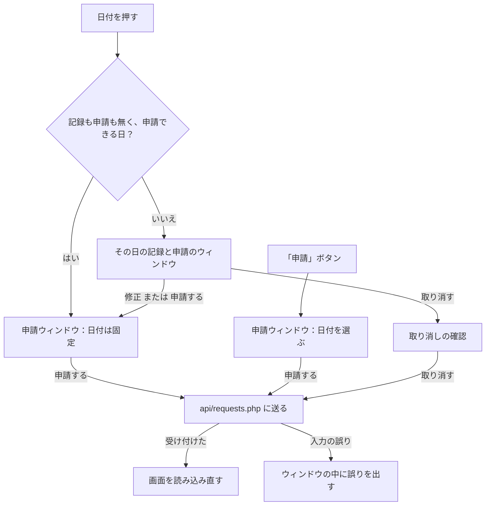

# `js/records.js` を読む（記録表示の JavaScript）

## このファイルの役割

記録表示の画面（`records/index.php`）で、**日付を押したときのウィンドウ**と、**修正・新規登録の申請**、**申請の取り消し**を動かすファイル。社員の勤怠の詳細（`members/detail.php`。PR 10）でも使い、そこでは**日付を押したときのウィンドウだけ**を動かす（見るだけ。7章の最後）。

- 表示する値（時刻・労働時間・申請の一覧など）は、サーバーが画面に埋め込んだもの（`#calendar` の `data-days`）を使う。JavaScript で計算したり、サーバーに問い合わせたりしない。
- 申請と取り消しは、`fetch()` で `api/requests.php` に送る。入力の誤りはウィンドウの中に出し、受け付けられたら画面を読み込み直す。
- ウィンドウの HTML（`<dialog>`）は、その日の記録のウィンドウを `templates/calendar.php`（カレンダーの部品）が、申請ウィンドウと取り消しの確認を `records/index.php` が用意している。このファイルは、中身を入れて、開いたり閉じたりするだけ。

## 全体の構成

| 行のあたり | 中身 |
| --- | --- |
| 先頭 | 部品を探す、`data-days` を読む、ウィンドウの外を押したら閉じる |
| 通知 | 通知（トースト）を5秒で消す |
| その日の記録と申請 | `requestItem()`（申請1件の表示）、`openDay()`（その日のウィンドウ）、日付を押したとき |
| 見るだけなら終わり | `data-readonly` のとき、ここで `return`（下の2つを用意しない） |
| 申請ウィンドウ | `clearErrors()`・`showErrors()`・`fillValues()`・`openRequest()`、申請を送る |
| 申請の取り消し | `openCancel()`・`showCancelError()`、取り消しを送る |

画面の動きを先に示す。



---

## 1. 全体を包む書き方

```js
(() => {
    'use strict';
    …
})();
```

- `(() => { … })();` は、**作ってすぐ呼ぶ関数**（即時実行関数）。中で作った変数（`days`・`form` など）は、この関数の中だけで使える。ほかのファイル（`js/menu.js` など）の変数と名前がぶつからない。
- `'use strict';`：厳格モード。宣言していない変数に代入するなど、間違いやすい書き方をエラーにしてくれる。

## 2. 準備：部品を探して、`data-days` を読む

```js
    const calendar = document.getElementById('calendar');
    const dayDialog = document.getElementById('day-dialog');
    const requestDialog = document.getElementById('request-dialog');
    const readOnly = calendar?.dataset.readonly === 'true';
    if (!calendar || !dayDialog || (!readOnly && !requestDialog)) {
        return;
    }
    const days = JSON.parse(calendar.dataset.days);
```

- `readOnly`：見るだけの画面か。社員の勤怠の詳細では、`templates/calendar.php` が `#calendar` に `data-readonly="true"` を付ける。記録表示には付かないので `undefined` になり、`=== 'true'` は `false`。
- `calendar?.dataset`：`?.`（オプショナルチェーン）。`calendar` が `null`（カレンダーが無い画面）なら、エラーにせず `undefined` を返す。次の行で `!calendar` を確かめる前に読むので、`?.` が要る。
- 必要な部品が無ければ、何もせずに終わる（早期リターン）。部品が無いまま進むと、`null.dataset` を読んでエラーになる。申請ウィンドウ（`#request-dialog`）は、見るだけの画面には無いので、**見るだけでないときだけ**必ず要る、という条件にしている（`!readOnly && !requestDialog`）。
- `calendar.dataset.days`：HTML の `data-days="…"` の値。`dataset` は `data-` 属性をまとめたもので、`data-api-url` は `dataset.apiUrl`、`data-csrf-token` は `dataset.csrfToken` のように、`-` のあとが大文字の名前になる。
- `JSON.parse()`：JSON の文字列を、JavaScript のオブジェクトにする。`days['2026-09-01']` で、その日の値（`label`・`checkIn`・`requests` など）が取り出せる。中身は `src/records.php` の `calendarDays()` が作った `$days`（[src_records.md](./src_records.md) の6章）。

```js
    const form = document.getElementById('request-form');
    const dateInput = document.getElementById('request-date');
    const submitButton = document.getElementById('request-submit');
    const timeNames = ['check_in', 'check_out', 'break_start', 'break_end'];
    const errorNames = ['form', 'target_date', ...timeNames, 'reason'];
    const element = (id) => document.getElementById(id);
    let currentDate = null;
```

- 見るだけの画面では、申請のフォーム（`request-form` など）が無いので、`form`・`dateInput`・`submitButton` は `null` になる。でも、これらを使うのは下の「申請ウィンドウ」の部分だけで、見るだけのときはそこまで進まない（7章の最後）ので、エラーにならない。
- `timeNames`：4つの時刻の欄の名前。サーバーに送る項目の名前と同じ。
- `...timeNames`：**スプレッド構文**。配列の中身を、その場に広げる。`errorNames` は `['form', 'target_date', 'check_in', 'check_out', 'break_start', 'break_end', 'reason']` になる。エラーを出す場所（`request-error-○○`）の一覧。
- `element`：`document.getElementById` を短く書くための関数（アロー関数）。何度も使うので、名前を短くしている。
- `currentDate`：今、どの日のウィンドウを開いているか。あとで「修正」や「取り消す」を押したときに使う。`let` は、あとで値を変える変数。

## 3. ウィンドウの外を押したら閉じる

```js
    [dayDialog, requestDialog].filter(Boolean).forEach((dialog) => {
        dialog.addEventListener('click', (event) => {
            if (event.target === dialog) {
                dialog.close();
            }
        });
    });
```

- 2つのウィンドウに、同じ処理を付ける。配列にして `forEach` で回すと、同じコードを2回書かなくてよい。
- `.filter(Boolean)`：配列から、`null` などの「無いもの」を取り除く。`Boolean` を関数として渡すと、1つずつ `Boolean(値)` で `true`／`false` にし、`true` のものだけが残る。見るだけの画面では `requestDialog` が `null` なので、`[dayDialog]` だけになる（`null.addEventListener` のエラーを防ぐ）。
- `event.target`：実際に押された部品。ウィンドウの外の暗い部分（`::backdrop`）を押すと、`event.target` は `<dialog>` そのものになる。中の文字やボタンを押したときは、その部品になる。
- CSS で `<dialog>` の余白（`padding`）を 0 にして、中身は `.dialog__body` に入れているので、「`<dialog>` そのものが押された」＝「外の暗い部分が押された」と判断できる。

## 4. 通知を5秒で消す

```js
    const toast = element('toast');
    if (toast && !toast.hidden) {
        setTimeout(() => {
            toast.hidden = true;
        }, 5000);
    }
```

- 通知（例：「申請を受け付けました。…」）が出ていれば、`setTimeout()` で 5000 ミリ秒（5秒）後に隠す。
- 通知の文は PHP が出している（`takeFlash()`）。JavaScript は消すだけ。

## 5. `requestItem()`：申請1件の表示を作る

```js
    function requestItem(request) {
        const item = document.createElement('li');
        item.className = 'request-item';

        const head = document.createElement('div');
        head.className = 'request-item__head';
        const type = document.createElement('span');
        type.className = 'request-item__type';
        type.textContent = request.type;
        …
        head.append(type, badge, created);
        item.append(head);
```

- `request` は、`src/requests.php` の `requestView()` が作った形（`type`・`status`・`statusLabel`・`createdAt`・`changes`・`reason`・`reviewComment`・`canCancel`・`id`）。
- `document.createElement('li')` で部品を作り、`className` でクラスを付け、`textContent` で文字を入れ、`append()` で中に入れる。種別（修正／新規登録／残業）、状態のバッジ、申請した日時を1行に並べる。

```js
        const changes = document.createElement('ul');
        changes.className = 'request-item__changes';
        request.changes.forEach((change) => {
            const line = document.createElement('li');
            line.textContent = `${change.label}　${change.before} → ${change.after}`;
            changes.append(line);
        });
        item.append(changes);
```

- 変わった項目だけを「退勤　17:30 → 18:45」の形で並べる。どの項目が変わったかは、サーバー（`requestChanges()`）が決めている。
- `` `…${式}…` ``：**テンプレートリテラル**。文字列の中に、値を埋め込める。

```js
        [['理由', request.reason], ['却下コメント', request.reviewComment]].forEach(([label, text]) => {
            if (text !== '') {
                const note = document.createElement('p');
                note.className = 'request-item__note';
                note.textContent = `${label}：${text}`;
                item.append(note);
            }
        });
```

- 理由と却下コメントは、同じ形で出すので、`[名前, 文]` の組の配列にして回している。
- `([label, text]) => …`：引数の**分割代入**。組の1つ目を `label`、2つ目を `text` で受け取る。
- 文が空（`''`）なら出さない。サーバーは、理由やコメントが無いとき `''` を送る。

> **ここが重要**：理由や却下コメントは、**人が自由に書いた文**。`innerHTML` で HTML として入れると、`<script>` や `` を書かれたときに、そのまま動いてしまう（XSS）。このファイルは、文字を入れるときは必ず **`textContent`** を使う。`textContent` は、どんな文字も「ただの文字」として表示するので安全。PHP の `h()` と同じ役目を、JavaScript では `textContent` が果たす。

```js
        // 申請中の申請は、取り消せる（D-063）
        if (request.canCancel) {
            const cancel = document.createElement('button');
            cancel.type = 'button';
            cancel.className = 'button button--outline request-item__cancel';
            cancel.textContent = '取り消す';
            cancel.addEventListener('click', () => openCancel(request));
            item.append(cancel);
        }
        return item;
    }
```

- 申請中の申請には「取り消す」ボタンを付ける。押すと `openCancel(request)` を呼ぶ。
- `() => openCancel(request)` の中の `request` は、**この申請1件**を指したまま覚えられている（クロージャ）。一覧に3件あれば、3つのボタンがそれぞれ自分の申請を覚えているので、押したボタンの申請が取り消しの対象になる。

## 6. `openDay()`：その日の記録と申請のウィンドウを開く

```js
    function openDay(date) {
        const day = days[date];
        currentDate = date;
        element('day-title').textContent = day.label;
        const holiday = element('day-holiday');
        holiday.textContent = day.holiday;
        holiday.hidden = day.holiday === '';
        element('day-detail').hidden = !day.hasRecord;
        element('day-empty').hidden = day.hasRecord;
        element('day-check-in').textContent = day.checkIn;
        element('day-check-out').textContent = day.checkOut;
        element('day-break').textContent = day.break;
        element('day-work-time').textContent = day.workTime;
```

- その日の値を、ウィンドウの空の欄に入れていく。
- `hidden` に `true`／`false` を入れて、出す・隠すを切り替える。記録がある日は時刻の一覧、無い日は「記録はありません。」を出す（どちらか一方）。
- 祝日でなければ、祝日名の行を隠す。

```js
        const items = element('day-request-items');
        items.replaceChildren(...day.requests.map(requestItem));
        element('day-requests').hidden = day.requests.length === 0;
        element('day-pending').hidden = !day.pendingCorrection;
```

- `day.requests.map(requestItem)`：申請の配列の1件ずつに `requestItem()` を当てて、`<li>` の配列を作る。
- `replaceChildren(...配列)`：中身を**全部入れ替える**。前に開いた日の一覧が残らない。スプレッド構文で、配列を1つずつの引数にして渡している。
- 申請中の修正・新規登録があれば、「申請中のため、新しい申請はできません。…」の案内を出す。

```js
        // 記録がある日は「修正」、無い日は「申請する」（申請中・未来の日・入社前は出さない）
        const requestButton = element('day-request');
        requestButton.hidden = !day.canRequest;
        requestButton.textContent = day.hasRecord ? '修正' : '申請する';
        dayDialog.showModal();
    }
```

- 申請できるかは、サーバーが決めた `canRequest` に従う。JavaScript では判断しない。
- ボタンの名前は、記録があれば「修正」、無ければ「申請する」（D-051 ①②）。種別の名前（新規登録）は出さない。
- `showModal()`：ウィンドウを開く。後ろの画面は押せなくなる。

## 7. 日付を押したとき

```js
    calendar.addEventListener('click', (event) => {
        const button = event.target.closest('[data-date]');
        if (!button) {
            return;
        }
        const day = days[button.dataset.date];
        // 記録も申請も無い日は、そのまま空の申請ウィンドウを開く（D-051 ②）
        if (!day.hasRecord && day.requests.length === 0 && day.canRequest) {
            openRequest(button.dataset.date, true);
        } else {
            openDay(button.dataset.date);
        }
    });
```

- 日付のボタンは1か月で約30個あるが、イベントは**カレンダー全体に1つだけ**付けている（イベントの委任）。押された部品から `closest('[data-date]')` で「`data-date` を持つ一番近い親（自分も含む）」を探し、どの日が押されたかを知る。
  - 日付のボタンの中の文字（時刻やバッジの `<span>`）を押しても、`closest()` で外側のボタンが見つかる。
  - 曜日の見出しや空のマスを押したときは見つからない（`null`）ので、何もしない。
- 記録も申請も無く、申請できる日なら、間のウィンドウを飛ばして、**すぐに申請ウィンドウを開く**（打刻を忘れた日に、すぐ入力できる）。それ以外は、その日のウィンドウを開く。

> **ここが重要**：ボタン1つずつに `addEventListener` するより、親に1つだけ付けるほうが、コードが短く、付け忘れも起きない。あとからボタンが増えても、そのまま動く。表のような「同じ部品がたくさん並ぶ」画面では、よく使う書き方。

```js
    element('day-request').addEventListener('click', () => {
        dayDialog.close();
        openRequest(currentDate, true);
    });
```

- その日のウィンドウの「修正」「申請する」を押したら、ウィンドウを閉じて、申請ウィンドウを開く。どの日かは `currentDate`（`openDay()` で覚えた日）で分かる。

### 見るだけの画面では、ここで終わる（社員の勤怠の詳細。D-070）

```js
    // 見るだけの画面には、申請ウィンドウと取り消しの確認が無い（その日の記録と申請の表示だけ）
    if (readOnly) {
        return;
    }
```

- 見るだけのときは、ここで関数を抜ける。この下の「申請ウィンドウ」（8〜11章）と「申請の取り消し」（12章）の処理は、**用意しない**（ボタンにイベントを付けない）。その画面には、申請のフォームも取り消しの確認も無いので、用意しようとすると `null` に `addEventListener` してエラーになる。
- ここまでの処理（日付を押したときの `openDay()` など）は、記録表示と同じものが動く。ボタンを出すかどうかは、サーバーが渡した値で決まる。見るだけの画面では `calendarDays($calendar, true)` が `canRequest`・`pendingCorrection`・`canCancel` を全部 `false` にしているので（[src_records.md](./src_records.md) の6章）：
  - 「修正」「申請する」のボタン（`day-request`）は、いつも隠れる。
  - 申請中の案内（`day-pending`）は出ない。申請の一覧の「取り消す」ボタンも作られない（`requestItem()` の `if (request.canCancel)`）。
  - 記録も申請も無い日を押したときも、`day.canRequest` が `false` なので申請ウィンドウは開かず、`openDay()` で「記録はありません。」のウィンドウが出る。
- 下にある `openRequest()`・`openCancel()` などは `function` で書いた関数（関数宣言）なので、`return` より下にあっても、関数の中のどこからでも呼べる（巻き上げ）。ただ、見るだけの画面では、それらを呼ぶボタンが出ないので、呼ばれることはない。

> **ここが重要**：見るだけの画面のために、ファイルを2つに分けたり、あちこちに `if (readOnly)` を書いたりしていない。**値（`canRequest` など）で表示を決める作り**にしておいたので、サーバーが `false` を渡すだけで、ほとんどのボタンが自然に消える。JavaScript で足したのは、「無い部品に触らない」ための入口の条件と、この `return` だけ。

## 8. 誤りの表示：`clearErrors()`・`showErrors()`

```js
    function clearErrors() {
        errorNames.forEach((name) => {
            const error = element(`request-error-${name}`);
            error.hidden = true;
            error.textContent = '';
        });
        form.querySelectorAll('[aria-invalid]').forEach((input) => input.removeAttribute('aria-invalid'));
    }
```

- エラーを出す場所を全部空にして隠し、入力欄の `aria-invalid`（「この欄は誤り」という印）を外す。

```js
    function showErrors(errors) {
        clearErrors();
        let first = null;
        Object.entries(errors).forEach(([name, message]) => {
            const error = element(`request-error-${name}`) ?? element('request-error-form');
            error.textContent = message;
            error.hidden = false;
            const input = form.elements[name];
            if (input) {
                input.setAttribute('aria-invalid', 'true');
                first ??= input;
            }
        });
        if (first) {
            first.focus();
        }
    }
```

- `errors` は、サーバーが返す「項目の名前 → 文」の形（例：`{ check_in: '出勤時刻を入力してください。' }`）。
- `Object.entries(errors)`：オブジェクトを `[キー, 値]` の組の配列にする。`forEach` で1組ずつ扱える。
- `element(…) ?? element('request-error-form')`：`??` は「左が `null`（か `undefined`）なら右」。項目に合う場所が無いエラーは、フォーム全体のエラーの場所に出す。知らない名前のエラーが来ても、どこにも出ずに消えることはない。
- `form.elements[name]`：フォームの中で、その `name` を持つ入力欄。`form` のように欄が無い名前なら `undefined`。
- `first ??= input`：`??=` は「左が `null` なら、右を入れる」。**最初に見つかった誤りの欄**だけを `first` に覚えて、最後にそこへカーソルを移す（`focus()`）。

## 9. `fillValues()`：対象日の今の値を入れる

```js
    function fillValues(date) {
        const day = days[date];
        timeNames.forEach((name) => {
            form.elements[name].value = day ? day.values[name] : '';
        });
        clearErrors();
        const pending = Boolean(day && day.pendingCorrection);
        submitButton.disabled = pending;
        if (pending) {
            showErrors({ form: '申請中のため、新しい申請はできません。新しく申請する場合は、申請中の申請を取り消してください。' });
        }
    }
```

- 4つの時刻の欄に、その日の今の値（`values`。記録が無い時刻は空欄）を入れる。申請ウィンドウは「今の値が入った状態」で開き、変えたい所だけ書き換える（D-062）。
- 申請中の修正・新規登録がある日は、「申請する」ボタンを押せなくし、理由をエラーの場所に出す。「申請」ボタンから日付を選んだとき、申請中の日を選ぶことがあるため。
- `Boolean(…)`：値を `true`／`false` にする。`day` が無いとき（`undefined`）も `false` になる。

## 10. `openRequest()`：申請ウィンドウを開く

```js
    // fixedDate が true なら対象日を固定（カレンダーから開いたとき）。false なら対象日を選ぶ（「申請」ボタン）
    function openRequest(date, fixedDate) {
        form.reset();
        dateInput.value = date ?? '';
        dateInput.readOnly = fixedDate;
```

- `form.reset()`：フォームを最初の状態に戻す。前に入力した理由などが残らない。
- 日付から開いたときは、対象日を入れて**書き換えられなく**する（`readOnly`）。「申請」ボタンから開いたとき（`date` が `null`）は空にして、選べるようにする。

> **ここが重要**：書き換えられなくするのに、`disabled` ではなく **`readOnly`** を使っている。`disabled` の欄は、フォームを送るときに**値が送られない**（`FormData` にも入らない）。`readOnly` なら、書き換えはできないが、値はちゃんと送られる。対象日はサーバーに必ず送りたい値なので、`readOnly` が正しい。

```js
        // カレンダーから開いたときは、その日（と祝日名）を出す（スマホではカレンダーに祝日名が出ないため）
        const dayLabel = element('request-day');
        dayLabel.textContent = date ? [days[date].label, days[date].holiday].filter(Boolean).join('　') : '';
        dayLabel.hidden = !date;
```

- `[ラベル, 祝日名].filter(Boolean)`：空の文字（`''`）を取り除く。祝日でない日は祝日名が `''` なので、ラベルだけが残る。`join('　')` で全角の空白でつなぐ。例：`9月21日（月）　敬老の日`。

```js
        submitButton.disabled = false;
        if (date) {
            fillValues(date);
        } else {
            clearErrors();
        }
        requestDialog.showModal();
        (fixedDate ? form.elements.check_in : dateInput).focus();
    }
```

- 日付が決まっていれば、今の値を入れる（`fillValues()`）。
- 開いたら、最初に入力する欄にカーソルを置く。日付が固定なら出勤時刻、そうでなければ対象日。

```js
    dateInput.addEventListener('change', () => {
        if (!dateInput.readOnly && days[dateInput.value]) {
            fillValues(dateInput.value);
        }
    });
```

- 「申請」ボタンから開いて対象日を選んだら、その日の今の値を入れる。`days` にある日（表示中の月の日）だけ。

```js
    const openButton = element('request-open');
    if (openButton) {
        openButton.addEventListener('click', () => openRequest(null, false));
    }
    element('request-cancel').addEventListener('click', () => requestDialog.close());
```

- 「申請」ボタンは、選べる日が無い月には PHP が出さない。そのため、**ボタンが無いことがある**ので `if (openButton)` で確かめる。

## 11. 申請を送る

```js
    form.addEventListener('submit', async (event) => {
        event.preventDefault();
        submitButton.disabled = true;
        const body = new FormData(form);
        body.append('csrf_token', calendar.dataset.csrfToken);
        body.append('type', 'correction');
```

- `event.preventDefault()`：フォームのふつうの送信（画面の移動）を止める。代わりに `fetch()` で送る。
- 送る前に「申請する」ボタンを押せなくする。続けて2回押されても、2回送らない（二重送信の防止）。
- `new FormData(form)`：フォームの入力欄の値（`target_date`・`check_in`・…・`reason`）を、まとめて送れる形にする。そこに CSRF トークンと、申請の種類（`type=correction`）を足す。

```js
        let data = null;
        try {
            const response = await fetch(calendar.dataset.apiUrl, {
                method: 'POST',
                body,
                credentials: 'same-origin',
                headers: { Accept: 'application/json' },
            });
```

- `async`／`await`：`fetch()` の答えが返るまで待ってから、次の行に進む。待っている間も、画面は固まらない。
- `body,`：`body: body,` の短い書き方（名前と変数が同じとき）。
- `credentials: 'same-origin'`：同じサイトへの送信では、Cookie（ログイン状態）を付ける。
- `Accept: 'application/json'`：答えは JSON がほしい、と伝える。

```js
            if (response.status === 401) {
                window.location.href = calendar.dataset.loginUrl;
                return;
            }
            data = await response.json().catch(() => null);
            if (!response.ok || data === null) {
                showErrors({ form: data?.message ?? 'エラーが発生しました。画面を読み込み直して、もう一度お試しください。' });
                submitButton.disabled = false;
                return;
            }
        } catch (error) {
            showErrors({ form: '通信できませんでした。接続を確かめて、もう一度お試しください。' });
            submitButton.disabled = false;
            return;
        }
```

答えの場合分け：

| 答え | 起きる場面 | 動き |
| --- | --- | --- |
| 401 | 長く操作しなかったなどで、ログインが切れた | ログイン画面へ移る |
| 200 以外で、JSON の `message` がある | システム管理者が送った（403）、`type` が正しくない（400）など | その `message` を、フォームのエラーの場所に出す |
| JSON として読めない | CSRF トークンが正しくない（400 で、答えが文字だけ）、サーバーの障害など | 決まった文（「エラーが発生しました。…」）を出す |
| 通信できない | ネットが切れた | `catch` で「通信できませんでした。…」を出す |
| 200 で `ok: false` | 入力の誤り | 下で、欄ごとに誤りを出す |
| 200 で `ok: true` | 受け付けた | 下で、画面を読み込み直す |

- `response.json().catch(() => null)`：JSON として読めなければ、エラーにせず `null` にする。例えば CSRF トークンが正しくないとき、サーバー（`requireValidCsrfToken()`）は文字だけ（JSON でない）で 400 を返すので、ここで `null` になり、決まった文を出す。
- `data?.message`：`?.`（オプショナルチェーン）は、`data` が `null` なら、エラーにせず `undefined` を返す。それを `??` で決まった文に置き換える。
- エラーのときは、ボタンをまた押せるようにしてから終わる。押せないままだと、直して送り直すことができない。

```js
        if (data.ok) {
            // 受け付けられたら、読み込み直してバッジと通知を出す
            window.location.reload();
            return;
        }
        showErrors(data.errors);
        submitButton.disabled = false;
    });
```

- 受け付けられたら、画面を**読み込み直す**。サーバーは通知の文を残している（`setFlash()`）ので、読み込み直した画面に「申請を受け付けました。…」が出て、カレンダーにも「申請中」のバッジが付く。
- 入力の誤りなら、`data.errors` を欄ごとに出す（`showErrors()`）。

> **ここが重要**：受け付けたあと、JavaScript でバッジや一覧を書き換えることもできるが、ここでは**読み込み直す**。カレンダーの表示は PHP（`buildCalendar()`）が作るので、読み込み直せば、DB の本当の状態から作り直される。表示を作る場所が PHP の1か所だけで済み、JavaScript とずれる心配が無い。

## 12. 申請の取り消し（D-063）

```js
    const cancelDialog = element('cancel-dialog');
    const cancelSubmit = element('cancel-submit');
    let cancelTarget = null;

    function openCancel(request) {
        cancelTarget = request;
        element('cancel-text').textContent = `${days[currentDate].label}の${request.type}の申請を取り消します。取り消した申請は、元に戻せません。`;
        element('cancel-error').hidden = true;
        cancelSubmit.disabled = false;
        dayDialog.close();
        cancelDialog.showModal();
    }
```

- `cancelTarget`：取り消す申請を覚えておく。確認のウィンドウで「取り消す」を押したときに使う。
- 確認の文は、例えば「9月1日（火）の修正の申請を取り消します。取り消した申請は、元に戻せません。」になる。
- その日のウィンドウを閉じてから、確認のウィンドウを開く。

> **ここが重要**：`openCancel()` は、上の `requestItem()` の中で使われているが、定義はそれより下にある。`function` で宣言した関数は、同じ関数（ここでは全体を包む即時実行関数）の中なら、**どこからでも呼べる**（巻き上げ）。しかも `openCancel()` が実際に呼ばれるのは「取り消す」を押したときで、そのときにはファイルの最後まで実行が済み、`cancelDialog` なども用意できている。`const` の変数は、宣言の行より前に使うとエラーになるので、「押したときに呼ばれる」からこそ、この順番で書ける。

```js
    element('cancel-back').addEventListener('click', () => cancelDialog.close());
    cancelDialog.addEventListener('click', (event) => {
        if (event.target === cancelDialog) {
            cancelDialog.close();
        }
    });

    function showCancelError(message) {
        const error = element('cancel-error');
        error.textContent = message;
        error.hidden = false;
        cancelSubmit.disabled = false;
    }
```

- 「戻る」とウィンドウの外で閉じる（3章と同じ考え方）。
- `showCancelError()`：誤りを出して、「取り消す」ボタンをまた押せるようにする。

```js
    cancelSubmit.addEventListener('click', async () => {
        cancelSubmit.disabled = true;
        const body = new FormData();
        body.append('csrf_token', calendar.dataset.csrfToken);
        body.append('type', 'cancel');
        body.append('request_id', String(cancelTarget.id));
        try {
            const response = await fetch(calendar.dataset.apiUrl, { … });
            if (response.status === 401) {
                window.location.href = calendar.dataset.loginUrl;
                return;
            }
            const data = await response.json().catch(() => null);
            if (!response.ok || data === null) {
                showCancelError(data?.message ?? 'エラーが発生しました。画面を読み込み直して、もう一度お試しください。');
                return;
            }
            if (data.ok) {
                window.location.reload();
                return;
            }
            showCancelError(data.errors.form);
        } catch (error) {
            showCancelError('通信できませんでした。接続を確かめて、もう一度お試しください。');
        }
    });
```

- 流れは申請と同じ。フォームが無いので、`new FormData()` を空で作り、CSRF トークン・`type=cancel`・申請の番号（`request_id`）を足す。`String()` で番号を文字列にしている（`FormData` の値は文字列で送られる）。
- 取り消せなかったとき（すでに承認・却下された、など）は、サーバーが `errors.form` に理由を入れて返すので、それを出す。

> **ここが重要**：送る `request_id` は、画面の値なので、書き換えて**ほかの人の申請の番号**を送ることもできてしまう。そこでサーバーは、削除の SQL に「本人の申請」で「申請中」という条件を付けている（`deletePendingRequest()`）。画面から来た番号を信用せず、サーバーで「消してよい申請か」を確かめるのが大事。

---

## まとめ：このファイルから学べること

| 書き方 | このファイルでの例 |
| --- | --- |
| 変数を外に漏らさない | 即時実行関数 `(() => { … })();` と `'use strict'` |
| 表示する値はサーバーから受け取る | `data-days` を `JSON.parse()`。JavaScript で計算しない |
| 人が書いた文は `textContent` で | 理由・却下コメントを安全に出す（XSS 対策） |
| イベントは親に1つ | カレンダー全体の `click` と `closest('[data-date]')` |
| 送られない `disabled`、送られる `readOnly` | 対象日を固定するのは `readOnly` |
| 二重送信を防ぐ | 送る前にボタンを `disabled`、エラーなら戻す |
| 失敗の種類ごとに扱いを分ける | 401／200 以外／JSON でない／通信できない／入力の誤り |
| 受け付けたら読み込み直す | 表示を作るのは PHP の1か所だけ |
| 画面の値はサーバーで確かめ直す | 取り消しの番号は、本人・申請中の条件で守る |
| 新しい書き方で短く | `??`・`??=`・`?.`・スプレッド構文・分割代入・テンプレートリテラル |
| 1つのファイルを、値で出し分けて使い回す | 見るだけの画面は `data-readonly` で、日付のウィンドウだけを動かす |
| 無いかもしれない部品は取り除いてから回す | `[dayDialog, requestDialog].filter(Boolean)` |

## 関連するファイル

- 画面の HTML：`records/index.php` → [records_index.md](./records_index.md)、カレンダーとその日の記録のウィンドウ・`data-days`・`data-readonly`：`templates/calendar.php` → [templates.md](./templates.md)
- 見るだけで使う画面：`members/detail.php`（社員の勤怠の詳細） → [members.md](./members.md)
- セルの値を作る：`src/records.php`（`buildCalendar()`・`calendarDays()`） → [src_records.md](./src_records.md)
- 申請の表示の形（`requestView()`）と入力のルール：`src/requests.php` → [src_requests.md](./src_requests.md)
- 送り先：`api/requests.php` → [api_requests.md](./api_requests.md)
- 取り消しの SQL（`deletePendingRequest()`）：`src/queries/attendance_requests.php` → [src_queries_attendance_requests.md](./src_queries_attendance_requests.md)
- メイン画面の JavaScript（同じ考え方の `fetch()`）：`js/main.js` → [js_main.md](./js_main.md)
