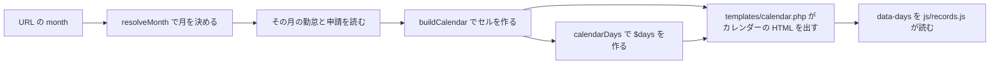

# `records/index.php` を読む（記録表示の画面）

## このファイルの役割

自分の勤怠を**1か月のカレンダー**で見せる画面。日付を押すと、その日の記録と申請を表示し、そこから修正・新規登録の申請もできる（申請の動きは `js/records.js`）。

- 計算（表示する月・労働時間・カレンダーのセル）は `src/records.php` に任せる。このファイルは「値を集めて、HTML に並べる」だけ。
- 日付を押したときに見せる値は、ページを作るときに JSON にして HTML に埋め込んでおく。JavaScript はそれを読んで表示するだけで、サーバーに問い合わせない。
- 申請と取り消しは、JavaScript が `api/requests.php` に送る。このファイルは、そのためのウィンドウ（`<dialog>`）の HTML を用意しておく。
- 月の切り替え・集計・カレンダー・その日の記録のウィンドウの HTML は、部品 `templates/calendar.php` にある。PR 10 で、社員の勤怠の詳細（`members/detail.php`）と共有するために、このファイルから移した（[templates.md](./templates.md) の4章）。このファイルは、部品が使う変数を用意してから読み込む。

## 全体の構成

| 行のあたり | 中身 |
| --- | --- |
| 先頭（4〜8行） | 使うファイルの読み込み |
| 10〜14行 | ログインと権限の確認 |
| 16〜22行 | 表示する月を決め、勤怠・申請・勤務設定を読み、カレンダーを組み立てる |
| 24〜25行 | JavaScript に渡す「日ごとの値」（`$days`）を作る（`calendarDays()`） |
| 27〜29行 | 「申請」ボタンで選べる日の範囲 |
| 34〜39行 | HTML：通知 |
| 41〜46行 | カレンダーの部品（`templates/calendar.php`）を読み込む：月の切り替え・集計・カレンダー・その日の記録のウィンドウ |
| 48〜92行 | HTML：2つのウィンドウ（取り消しの確認／申請） |
| 最後 | `js/records.js` の読み込み |

前半の PHP で**値を全部そろえてから**、後半で HTML を出す。HTML の途中で DB を読んだり計算したりしない。

データの流れを先に示す。



---

## 1. 使うファイルの読み込み

```php
include_once(__DIR__ . '/../src/functions.php');
include_once(__DIR__ . '/../src/dbconnect.php');
include_once(__DIR__ . '/../src/auth.php');
include_once(__DIR__ . '/../src/queries/work_settings.php');
include_once(__DIR__ . '/../src/records.php');
```

- `__DIR__` は「このファイルがあるフォルダ」（`records/`）。`/../src/…` で1つ上の `src/` を指す。どこから実行されても、同じファイルを読める。
- `include_once` は、同じファイルを2回読まない。`src/records.php` の中でも `src/attendance.php` などを読んでいるので、重なっても関数の二重定義のエラーにならない。
- `src/records.php` が、`holidays.php`・`attendance.php`・`requests.php` をまとめて読み込む。勤怠と申請を読む関数（`fetchMonthlyAttendances()`・`fetchMonthlyRequests()`）も、そこから読み込まれる。

## 2. ログインと権限の確認

```php
$currentUser = requireLogin($pdo);
requireRole($currentUser, [ROLE_EMPLOYEE, ROLE_MANAGER]);
if ($currentUser['joined_on'] === null) {
    throw new RuntimeException('入社日を取得できません: ' . $currentUser['employee_id']);
}
```

- `requireLogin()`：ログインしていなければログイン画面へ移す。ログイン中なら、利用者の情報（社員番号・権限・入社日など）を配列で返す。
- `requireRole()`：社員か管理者でなければ 403 で止める。システム管理者は社員ではない（勤怠が無い）ので、この画面は使えない。
- 入社日（`joined_on`）が `null` なら例外にする。社員・管理者なら入社日はあるはずで、無ければデータの誤り。入社日は、月の範囲と「申請できる日」を決めるのに使う。

> **ここが重要**：「起こらないはずのこと」が起きたとき、黙って進めずに**例外で止める**。`null` のまま進めると、`resolveMonth()` に `null` を渡して型のエラーになったり、変な月を表示したりして、原因が分かりにくくなる。止めておけば、すぐに原因（入社日が無い）が分かる。

## 3. 表示する月を決めて、データを集める

```php
$today = date('Y-m-d');
$requested = isset($_GET['month']) && is_string($_GET['month']) ? $_GET['month'] : null;
$month = resolveMonth($requested, $today, $currentUser['joined_on']);
$attendances = fetchMonthlyAttendances($pdo, $currentUser['employee_id'], $month['first'], $month['last']);
$requests = fetchMonthlyRequests($pdo, $currentUser['employee_id'], $month['first'], $month['last']);
$calendar = buildCalendar($month, $attendances, fetchWorkSettings($pdo), $today, $requests, $currentUser['joined_on']);
$flash = takeFlash();
```

- URL の `?month=2026-09` を受け取る。指定が無ければ `null`。
- **`is_string()` で確かめている**のがポイント。`?month[]=x` のように送られると、`$_GET['month']` は配列になる。そのまま `resolveMonth(?string …)` に渡すと型のエラーになるので、文字列のときだけ受け取る。
- `resolveMonth()`（`src/records.php`）：受け取った値が正しい形で、表示してよい範囲（入社した月〜今月）にあるときだけ、その月にする。それ以外は今月。戻り値は `first`（月の初日）・`last`（末日）・`prev`／`next`（前後の月。行けなければ `null`）など。
- 勤怠と申請は、月の初日〜末日の分を**まとめて1回ずつ**読む。日ごとに SQL を流すと、1か月で約30回になってしまう。
- `fetchWorkSettings()`：勤務設定（昼休憩の時刻など）。労働時間の計算で使う。
- `buildCalendar()`：週ごとのセル、出勤日数、総労働時間を作る。
- `takeFlash()`：前の画面で残した通知（例：「申請を受け付けました。…」）を1回だけ取り出す。申請を送ったあと、JavaScript が画面を読み込み直すと、ここで通知が取り出されて表示される。

> **ここが重要**：URL の値は、利用者がいくらでも書き換えられる。このファイルでは `is_string()` で型を確かめ、`resolveMonth()` で「正しい形・正しい範囲だけ受け取り、ほかは今月」にしている。**受け取ってよい値を決めて、それ以外は捨てる**（ホワイトリスト）ので、入社前の月や未来の月をのぞくこともできない。

## 4. JavaScript に渡す「日ごとの値」を作る

```php
// 日付を押したときに表示する、その日の記録と申請（js/records.js が使う）
$days = calendarDays($calendar);
```

- `calendarDays()`（`src/records.php`）：カレンダーのセルから、JavaScript に要るキーだけを取り出し、日付（`'2026-09-01'`）をキーにした配列にする。JavaScript では `days['2026-09-01']` で、その日の値をすぐに取り出せる。
- PR 10 までは、この画面の中に `foreach` と `array_intersect_key()` で直接書いていた。社員の勤怠の詳細でも同じものが要るので、関数にして `src/records.php` へ移した（中身は [src_records.md](./src_records.md) の6章）。
- 2つ目の引数（見るだけか）を渡していないので、既定値の `false` になる。申請できる日・申請中の案内・取り消しのボタンは、今までどおり出る。

例えば、1日分は次のような形になる（記録がある日）。

```php
'2026-09-01' => [
    'label' => '9月1日（火）', 'holiday' => '', 'hasRecord' => true,
    'checkIn' => '09:00', 'checkOut' => '18:00', 'break' => '--:--', 'workTime' => '8時間00分',
    'values' => ['check_in' => '09:00', 'check_out' => '18:00', 'break_start' => '', 'break_end' => ''],
    'requests' => [], 'isFuture' => false, 'pendingCorrection' => false, 'canRequest' => true,
]
```

> **ここが重要**：セルには、HTML を作るためだけの値（`weekday`・`isRestDay`・`isToday`・`badge` など）も入っている。JavaScript に要らない値は、**渡す前に落とす**（`calendarDays()` の中の、キーの一覧）。HTML が小さくなるうえ、「JavaScript に何を渡しているか」が、その一覧を見れば分かる。（なお、一覧の `isFuture` は、今の `js/records.js` では使っていない。未来の日は `canRequest` が `false` になるので、それで足りている。）

## 5. 「申請」ボタンで選べる日

```php
$requestMin = max($month['first'], $currentUser['joined_on']);
$requestMax = min($month['last'], $today);
```

- 選べるのは「表示中の月の日」で、かつ「入社日から今日まで」の日（D-062）。2つの範囲の重なりを、`max`（遅いほうの始まり）と `min`（早いほうの終わり）で求めている。
- `'Y-m-d'` の文字列は、文字列の大小と日付の前後が一致するので、`max()`・`min()` でそのまま比べられる。
- 例：今日が 2026-10-15、入社日が 2025-04-01 で、10月を表示しているとき → `2026-10-01`〜`2026-10-15`。
- この2つの値は、カレンダーの部品で「申請」ボタンを出すかどうかと、下の申請ウィンドウの日付の入力欄の `min`・`max` に使う。

---

ここから HTML。

## 6. 通知（トースト）

```php
    <?php if ($flash !== null): ?>
        <div class="toast" id="toast" role="status" aria-live="polite"><?= h($flash) ?></div>
    <?php else: ?>
        <div class="toast" id="toast" role="status" aria-live="polite" hidden></div>
    <?php endif; ?>
```

- `if (…): ?> … <?php endif;` は、HTML の中で使いやすい `if` の書き方（`{ }` の代わりに `:` と `endif`）。`foreach` にも同じ形（`endforeach`）がある。
- 通知があれば表示し、無ければ `hidden` で隠した空の箱を置く。表示した通知は、`js/records.js` が5秒後に隠す。
- `role="status"`・`aria-live="polite"`：画面読み上げソフトに、「ここに出た文を読み上げる」と伝える。
- `<?= h($flash) ?>`：`<?= … ?>` は `<?php echo … ?>` の短い形。**画面に出す値は、必ず `h()` を通す**（`htmlspecialchars()` で `<` などを無害な文字に変える。XSS 対策）。

## 7. カレンダーの部品を読み込む

```php
    <?php
    $monthQuery = '?';
    $monthHeading = 'h1';
    $readOnly = false;
    include(__DIR__ . '/../templates/calendar.php');
    ?>
```

- `templates/calendar.php` は、`include` した画面の変数をそのまま使う部品（`templates/header.php` と同じ受け渡しのしかた）。読み込む前に、部品が使う変数を用意しておく。

| 変数 | この画面の値 | 意味 |
| --- | --- | --- |
| `$month`・`$calendar`・`$days` | 3章・4章で作った値 | 表示する月、カレンダーのセル、日ごとの値 |
| `$monthQuery` | `'?'` | 月の切り替えのリンクの、`month=` より前の部分。前の月のリンクは `?month=2026-08` になる（社員の勤怠の詳細は `'?id=2025001&'`） |
| `$monthHeading` | `'h1'` | 月の見出し（「2026年10月」）のタグ。この画面では月がいちばん大きい見出しなので `<h1>` |
| `$readOnly` | `false` | 見るだけではない。「申請」ボタン、申請の API の URL・CSRF トークンを出す |
| `$requestMin`・`$requestMax` | 5章の値 | 「申請」ボタンを出すか（選べる日が1日でもあるか） |

- 部品が出すもの：月の切り替えと出勤日数・総労働時間、「申請」ボタン、カレンダー本体（`#calendar`。`data-days` などの `data-*` 属性つき）、その日の記録と申請のウィンドウ（`#day-dialog`）。1行ずつの説明は [templates.md](./templates.md) の4章。
- PR 10 で部品に移したとき、出す HTML は**1文字も変えていない**（`$monthQuery`・`$monthHeading`・`$readOnly` の値を、この画面の今までの形に合わせている）。記録表示の見た目と動きが変わっていないことは、前の PR のブラウザの確認（`pr4.js`・`pr5.js`・`pr5補足.js` など）を流し直して確かめた。

> **ここが重要**：同じ HTML を2つの画面に写すと、片方だけ直して、もう片方を直し忘れることが起きる。**部品（テンプレート）にして、違うところだけを変数で渡す**と、カレンダーの見た目を直すときは `templates/calendar.php` の1か所だけでよい。違いを変数に出すときは、「何が違うのか」（リンクの前半・見出しのタグ・見るだけか）を小さくまとめておくと、部品が読みやすい。

## 8. 2つのウィンドウ（`<dialog>`）

画面には、ウィンドウを隠して置いておく。開く・閉じる・中身を入れるのは `js/records.js`。

| id | 置き場所 | 中身 | 開くとき |
| --- | --- | --- | --- |
| `day-dialog` | `templates/calendar.php` | その日の記録と申請の一覧、「修正」または「申請する」ボタン | 日付を押したとき |
| `cancel-dialog` | このファイル | 申請の取り消しの確認（D-063） | 一覧の「取り消す」を押したとき |
| `request-dialog` | このファイル | 修正・新規登録の申請の入力欄 | 「修正」「申請する」「申請」を押したとき、記録も申請も無い日を押したとき |

- その日の記録のウィンドウは、見るだけの画面でも使うので部品の中にある。取り消しの確認と申請ウィンドウは、**自分の記録を直す画面（ここ）だけ**のものなので、このファイルに残している。社員の勤怠の詳細には、そもそも出ない。
- `<dialog>`（HTML の標準のウィンドウ）と `<form method="dialog">` の説明は、[templates.md](./templates.md) の4章（その日の記録のウィンドウ）。

```php
        <form class="dialog__body" id="request-form" novalidate>
            …
                    <input class="form-field__input" type="date" id="request-date" name="target_date" min="<?= h($requestMin) ?>" max="<?= h($requestMax) ?>" required>
                    <p class="form-field__error" id="request-error-target_date" hidden></p>
            …
                <?php foreach (['check_in' => '出勤時刻', 'check_out' => '退勤時刻', 'break_start' => '休憩開始', 'break_end' => '休憩終了'] as $name => $label): ?>
                    <div class="form-field">
                        <label class="form-field__label" for="request-<?= h($name) ?>"><?= h($label) ?></label>
                        <input class="form-field__input" type="time" id="request-<?= h($name) ?>" name="<?= h($name) ?>" step="60">
                        <p class="form-field__error" id="request-error-<?= h($name) ?>" hidden></p>
                    </div>
                <?php endforeach; ?>
```

- 申請のフォーム。種別（修正／新規登録）を選ぶ欄は置かない。記録の有無で、システムが決める（D-051）。
- 4つの時刻の欄は、`foreach` で同じ形をくり返して作る。`name`（`check_in` など）は、`api/requests.php` が受け取る項目の名前と同じ。
- 欄ごとに、エラーの文を出す場所（`request-error-check_in` など）を用意しておく。サーバーが返すエラーは「項目の名前 → 文」の形なので、JavaScript は `request-error-` ＋ 項目の名前の場所に文を入れればよい。
- `type="time"` と `step="60"`：時刻の入力欄で、刻みを60秒（1分）にする。秒は入力しない。
- `min`・`max`：日付の欄で選べる範囲（5章の `$requestMin`・`$requestMax`）。
- `novalidate`：ブラウザの入力チェック（`required` などの吹き出し）を止める。入力のルールはサーバー（`src/requests.php`）で確かめ、その結果を、欄ごとの場所に同じ形で出す。

```php
                    <textarea class="form-field__input form-field__textarea" id="request-reason" name="reason" rows="3" maxlength="<?= h(REQUEST_REASON_MAX_LENGTH) ?>"></textarea>
```

- 理由の文字数の上限は、定数 `REQUEST_REASON_MAX_LENGTH`（500。`src/requests.php`）から出す。サーバーの確認と画面の上限が、同じ数字になる。

> **ここが重要**：画面の `min`・`max`・`maxlength` は、**使いやすさのためだけ**。開発者ツールで HTML を書き換えれば、いくらでも外せる。だから、対象日の範囲・時刻の順番・文字数などは、すべてサーバー（`validateCorrection()`）で確かめ直している。画面とサーバーで数字がずれないように、上限は定数を共有している。

## 9. JavaScript の読み込み

```php
<script src="<?= h(assetUrl('js/records.js')) ?>" defer></script>
<?php include(__DIR__ . '/../templates/footer.php'); ?>
```

- `assetUrl()`：URL の後ろに、ファイルを最後に変えた日時（`?v=…`）を付ける。ファイルを変えると URL が変わるので、ブラウザが古い JavaScript を使い続けない（D-068）。
- `defer`：HTML を最後まで読み終えてから実行する。`js/records.js` は `#calendar` などの部品を探すので、部品ができる前に動いてはいけない。

---

## まとめ：このファイルから学べること

| 書き方 | このファイルでの例 |
| --- | --- |
| 計算と表示を分ける | 計算は `src/records.php`、このファイルは値を集めて並べるだけ |
| 値をそろえてから HTML を出す | 前半の PHP で全部用意し、後半は表示だけ |
| URL の値はホワイトリストで受け取る | `is_string()` と `resolveMonth()`。ほかは今月 |
| まとめて読む | 勤怠と申請を、月の分まとめて1回ずつ読む |
| JavaScript には必要な値だけ渡す | `array_intersect_key()` で、使うキーだけ残す |
| PHP → JavaScript は `data-` 属性で | `json_encode()` ＋ `h()` で、安全に埋め込む（部品 `templates/calendar.php` の中） |
| 同じ HTML は部品にして、違いを変数で渡す | `templates/calendar.php` に `$monthQuery`・`$monthHeading`・`$readOnly` |
| 画面の制限はサーバーで確かめ直す | `min`・`max`・`maxlength` は使いやすさのため |
| HTML の標準の部品を使う | `<dialog>`・日付と時刻の入力欄 |

## 関連するファイル

- 計算：`src/records.php`（`resolveMonth()`・`buildCalendar()`・`formatMinutes()`・`calendarDays()`） → [src_records.md](./src_records.md)
- カレンダーの部品：`templates/calendar.php` → [templates.md](./templates.md) の4章。同じ部品を見るだけで使う画面：`members/detail.php` → [members.md](./members.md)
- 祝日：`src/holidays.php` → [src_holidays.md](./src_holidays.md)
- 画面の動き：`js/records.js`（`data-days` を読んで、ウィンドウを開く・申請を送る） → [js_records.md](./js_records.md)
- 申請の受け口：`api/requests.php` → [api_requests.md](./api_requests.md)、入力のルール：`src/requests.php` → [src_requests.md](./src_requests.md)
- ログインと権限：`src/auth.php` → [src_auth.md](./src_auth.md)、通知と CSRF トークン：`src/session.php` → [src_session.md](./src_session.md)
- 共通の関数（`h()`・`appUrl()`・`assetUrl()`）：`src/functions.php` → [src_functions.md](./src_functions.md)
- 画面の上下：`templates/header.php`・`templates/footer.php` → [templates.md](./templates.md)
- SQL：`src/queries/attendances.php` → [src_queries_attendances.md](./src_queries_attendances.md)、`src/queries/attendance_requests.php` → [src_queries_attendance_requests.md](./src_queries_attendance_requests.md)
