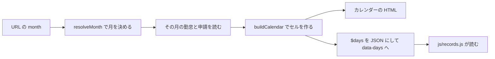

# `records/index.php` を読む（記録表示の画面）

## このファイルの役割

自分の勤怠を**1か月のカレンダー**で見せる画面。日付を押すと、その日の記録と申請を表示し、そこから修正・新規登録の申請もできる（申請の動きは `js/records.js`）。

- 計算（表示する月・労働時間・カレンダーのセル）は `src/records.php` に任せる。このファイルは「値を集めて、HTML に並べる」だけ。
- 日付を押したときに見せる値は、ページを作るときに JSON にして HTML に埋め込んでおく。JavaScript はそれを読んで表示するだけで、サーバーに問い合わせない。
- 申請と取り消しは、JavaScript が `api/requests.php` に送る。このファイルは、そのためのウィンドウ（`<dialog>`）の HTML を用意しておく。

## 全体の構成

| 行のあたり | 中身 |
| --- | --- |
| 先頭（4〜8行） | 使うファイルの読み込み |
| 10〜14行 | ログインと権限の確認 |
| 16〜22行 | 表示する月を決め、勤怠・申請・勤務設定を読み、カレンダーを組み立てる |
| 24〜35行 | JavaScript に渡す「日ごとの値」（`$days`）を作る |
| 37〜39行 | 「申請」ボタンで選べる日の範囲 |
| 41〜122行 | HTML：通知・月の切り替え・集計・カレンダー |
| 124〜192行 | HTML：3つのウィンドウ（その日の記録／取り消しの確認／申請） |
| 最後 | `js/records.js` の読み込み |

前半の PHP で**値を全部そろえてから**、後半で HTML を出す。HTML の途中で DB を読んだり計算したりしない。

データの流れを先に示す。



---

## 1. 使うファイルの読み込み

```php
include_once(__DIR__ . '/../src/functions.php');
include_once(__DIR__ . '/../src/dbconnect.php');
include_once(__DIR__ . '/../src/auth.php');
include_once(__DIR__ . '/../src/queries/work_settings.php');
include_once(__DIR__ . '/../src/records.php');
```

- `__DIR__` は「このファイルがあるフォルダ」（`records/`）。`/../src/…` で1つ上の `src/` を指す。どこから実行されても、同じファイルを読める。
- `include_once` は、同じファイルを2回読まない。`src/records.php` の中でも `src/attendance.php` などを読んでいるので、重なっても関数の二重定義のエラーにならない。
- `src/records.php` が、`holidays.php`・`attendance.php`・`requests.php` をまとめて読み込む。勤怠と申請を読む関数（`fetchMonthlyAttendances()`・`fetchMonthlyRequests()`）も、そこから読み込まれる。

## 2. ログインと権限の確認

```php
$currentUser = requireLogin($pdo);
requireRole($currentUser, [ROLE_EMPLOYEE, ROLE_MANAGER]);
if ($currentUser['joined_on'] === null) {
    throw new RuntimeException('入社日を取得できません: ' . $currentUser['employee_id']);
}
```

- `requireLogin()`：ログインしていなければログイン画面へ移す。ログイン中なら、利用者の情報（社員番号・権限・入社日など）を配列で返す。
- `requireRole()`：社員か管理者でなければ 403 で止める。システム管理者は社員ではない（勤怠が無い）ので、この画面は使えない。
- 入社日（`joined_on`）が `null` なら例外にする。社員・管理者なら入社日はあるはずで、無ければデータの誤り。入社日は、月の範囲と「申請できる日」を決めるのに使う。

> **ここが重要**：「起こらないはずのこと」が起きたとき、黙って進めずに**例外で止める**。`null` のまま進めると、`resolveMonth()` に `null` を渡して型のエラーになったり、変な月を表示したりして、原因が分かりにくくなる。止めておけば、すぐに原因（入社日が無い）が分かる。

## 3. 表示する月を決めて、データを集める

```php
$today = date('Y-m-d');
$requested = isset($_GET['month']) && is_string($_GET['month']) ? $_GET['month'] : null;
$month = resolveMonth($requested, $today, $currentUser['joined_on']);
$attendances = fetchMonthlyAttendances($pdo, $currentUser['employee_id'], $month['first'], $month['last']);
$requests = fetchMonthlyRequests($pdo, $currentUser['employee_id'], $month['first'], $month['last']);
$calendar = buildCalendar($month, $attendances, fetchWorkSettings($pdo), $today, $requests, $currentUser['joined_on']);
$flash = takeFlash();
```

- URL の `?month=2026-09` を受け取る。指定が無ければ `null`。
- **`is_string()` で確かめている**のがポイント。`?month[]=x` のように送られると、`$_GET['month']` は配列になる。そのまま `resolveMonth(?string …)` に渡すと型のエラーになるので、文字列のときだけ受け取る。
- `resolveMonth()`（`src/records.php`）：受け取った値が正しい形で、表示してよい範囲（入社した月〜今月）にあるときだけ、その月にする。それ以外は今月。戻り値は `first`（月の初日）・`last`（末日）・`prev`／`next`（前後の月。行けなければ `null`）など。
- 勤怠と申請は、月の初日〜末日の分を**まとめて1回ずつ**読む。日ごとに SQL を流すと、1か月で約30回になってしまう。
- `fetchWorkSettings()`：勤務設定（昼休憩の時刻など）。労働時間の計算で使う。
- `buildCalendar()`：週ごとのセル、出勤日数、総労働時間を作る。
- `takeFlash()`：前の画面で残した通知（例：「申請を受け付けました。…」）を1回だけ取り出す。申請を送ったあと、JavaScript が画面を読み込み直すと、ここで通知が取り出されて表示される。

> **ここが重要**：URL の値は、利用者がいくらでも書き換えられる。このファイルでは `is_string()` で型を確かめ、`resolveMonth()` で「正しい形・正しい範囲だけ受け取り、ほかは今月」にしている。**受け取ってよい値を決めて、それ以外は捨てる**（ホワイトリスト）ので、入社前の月や未来の月をのぞくこともできない。

## 4. JavaScript に渡す「日ごとの値」を作る

```php
$days = [];
foreach ($calendar['weeks'] as $week) {
    foreach ($week as $cell) {
        if ($cell !== null) {
            $days[$cell['date']] = array_intersect_key($cell, array_flip([
                'label', 'holiday', 'hasRecord', 'checkIn', 'checkOut', 'break', 'workTime',
                'values', 'requests', 'isFuture', 'pendingCorrection', 'canRequest',
            ]));
        }
    }
}
```

- `$calendar['weeks']` は「週の配列」で、1週は7つのセル（日〜土）。月の外の日は `null` なので飛ばす。
- 日付（`'2026-09-01'`）をキーにした配列にする。JavaScript では `days['2026-09-01']` で、その日の値をすぐに取り出せる。
- `array_flip([...])`：値とキーを入れ替える。`['label', 'holiday', …]` が `['label' => 0, 'holiday' => 1, …]` になる。
- `array_intersect_key($cell, …)`：`$cell` のうち、**キーが一覧にあるものだけ**を残す。2つを組み合わせると「必要なキーだけ取り出す」ことができる。

例えば、1日分は次のような形になる（記録がある日）。

```php
'2026-09-01' => [
    'label' => '9月1日（火）', 'holiday' => '', 'hasRecord' => true,
    'checkIn' => '09:00', 'checkOut' => '18:00', 'break' => '--:--', 'workTime' => '8時間00分',
    'values' => ['check_in' => '09:00', 'check_out' => '18:00', 'break_start' => '', 'break_end' => ''],
    'requests' => [], 'isFuture' => false, 'pendingCorrection' => false, 'canRequest' => true,
]
```

> **ここが重要**：セルには、HTML を作るためだけの値（`weekday`・`isRestDay`・`isToday`・`badge` など）も入っている。JavaScript に要らない値は、**渡す前に落とす**。HTML が小さくなるうえ、「JavaScript に何を渡しているか」が、この一覧を見れば分かる。（なお、一覧の `isFuture` は、今の `js/records.js` では使っていない。未来の日は `canRequest` が `false` になるので、それで足りている。）

## 5. 「申請」ボタンで選べる日

```php
$requestMin = max($month['first'], $currentUser['joined_on']);
$requestMax = min($month['last'], $today);
```

- 選べるのは「表示中の月の日」で、かつ「入社日から今日まで」の日（D-062）。2つの範囲の重なりを、`max`（遅いほうの始まり）と `min`（早いほうの終わり）で求めている。
- `'Y-m-d'` の文字列は、文字列の大小と日付の前後が一致するので、`max()`・`min()` でそのまま比べられる。
- 例：今日が 2026-10-15、入社日が 2025-04-01 で、10月を表示しているとき → `2026-10-01`〜`2026-10-15`。
- この2つの値は、下の HTML で「申請」ボタンを出すかどうかと、日付の入力欄の `min`・`max` に使う。

---

ここから HTML。

## 6. 通知（トースト）

```php
    <?php if ($flash !== null): ?>
        <div class="toast" id="toast" role="status" aria-live="polite"><?= h($flash) ?></div>
    <?php else: ?>
        <div class="toast" id="toast" role="status" aria-live="polite" hidden></div>
    <?php endif; ?>
```

- `if (…): ?> … <?php endif;` は、HTML の中で使いやすい `if` の書き方（`{ }` の代わりに `:` と `endif`）。`foreach` にも同じ形（`endforeach`）がある。
- 通知があれば表示し、無ければ `hidden` で隠した空の箱を置く。表示した通知は、`js/records.js` が5秒後に隠す。
- `role="status"`・`aria-live="polite"`：画面読み上げソフトに、「ここに出た文を読み上げる」と伝える。
- `<?= h($flash) ?>`：`<?= … ?>` は `<?php echo … ?>` の短い形。**画面に出す値は、必ず `h()` を通す**（`htmlspecialchars()` で `<` などを無害な文字に変える。XSS 対策）。

## 7. 月の切り替えと集計

```php
            <?php if ($month['prev'] !== null): ?>
                <a class="month-nav__button" href="?month=<?= h($month['prev']) ?>" aria-label="前の月"><span class="material-symbols-outlined" aria-hidden="true">chevron_left</span></a>
            <?php else: ?>
                <span class="month-nav__button month-nav__button--disabled" aria-hidden="true"><span class="material-symbols-outlined">chevron_left</span></span>
            <?php endif; ?>
            <h1 class="month-nav__label"><?= h($month['label']) ?></h1>
```

- 前の月に行けるときはリンク（`<a>`）、行けないとき（入社した月）は、押せない見た目の `<span>` を出す。`next` も同じで、今月より先には行けない。
- `href="?month=2026-08"` のように `?` から始まる URL は、「今のページのまま、後ろの `?…` だけ変える」という意味になる。
- `chevron_left` は、Google のアイコンフォント（Material Symbols）の名前。文字がアイコンの形で表示される。`aria-hidden="true"` で読み上げから外し、代わりに `aria-label="前の月"` を読ませる。

```php
            <span class="summary__item">出勤日数 <b id="summary-days"><?= h($calendar['workDays']) ?>日</b></span>
            <span class="summary__item">総労働時間 <b id="summary-total"><?= h(formatMinutes($calendar['totalMinutes'])) ?></b></span>
```

- 出勤日数と総労働時間（表示中の月の合計。D-049）。`formatMinutes()` で、分を `160時間30分` の形にする。数え方は [src_records.md](./src_records.md) で説明する。

```php
        <?php if ($requestMin <= $requestMax): ?>
            <button class="button button--primary records__request" type="button" id="request-open">申請</button>
        <?php endif; ?>
```

- 日付を選ばずに開く「申請」ボタン（D-052）。選べる日が1日も無いとき（例：入社日がまだ来ていない）は出さない。

## 8. カレンダー本体

```php
    <div class="calendar" id="calendar"
        data-days="<?= h(json_encode($days, JSON_UNESCAPED_UNICODE | JSON_THROW_ON_ERROR)) ?>"
        data-api-url="<?= h(appUrl('api/requests.php')) ?>"
        data-login-url="<?= h(appUrl('login.php')) ?>"
        data-csrf-token="<?= h(csrfToken()) ?>">
```

- `data-…` 属性は、HTML に好きな値を持たせる仕組み。JavaScript からは `calendar.dataset.days`・`calendar.dataset.apiUrl` のように読める（`data-api-url` は `apiUrl` という名前になる）。
- `json_encode()`：PHP の配列を JSON の文字列にする。
  - `JSON_UNESCAPED_UNICODE`：日本語を `日` のような形にせず、そのまま出す（HTML が読みやすく、小さくなる）。
  - `JSON_THROW_ON_ERROR`：変換に失敗したら例外にする。これが無いと、失敗したときに `false` が返り、空の属性になって、JavaScript 側で原因の分からないエラーになる。
- JSON を `h()` に通してから属性に入れている。JSON には `"` が入るので、そのままだと属性が途中で切れてしまう。`h()` で `&quot;` に変えておくと、ブラウザが属性を読むときに元の `"` に戻すので、`dataset.days` では元の JSON がそのまま取り出せる。
- `data-csrf-token`：申請を送るときに付ける CSRF トークン（推測できない文字列）。サーバーは、トークンが正しくない POST を受け付けない。別のサイトから勝手に申請を送らせる攻撃（CSRF）を防ぐ。
- API とログイン画面の URL も `appUrl()` で作って渡す。アプリを置いた場所（`/attendance/` など）が変わっても、JavaScript を直さなくてよい。

> **ここが重要**：PHP から JavaScript に値を渡すとき、`<script>` の中に `var days = <?= json_encode(...) ?>;` と直接書く方法もあるが、ここでは **`data-` 属性 ＋ `h()`** にしている。属性に入れる値は `h()` だけで安全にできるので、エスケープの考え方が「画面に出す値は `h()`」の1つで済む。JavaScript を別ファイル（`js/records.js`）に分けたままにできる良さもある。

```php
        <div class="calendar__head" aria-hidden="true">
            <?php foreach (['日', '月', '火', '水', '木', '金', '土'] as $i => $weekdayName): ?>
                <div class="calendar__weekday calendar__weekday--<?= h($i) ?>"><?= h($weekdayName) ?></div>
            <?php endforeach; ?>
        </div>
```

- 曜日の見出し。`as $i => $weekdayName` で、番号（0〜6）と名前の両方を受け取り、番号をクラス名（`calendar__weekday--0` など）に使う。

```php
        <?php foreach ($calendar['weeks'] as $week): ?>
            <div class="calendar__week">
                <?php foreach ($week as $cell): ?>
                    <?php if ($cell === null): ?>
                        <div class="calendar__blank"></div>
                    <?php else: ?>
```

- 週ごと・セルごとの二重の `foreach`。月の外の日（`null`）は空の箱にする。セルの並べ方は `buildCalendar()` が決めているので、ここは順に出すだけ。

```php
                        <?php
                        $classes = ['calendar__day'];
                        if ($cell['isRestDay']) {
                            $classes[] = 'calendar__day--rest';
                        }
                        if ($cell['isToday']) {
                            $classes[] = 'calendar__day--today';
                        }
                        $dateClass = ($cell['weekday'] === 0 || $cell['holiday'] !== '') ? ' calendar__date--sunday' : ($cell['weekday'] === 6 ? ' calendar__date--saturday' : '');
                        $ariaLabel = $cell['label'] . ($cell['holiday'] !== '' ? ' ' . $cell['holiday'] : '') . ($cell['badge'] !== null ? ' ' . $cell['badgeLabel'] : '') . 'の記録';
                        ?>
```

- クラス名を配列に集めて、あとで `implode(' ', $classes)` で空白区切りにする。条件が増えても、`$classes[] = …` を足すだけでよい。
- 休日（土日・祝日）は `--rest`、今日は `--today` を付ける。
- 日付の数字の色：日曜と祝日は赤（`--sunday`）、土曜は青（`--saturday`）。
- 三項演算子（`条件 ? A : B`）を2つ重ねている。**PHP 8 では、三項演算子を重ねるときに `( )` が必須**（付けないとエラー）。どちらを先に判断するかが、読む人にもはっきりする。
- `$ariaLabel`：画面読み上げ用の名前。例えば `9月21日（月） 敬老の日 申請中の記録`。見た目では色や小さな文字で伝えていることを、言葉でも伝える。

```php
                        <button class="<?= h(implode(' ', $classes)) ?>" type="button" data-date="<?= h($cell['date']) ?>" aria-label="<?= h($ariaLabel) ?>"<?= $cell['isToday'] ? ' aria-current="date"' : '' ?>>
```

- 1日を1つの `<button>` にする。押せる部品をボタンにしておくと、キーボード（Tab と Enter）でも操作できる。
- `data-date="2026-09-01"`：どの日が押されたかを、JavaScript がこの属性で知る。上の `$days` のキーと同じ形。
- `aria-current="date"`：今日のセルであることを伝える。固定の文字列なので `h()` は通していない。

```php
                            <?php if ($cell['hasRecord']): ?>
                                <span class="calendar__times">
                                    <span><span class="calendar__mark">出</span> <?= h($cell['checkIn']) ?></span>
                                    <span><span class="calendar__mark">退</span> <?= h($cell['checkOut']) ?></span>
                                </span>
                            <?php endif; ?>
                            <?php if ($cell['badge'] !== null): ?>
                                <span class="request-badge request-badge--<?= h($cell['badge']) ?>"><?= h($cell['badgeLabel']) ?></span>
                            <?php endif; ?>
```

- 記録がある日は、出勤・退勤の時刻を出す。無い時刻は `--:--`（`formatClock()` が作る）。
- 申請がある日は、状態のバッジ（申請中・承認済み・却下）を出す。`badge` は `pending` などで、クラス名（`request-badge--pending`）で色を変える。

## 9. 3つのウィンドウ（`<dialog>`）

画面には、最初から3つのウィンドウを隠して置いておく。開く・閉じる・中身を入れるのは `js/records.js`。

| id | 中身 | 開くとき |
| --- | --- | --- |
| `day-dialog` | その日の記録と申請の一覧、「修正」または「申請する」ボタン | 日付を押したとき |
| `cancel-dialog` | 申請の取り消しの確認（D-063） | 一覧の「取り消す」を押したとき |
| `request-dialog` | 修正・新規登録の申請の入力欄 | 「修正」「申請する」「申請」を押したとき、記録も申請も無い日を押したとき |

```php
    <dialog class="dialog" id="day-dialog" aria-labelledby="day-title">
        <form method="dialog" class="dialog__body">
            <h2 class="dialog__title" id="day-title"></h2>
            …
            <div class="dialog__actions">
                <button class="button button--outline" type="submit" value="close">閉じる</button>
                <button class="button button--primary" type="button" id="day-request" hidden></button>
            </div>
        </form>
    </dialog>
```

- `<dialog>` は、HTML に標準で用意されたウィンドウ。JavaScript の `showModal()` で開くと、後ろの画面は押せなくなり、Esc キーで閉じられる。
- `aria-labelledby="day-title"`：ウィンドウの名前は、`id="day-title"` の見出しだと伝える。
- **`<form method="dialog">`**：この中の送信ボタン（`type="submit"`）を押すと、サーバーには何も送らずに、ウィンドウが閉じる。「閉じる」ボタンには JavaScript が要らない。
- 見出しや時刻の欄（`day-check-in` など）は空で置いておき、日付を押したときに JavaScript が中身を入れる。

```php
        <form class="dialog__body" id="request-form" novalidate>
            …
                    <input class="form-field__input" type="date" id="request-date" name="target_date" min="<?= h($requestMin) ?>" max="<?= h($requestMax) ?>" required>
                    <p class="form-field__error" id="request-error-target_date" hidden></p>
            …
                <?php foreach (['check_in' => '出勤時刻', 'check_out' => '退勤時刻', 'break_start' => '休憩開始', 'break_end' => '休憩終了'] as $name => $label): ?>
                    <div class="form-field">
                        <label class="form-field__label" for="request-<?= h($name) ?>"><?= h($label) ?></label>
                        <input class="form-field__input" type="time" id="request-<?= h($name) ?>" name="<?= h($name) ?>" step="60">
                        <p class="form-field__error" id="request-error-<?= h($name) ?>" hidden></p>
                    </div>
                <?php endforeach; ?>
```

- 申請のフォーム。種別（修正／新規登録）を選ぶ欄は置かない。記録の有無で、システムが決める（D-051）。
- 4つの時刻の欄は、`foreach` で同じ形をくり返して作る。`name`（`check_in` など）は、`api/requests.php` が受け取る項目の名前と同じ。
- 欄ごとに、エラーの文を出す場所（`request-error-check_in` など）を用意しておく。サーバーが返すエラーは「項目の名前 → 文」の形なので、JavaScript は `request-error-` ＋ 項目の名前の場所に文を入れればよい。
- `type="time"` と `step="60"`：時刻の入力欄で、刻みを60秒（1分）にする。秒は入力しない。
- `min`・`max`：日付の欄で選べる範囲（5章の `$requestMin`・`$requestMax`）。
- `novalidate`：ブラウザの入力チェック（`required` などの吹き出し）を止める。入力のルールはサーバー（`src/requests.php`）で確かめ、その結果を、欄ごとの場所に同じ形で出す。

```php
                    <textarea class="form-field__input form-field__textarea" id="request-reason" name="reason" rows="3" maxlength="<?= h(REQUEST_REASON_MAX_LENGTH) ?>"></textarea>
```

- 理由の文字数の上限は、定数 `REQUEST_REASON_MAX_LENGTH`（500。`src/requests.php`）から出す。サーバーの確認と画面の上限が、同じ数字になる。

> **ここが重要**：画面の `min`・`max`・`maxlength` は、**使いやすさのためだけ**。開発者ツールで HTML を書き換えれば、いくらでも外せる。だから、対象日の範囲・時刻の順番・文字数などは、すべてサーバー（`validateCorrection()`）で確かめ直している。画面とサーバーで数字がずれないように、上限は定数を共有している。

## 10. JavaScript の読み込み

```php
<script src="<?= h(assetUrl('js/records.js')) ?>" defer></script>
<?php include(__DIR__ . '/../templates/footer.php'); ?>
```

- `assetUrl()`：URL の後ろに、ファイルを最後に変えた日時（`?v=…`）を付ける。ファイルを変えると URL が変わるので、ブラウザが古い JavaScript を使い続けない（D-068）。
- `defer`：HTML を最後まで読み終えてから実行する。`js/records.js` は `#calendar` などの部品を探すので、部品ができる前に動いてはいけない。

---

## まとめ：このファイルから学べること

| 書き方 | このファイルでの例 |
| --- | --- |
| 計算と表示を分ける | 計算は `src/records.php`、このファイルは値を集めて並べるだけ |
| 値をそろえてから HTML を出す | 前半の PHP で全部用意し、後半は表示だけ |
| URL の値はホワイトリストで受け取る | `is_string()` と `resolveMonth()`。ほかは今月 |
| まとめて読む | 勤怠と申請を、月の分まとめて1回ずつ読む |
| JavaScript には必要な値だけ渡す | `array_intersect_key()` で、使うキーだけ残す |
| PHP → JavaScript は `data-` 属性で | `json_encode()` ＋ `h()` で、安全に埋め込む |
| 画面の制限はサーバーで確かめ直す | `min`・`max`・`maxlength` は使いやすさのため |
| HTML の標準の部品を使う | `<dialog>`・`<form method="dialog">`・日付と時刻の入力欄 |

## 関連するファイル

- 計算：`src/records.php`（`resolveMonth()`・`buildCalendar()`・`formatMinutes()`） → [src_records.md](./src_records.md)
- 祝日：`src/holidays.php` → [src_holidays.md](./src_holidays.md)
- 画面の動き：`js/records.js`（`data-days` を読んで、ウィンドウを開く・申請を送る） → [js_records.md](./js_records.md)
- 申請の受け口：`api/requests.php` → [api_requests.md](./api_requests.md)、入力のルール：`src/requests.php` → [src_requests.md](./src_requests.md)
- ログインと権限：`src/auth.php` → [src_auth.md](./src_auth.md)、通知と CSRF トークン：`src/session.php` → [src_session.md](./src_session.md)
- 共通の関数（`h()`・`appUrl()`・`assetUrl()`）：`src/functions.php` → [src_functions.md](./src_functions.md)
- 画面の上下：`templates/header.php`・`templates/footer.php` → [templates.md](./templates.md)
- SQL：`src/queries/attendances.php` → [src_queries_attendances.md](./src_queries_attendances.md)、`src/queries/attendance_requests.php` → [src_queries_attendance_requests.md](./src_queries_attendance_requests.md)
