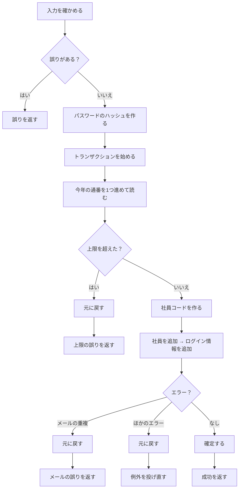

# `src/admin.php` を読む（システム管理者の処理）

## このファイルの役割

システム管理者の3つの画面（アカウント管理・部署・勤務設定）について、**入力を確かめ、DB に書き込み、一覧の表示の形を作る**ファイル。画面（`admin/accounts.php`・`admin/departments.php`・`admin/settings.php`）から呼ばれる。

- HTML は出さない。SQL も書かない（SQL は `src/queries/` の関数を呼ぶ）。
- 入力のルールは、**すべてここ（サーバー）で確かめる**。画面の `maxlength` や `min`・`max` は、使いやすさのためだけ。
- 処理する関数は、どれも `['ok' => true, 'message' => …]` か `['ok' => false, …]` を返す。画面は `ok` を見て、通知を出すか、誤りを出すかを決めるだけでよい。
- 確かめるだけの関数（`formatEmployeeId()`・`validateAccount()`・`validateWorkSettings()` など）は DB を使わないので、DB が無くてもテストできる（`tests/AdminTest.php`）。

## 全体の構成

| 行のあたり | 中身 |
| --- | --- |
| 先頭 | 読み込みと定数（文字数の上限、パスワードの形、社員コードの形、選択肢の名前） |
| 小さな関数 | `inputRaw()`・`formatEmployeeId()`・`validatePassword()`・`activeDepartments()`・`findDepartment()` |
| アカウントの作成 | `validateAccount()`・`createAccount()`（採番とトランザクション） |
| 一覧の操作 | `findManagedAccount()`・`leftOnRange()`・`deactivateAccount()`・`reactivateAccount()`・`resetPassword()`・`runInTransaction()` |
| 一覧の表示 | `accountView()` |
| 部署 | `validateDepartmentName()`・`addDepartment()`・`renameDepartment()`・`setDepartmentActive()` |
| 勤務設定 | `validateWorkSettings()`・`saveWorkSettings()` |

画面ごとに、上から「アカウント → 部署 → 勤務設定」の順に並んでいる。それぞれ「確かめる関数 → 処理する関数」の順。

---

## 1. 読み込みと定数

```php
include_once(__DIR__ . '/auth.php');
include_once(__DIR__ . '/requests.php');
include_once(__DIR__ . '/queries/employee_id_sequences.php');
include_once(__DIR__ . '/queries/departments.php');
include_once(__DIR__ . '/queries/employees.php');
include_once(__DIR__ . '/queries/login_accounts.php');
include_once(__DIR__ . '/queries/work_settings.php');
```

- `requests.php` を読むのは、申請の処理のために作った `inputString()`（入力を取り出す）・`isValidDate()`（正しい日付か）・`isDuplicateError()`（一意制約の違反か）を、ここでも使うため。同じ確認を2か所に書かない。

```php
// 文字数の上限（DB の列の長さ）
const ADMIN_NAME_MAX_LENGTH = 100;
const ADMIN_EMAIL_MAX_LENGTH = 254;
const ADMIN_DEPARTMENT_NAME_MAX_LENGTH = 50;
```

- DB の列の長さ（`VARCHAR(100)` など）と同じ数にしている。画面の `maxlength` も、この定数から出す。

### パスワードの形（正規表現）

```php
// パスワード：半角の英数字・記号（空白を除く、ASCII の 0x21〜0x7E）で 8〜64 文字（D-066）
const ADMIN_PASSWORD_PATTERN = '/\A[\x21-\x7E]{8,64}\z/';
const ADMIN_PASSWORD_RULE = 'パスワードは、半角の英数字・記号で 8〜64 文字にしてください。';
```

正規表現を部品に分けて読む。

| 部品 | 意味 |
| --- | --- |
| `\A` … `\z` | 文字列の**最初**と**最後**。全体がこの形でなければならない |
| `[\x21-\x7E]` | 文字コード 0x21（`!`）から 0x7E（`~`）までの1文字。半角の英字・数字・記号。空白（0x20）は入らない |
| `{8,64}` | 直前のものが 8〜64 個 |

- 日本語（全角）の文字は、0x80 以上のバイトでできているので、この範囲に入らず、はじかれる。
- `^` と `$` ではなく `\A` と `\z` を使うのがポイント。PHP の `$` は「最後」のほかに「最後の改行の直前」にも当てはまるので、`'password1\n'` のように末尾に改行が付いた値が通ってしまう。`\z` は本当の最後にしか当てはまらない。このファイルの正規表現は、すべて `\A` … `\z` で書いている。

### 社員コードの形と、1年の上限

```php
// 1年に作れる社員コードの数（001〜999 と A01〜Z99。D-013）
const EMPLOYEE_NUMBER_MAX = 999 + 26 * 99;

// 社員コードの形（例：2026001、2026A01。DB設計書）
const EMPLOYEE_ID_PATTERN = '/\A[0-9]{4}([0-9]{3}|[A-Z][0-9]{2})\z/';
```

- `const` には、計算式も書ける（定数どうしの計算や数の計算）。`999 + 26 * 99` は 3573。「数字の 999 人と、英字 26 文字 × 99 人」という**意味が見える**ので、`3573` と書くより分かりやすい。
- `EMPLOYEE_ID_PATTERN` は「年の4桁のあとに、数字3桁、または英大文字1つ＋数字2桁」。`(…|…)` は「どちらか」。一覧の操作で送られてきた社員コードの**形**を確かめるのに使う（7章）。

```php
const ACCOUNT_ROLE_LABELS = [ROLE_EMPLOYEE => '社員', ROLE_MANAGER => '管理者'];
const APPROVAL_SCOPE_LABELS = ['department' => '所属部署のみ', 'all' => '全社員'];
```

- 配列のキーに、`auth.php` の定数（`ROLE_EMPLOYEE` は `'employee'`）を使える。
- この2つの配列は、[src_attendance.md](./src_attendance.md) の `ATTENDANCE_ACTION_LABELS` と同じく、**「画面に出す名前」と「受け付けてよい値の一覧」を兼ねている**。画面の選択肢もこれで作り、サーバーの確認もこれで行う。システム管理者（`system_admin`）は入っていないので、画面からは作れない（D-066）。

```php
// 勤務設定の項目と、画面に出す名前（順番は、時刻の前後の順）
const WORK_SETTING_FIELDS = [
    'standard_start' => '標準始業時刻',
    'lunch_start' => '昼休憩の開始',
    'lunch_end' => '昼休憩の終了',
    'standard_end' => '標準終業時刻',
];
```

- 勤務設定の4つの項目。確かめる順（14章）は、この並びになる。

## 2. `inputRaw()`：パスワードは、そのまま取り出す

```php
function inputRaw(array $input, string $key): string {
    $value = $input[$key] ?? '';
    return is_string($value) ? $value : '';
}
```

- `requests.php` の `inputString()` は、値の前後の空白を `trim()` で取る。パスワードには、こちらを使わない。
- もし前後の空白を黙って取ると、利用者が「 abc12345」（先頭に空白）と入れたつもりのパスワードが、「abc12345」で保存されてしまう。そのまま取り出せば、空白はパスワードの形（`[\x21-\x7E]`）に合わないので、誤りとして知らせられる。
- `is_string()` で確かめるのは、`password[]=…` のように送ると、`$_POST['password']` が**配列**になるため。配列のまま先へ進むと、型の違いでエラーになる。

## 3. `formatEmployeeId()`：社員コードを作る

```php
// 年と通番から社員コードを作る（D-013）。1〜999 は 'yyyy'＋3桁、1000〜3573 は 'yyyy'＋英字＋2桁（1000＝A01、1099＝A99、1100＝B01）
function formatEmployeeId(int $year, int $number): string {
    if ($number < 1 || $number > EMPLOYEE_NUMBER_MAX) {
        throw new InvalidArgumentException('通番が範囲外です: ' . $number);
    }
    if ($number <= 999) {
        return sprintf('%04d%03d', $year, $number);
    }
    $m = $number - 1000;
    return sprintf('%04d%s%02d', $year, chr(ord('A') + intdiv($m, 99)), $m % 99 + 1);
}
```

- `sprintf()` は、書式に合わせて文字列を作る。`%04d` は「4桁の数。足りなければ前を 0 で埋める」、`%03d` は3桁、`%s` は文字列。`sprintf('%04d%03d', 2026, 7)` → `'2026007'`。
- 1000 以上は、`$m = $number - 1000` で 0 から数え直し、99 人ごとに英字を1つ進める。
  - `intdiv($m, 99)`：割り算の商（整数）。0 なら A、1 なら B、…
  - `ord('A')` は文字 A の文字コード（65）、`chr()` は文字コードを文字に戻す。`chr(65 + 1)` → `'B'`。
  - `$m % 99 + 1`：割り算の余りに 1 を足して、01〜99 にする。

| 通番 | `$m` | 商 → 英字 | 余り＋1 | 社員コード（2026年） |
| --- | --- | --- | --- | --- |
| 1 | — | — | — | `2026001` |
| 999 | — | — | — | `2026999` |
| 1000 | 0 | 0 → A | 1 | `2026A01` |
| 1098 | 98 | 0 → A | 99 | `2026A99` |
| 1099 | 99 | 1 → B | 1 | `2026B01` |
| 3573 | 2573 | 25 → Z | 99 | `2026Z99` |

- 範囲の外（0 以下、3574 以上）は例外にする。呼ぶ側（`createAccount()`）が先に上限を確かめるので、ふつうは起きない。起きたらプログラムの誤りなので、黙って変な社員コードを作らずに止める。

> **注意**：関数の上のコメントには「1099＝A99、1100＝B01」とあるが、実際の計算では **1098＝A99、1099＝B01** になる（表のとおり。`tests/AdminTest.php` も 1098 → A99、1099 → B01 を確かめている）。コメントのほうが1つずれている。

## 4. 小さな確認の関数

### `validatePassword()`

```php
function validatePassword(string $password, string $confirm): array {
    if ($password === '') {
        return ['password' => 'パスワードを入力してください。'];
    }
    if (!preg_match(ADMIN_PASSWORD_PATTERN, $password)) {
        return ['password' => ADMIN_PASSWORD_RULE];
    }
    if ($confirm !== $password) {
        return ['password_confirm' => '確認用のパスワードが一致しません。'];
    }
    return [];
}
```

- 誤りがあれば `[項目 => 文]`、無ければ空の配列を返す。アカウント作成（項目ごとの誤りが要る）と、パスワード再設定（文が1つあればよい）の両方で使えるように、この形にしている。
- `preg_match()` は、当てはまれば 1、当てはまらなければ 0 を返す。`!` で「当てはまらなければ」。
- 確かめる順は「空か → 形 → 確認と一致するか」。早期リターンで、最初に見つかった1つだけを返す。

### `activeDepartments()` と `findDepartment()`

```php
function activeDepartments(array $departments): array {
    return array_values(array_filter($departments, fn ($d) => (int) $d['is_active'] === 1));
}
```

- `array_filter(配列, 関数)`：関数が `true` を返した要素だけを残す。ここでは「`is_active` が 1 の部署」。
- `array_filter()` は元のキーを残す（`[0 => …, 2 => …]` のように番号が飛ぶ）。`array_values()` で、0, 1, 2, … と振り直す。
- `(int)` で数にしてから `=== 1` で比べる。DB からの値が文字列の `'1'` で来ても、数の `1` で来ても、同じに扱える。

```php
function findDepartment(array $departments, int $id): ?array {
    foreach ($departments as $department) {
        if ((int) $department['id'] === $id) {
            return $department;
        }
    }
    return null;
}
```

- 部署の一覧から、ID が一致する1つを探す。見つかった時点で `return` するので、残りは見ない。無ければ `null`（戻り値の型 `?array` は「配列か null」）。

## 5. `validateAccount()`：アカウント作成の入力を確かめる

```php
function validateAccount(array $input, array $departments, string $today): array {
    $values = [
        'name' => inputString($input, 'name'),
        'email' => inputString($input, 'email'),
        …
        'approval_scope' => inputString($input, 'approval_scope'),
    ];
    $errors = [];
```

- 最初に、送られてきた値を `$values` に取り出す（前後の空白を取る）。誤りがあったとき、画面はこの `$values` をそのまま入力欄に戻す。
- パスワードは `$values` に入れない。画面に書き戻さないため（[admin_accounts.md](./admin_accounts.md) の 7章）。
- `$departments` と `$today` は引数で受け取る。この関数の中で DB を読んだり `time()` を呼んだりしないので、テストでは好きな部署の一覧・好きな「今日」を渡して確かめられる。

### 氏名とメールアドレス

```php
    if ($values['name'] === '') {
        $errors['name'] = '氏名を入力してください。';
    } elseif (mb_strlen($values['name']) > ADMIN_NAME_MAX_LENGTH) {
        $errors['name'] = '氏名は ' . ADMIN_NAME_MAX_LENGTH . ' 文字までにしてください。';
    }

    if ($values['email'] === '') {
        $errors['email'] = 'メールアドレスを入力してください。';
    } elseif (strlen($values['email']) > ADMIN_EMAIL_MAX_LENGTH || filter_var($values['email'], FILTER_VALIDATE_EMAIL) === false) {
        $errors['email'] = 'メールアドレスの形が正しくありません。';
    }
```

- 氏名は `mb_strlen()`（**文字数**）で数える。`strlen()` は**バイト数**なので、日本語の「山田」は 6 になってしまう（UTF-8 では漢字1文字が3バイト）。DB の `VARCHAR(100)` は文字数の上限なので、`mb_strlen()` で合わせる。
- メールアドレスは `strlen()`。`FILTER_VALIDATE_EMAIL` は半角の文字のアドレスしか通さないので、通るアドレスは文字数とバイト数が同じになる。
- `filter_var(値, FILTER_VALIDATE_EMAIL)`：PHP に用意された、メールアドレスの形の確認。正しければその値を、正しくなければ `false` を返す。自分で正規表現を書くより、取りこぼしが少ない。
- **同じメールアドレスの社員がいるか**は、ここでは調べない。DB の一意制約に任せる（6章）。

### 部署

```php
    if ($values['department_id'] === '') {
        $errors['department_id'] = '部署を選んでください。';
    } else {
        $department = preg_match('/\A[1-9]\d{0,9}\z/', $values['department_id']) ? findDepartment($departments, (int) $values['department_id']) : null;
        if ($department === null || (int) $department['is_active'] !== 1) {
            $errors['department_id'] = '選んだ部署は使えません。画面を開き直してください。';
        }
    }
```

- `/\A[1-9]\d{0,9}\z/`：「1〜9 で始まり、そのあと数字が 0〜9 個」＝ 1 以上の整数（先頭に 0 が付かない、最大 10 桁）。`'abc'` や `'-1'` や `'1.5'` は、ここではじく。
- 形が正しければ、`findDepartment()` で一覧から探す。**無い部署や、無効にした部署は使えない**。
- 画面の選択欄には有効な部署しか出ないが、「画面を開いたあとで、別の画面で部署が無効にされた」ことや、開発ツールで値を書き換えて送られることがある。だからサーバーで確かめ直す。

### 入社日

```php
    $maxJoinedOn = date('Y-m-d', strtotime($today . ' +1 year'));
    if ($values['joined_on'] === '') {
        $errors['joined_on'] = '入社日を入力してください。';
    } elseif (!isValidDate($values['joined_on']) || $values['joined_on'] < ADMIN_JOINED_ON_MIN || $values['joined_on'] > $maxJoinedOn) {
        $errors['joined_on'] = '入社日は、' . ADMIN_JOINED_ON_MIN . ' から ' . $maxJoinedOn . ' までの日を指定してください。';
    }
```

- `isValidDate()`：`'Y-m-d'` の形で、実際にある日か（2月30日などをはじく）。
- 日付を**文字列のまま `<`・`>` で比べている**。`'YYYY-MM-DD'` は桁数がそろっているので、文字列の大小と日付の前後が一致する（[src_attendance.md](./src_attendance.md) の 5章の時刻と同じ考え方）。`isValidDate()` で形を確かめたあとなので、安全に比べられる。
- `||` は左から順に調べ、`true` が出たらそこで止まる。形が正しくないときは、比べる前に誤りになる。

### 権限と承認範囲

```php
    if (!array_key_exists($values['role'], ACCOUNT_ROLE_LABELS)) {
        $errors['role'] = '権限を選んでください。';
    } elseif ($values['role'] === ROLE_MANAGER) {
        if (!array_key_exists($values['approval_scope'], APPROVAL_SCOPE_LABELS)) {
            $errors['approval_scope'] = '承認範囲を選んでください。';
        }
    } else {
        // 社員は承認しないので、承認範囲は既定値にする
        $values['approval_scope'] = 'department';
    }

    $errors += validatePassword(inputRaw($input, 'password'), inputRaw($input, 'password_confirm'));
    return ['errors' => $errors, 'values' => $values];
}
```

- `array_key_exists(値, 配列)`：その値が配列の**キー**にあるか。1章の定数を「受け付けてよい値の一覧」として使っている。
- 社員を選んだときは、送られてきた承認範囲を使わず、`'department'` に固定する。画面では承認範囲の欄が隠れているが、隠れた欄の値も送られてくるので、ここで決め直す。
- `$errors += …`：配列の `+` は「左に無いキーだけを、右から足す」（配列の和）。パスワードの誤り（`password` か `password_confirm`）を、最後に付け足している。
- 誤りは、確かめた順（氏名 → メールアドレス → 部署 → 入社日 → 権限 → パスワード）に配列へ入る。画面は `reset($errors)` で最初の1つを出す。

## 6. `createAccount()`：アカウントを作る（採番とトランザクション）

流れを先に示す。



### 確かめてから、ハッシュを作る

```php
function createAccount(PDO $pdo, array $input, int $now): array {
    $today = date('Y-m-d', $now);
    $checked = validateAccount($input, fetchDepartments($pdo), $today);
    $values = $checked['values'];
    if ($checked['errors'] !== []) {
        return ['ok' => false, 'errors' => $checked['errors'], 'values' => $values];
    }
    // ハッシュは、トランザクションの外で作る（時間がかかるため、採番の行のロックを長く持たない）
    $passwordHash = password_hash(inputRaw($input, 'password'), PASSWORD_DEFAULT);
```

- `password_hash(パスワード, PASSWORD_DEFAULT)`：パスワードを、元に戻せない形（ハッシュ）にする。DB にはハッシュだけを入れ、パスワードそのもの（平文）は保存しない。ログインのときは `password_verify()` で照らし合わせる（[src_auth.md](./src_auth.md)）。
- `PASSWORD_DEFAULT` は「その PHP で推奨の方式」。毎回ちがう「塩（salt）」が自動で混ぜられるので、同じパスワードでも、毎回ちがうハッシュになる。
- ハッシュは、**わざと時間がかかるように作られている**（総当たりで破られにくくするため）。

> **ここが重要**：ハッシュを、トランザクションを始める**前に**作っている。トランザクションの中で採番すると、その年の採番の行は、確定（`commit`）するまでほかの人が変えられない（ロック）。ロックを持ったまま時間のかかる処理をすると、同時にアカウントを作ろうとした人が、そのぶん長く待たされる。**ロックを持つ時間は、できるだけ短くする**。

### トランザクションの中で採番する

```php
    $pdo->beginTransaction();
    try {
        $year = (int) date('Y', $now);
        $number = nextEmployeeNumber($pdo, $year);
        if ($number > EMPLOYEE_NUMBER_MAX) {
            $pdo->rollBack();
            return ['ok' => false, 'errors' => ['form' => '今年作れるアカウントの上限（' . EMPLOYEE_NUMBER_MAX . ' 人）に達しました。'], 'values' => $values];
        }
        $employeeId = formatEmployeeId($year, $number);
        insertEmployee($pdo, $employeeId, $values['name'], $values['email'], (int) $values['department_id'], $values['joined_on']);
        insertLoginAccount($pdo, $employeeId, $passwordHash, $values['role'], $values['approval_scope']);
        $pdo->commit();
```

- **トランザクション**：`beginTransaction()` から `commit()` までの書き込みを、「全部する」か「全部しない」かのどちらかにする仕組み。途中で `rollBack()` すると、それまでの書き込みがすべて取り消される。
- ここでは、3つの書き込み（通番を進める・社員を追加・ログイン情報を追加）を1つにまとめている。「社員はできたのに、ログイン情報が無い」という中途半端な状態が残らない。
- `nextEmployeeNumber()`（依頼者が書いた SQL）は、`INSERT … ON DUPLICATE KEY UPDATE` で「その年の行が無ければ 1 で作り、あれば +1」してから、その値を読む（[src_queries_departments_sequences_work_settings.md](./src_queries_departments_sequences_work_settings.md)）。行を作った・増やした時点で、その行は**トランザクションが終わるまでロックされる**。もう1人が同時に作ろうとすると、先の人が `commit` か `rollBack` するまで待たされ、そのあとで続きの番号を受け取る。だから、同時に作っても社員コードが重ならない。
- 上限（3573 人）を超えたときは、`rollBack()` してから誤りを返す。進めた通番も元に戻るので、カウンタは 3573 のまま止まる。誤りのキーは `'form'`（特定の欄の誤りではない）。画面は `reset($errors)` で、この文をそのまま出す。
- 年は、作った日（日本時間）の年。年が変わると、新しい年の行が 1 から始まる。

### エラーを受け止める

```php
    } catch (PDOException $e) {
        if ($pdo->inTransaction()) {
            $pdo->rollBack();
        }
        // 同じメールアドレスの社員がいる（一意制約）。元に戻したので、通番も進まない
        if (isDuplicateError($e) && str_contains($e->getMessage(), 'uq_employees_email')) {
            return ['ok' => false, 'errors' => ['email' => 'このメールアドレスは、すでに使われています。'], 'values' => $values];
        }
        throw $e;
    } catch (Throwable $e) {
        if ($pdo->inTransaction()) {
            $pdo->rollBack();
        }
        throw $e;
    }
```

- `catch` は上から順に調べられる。DB のエラー（`PDOException`）は1つ目で、それ以外のすべての例外・エラー（`Throwable`）は2つ目で受け止める。どちらでも、まず `rollBack()` して、書きかけを消す。
- `$pdo->inTransaction()`：トランザクションが続いているか。続いていないのに `rollBack()` を呼ぶと、それ自体が例外になるので、確かめてから呼ぶ。
- メールアドレスの重複は、`employees` の一意制約 `uq_employees_email` の違反（MySQL のエラー番号 1062）として起きる。
  - `isDuplicateError()` で 1062 かを確かめ、さらに `str_contains()` でエラーの文に制約の名前があるかを見る。**メールアドレスの重複のときだけ**、利用者向けの文に変える。
  - ほかの一意制約の違反（起きないはずのもの）や、ほかの DB のエラーは、`throw $e;` で投げ直す。本当の障害を隠さない。
- `rollBack()` したので、進めた通番も元に戻る。次に正しく作ると、同じ番号が使われる（番号が飛ばない）。

> **ここが重要**：メールアドレスの重複を、「先に SELECT で調べてから INSERT」で防ごうとしても、調べた直後に別の人が同じアドレスで作るかもしれない。**最後の守りは DB の一意制約**で、アプリはそのエラーを分かりやすい文に変えるだけ（[src_attendance.md](./src_attendance.md) の 7章と同じ考え方）。

```php
    return [
        'ok' => true,
        'employeeId' => $employeeId,
        'message' => 'アカウント「' . $employeeId . '」（' . $values['name'] . '）を作成しました。社員コード（ログイン ID）とパスワードを、本人に伝えてください。',
    ];
```

- 社員コードは自動で決まるので、通知の文に入れて、管理者に知らせる。

> **なぜ `runInTransaction()`（11章）を使わないのか**：作成では、トランザクションの途中で「上限を超えた」と分かったら、元に戻して**誤りを返す**必要がある。また、メールアドレスの重複のエラーだけは、例外を投げ直さずに**誤りに変える**。この2つは `runInTransaction()` の「全部成功か、例外か」の形に収まらないので、`try` と `catch` を直接書いている。

## 7. `findManagedAccount()`：一覧の操作の対象を確かめる

```php
function findManagedAccount(PDO $pdo, string $employeeId): ?array {
    if (!preg_match(EMPLOYEE_ID_PATTERN, $employeeId)) {
        return null;
    }
    $account = fetchLoginAccount($pdo, $employeeId);
    if ($account === null || $account['role'] === ROLE_SYSTEM_ADMIN || $account['employee_id'] !== $employeeId) {
        return null;
    }
    $profile = fetchEmployeeProfile($pdo, $employeeId);
    if ($profile === null) {
        return null;
    }
    return [
        'employee_id' => $employeeId,
        'name' => $profile['name'],
        'joined_on' => $profile['joined_on'],
        'is_active' => (int) $account['is_active'] === 1,
    ];
}
```

無効化・有効に戻す・パスワード再設定の3つが、最初にこの関数を呼ぶ。送られてきた社員コードを、次の順で確かめる。

1. **形**が社員コードか（`EMPLOYEE_ID_PATTERN`）。形が違えば、DB を読まずに `null`。
2. ログイン情報があるか。ログイン ID＝社員コード（D-011）なので、`fetchLoginAccount()` に社員コードを渡して探せる。
3. **システム管理者ではないか**。システム管理者のアカウントは、この画面で無効にしたり、パスワードを変えたりできない。
4. ログイン情報の `employee_id` が、送られた社員コードと同じか（ログイン ID と社員コードが本当に同じ人か）。
5. 社員の情報（氏名・入社日）があるか。

- 戻り値の `'is_active'` は、`(int) … === 1` の結果なので `true`／`false` になる。呼ぶ側は `if (!$account['is_active'])` と、そのまま条件に書ける。

> **ここが重要**：社員コードは、ウィンドウの隠し項目（`employee_id`）から送られてくる。隠し項目も、開発ツールで書き換えられる。**画面に出したボタンの社員だけが送られてくる、とは考えない**。システム管理者の ID を送られても、ここで止まる。

## 8. `leftOnRange()`：退社日に選べる範囲

```php
function leftOnRange(string $joinedOn, string $today): array {
    return ['min' => $joinedOn, 'max' => max($joinedOn, $today)];
}
```

- 退社日は、入社日から今日まで（D-067）。入社日が先の日付（来月入社の予定の人など）なら、今日より入社日のほうが後なので、`max()` で入社日まで選べるようにする（範囲が空にならない）。
- `max()` に文字列を渡すと、文字列として大きいほうを返す。`'YYYY-MM-DD'` なので、後の日付が返る。
- 画面（ボタンの `data-min`・`data-max`）とサーバー（`deactivateAccount()`）の両方が、この関数で範囲を作る。範囲の決め方が1か所にまとまっている。

## 9. 無効化・有効に戻す

```php
const ACCOUNT_NOT_FOUND = 'このアカウントは見つかりません。画面を読み込み直してください。';

function deactivateAccount(PDO $pdo, string $employeeId, string $leftOn, string $today): array {
    $account = findManagedAccount($pdo, $employeeId);
    if ($account === null) {
        return ['ok' => false, 'error' => ACCOUNT_NOT_FOUND];
    }
    if (!$account['is_active']) {
        return ['ok' => false, 'error' => 'このアカウントは、すでに無効です。'];
    }
    $range = leftOnRange($account['joined_on'], $today);
    if (!isValidDate($leftOn) || $leftOn < $range['min'] || $leftOn > $range['max']) {
        return ['ok' => false, 'error' => '退社日は、' . $range['min'] . ' から ' . $range['max'] . ' までの日を指定してください。'];
    }
    runInTransaction($pdo, function () use ($pdo, $employeeId, $leftOn) {
        updateEmploymentStatus($pdo, $employeeId, EMPLOYMENT_STATUS_RETIRED, $leftOn);
        updateLoginActive($pdo, $employeeId, false);
    });
    return ['ok' => true, 'message' => 'アカウント「' . $employeeId . '」（' . $account['name'] . '）を無効にしました。'];
}
```

- 誤りの返し方は `'error' => 文`（1つだけ）。画面は、ウィンドウを開き直して、この文を出す。
- 「すでに無効」を確かめるのは、2つのタブで同じ人を続けて無効にした場合などのため。古い画面から送られても、今の DB の状態で判断する。
- アカウントは**削除しない**（D-015）。勤怠と申請の記録を残すため、在籍状態を `retired`、退社日を入れ、ログインできないようにするだけ。
- 書き込みは2つの表にまたがる（`employees` の在籍状態・退社日と、`login_accounts` の利用可否）。`runInTransaction()` で1つのトランザクションにまとめる。

### 無名関数（クロージャ）と `use`

```php
    runInTransaction($pdo, function () use ($pdo, $employeeId, $leftOn) {
        updateEmploymentStatus($pdo, $employeeId, EMPLOYMENT_STATUS_RETIRED, $leftOn);
        updateLoginActive($pdo, $employeeId, false);
    });
```

- `function () { … }` は、名前の無い関数（**無名関数**、クロージャ）。関数を「値」として、ほかの関数に渡せる。
- PHP の無名関数は、外の変数を**自動では使えない**。`use ($pdo, $employeeId, $leftOn)` と書いた変数だけが、関数の中で使える（アロー関数 `fn` は自動で使えるが、`fn` は式を1つしか書けないので、2行の処理には `function` を使う）。
- 渡された関数を、いつ・どう呼ぶかは `runInTransaction()` が決める（11章）。

```php
function reactivateAccount(PDO $pdo, string $employeeId): array {
    …
    if ($account['is_active']) {
        return ['ok' => false, 'error' => 'このアカウントは、すでに有効です。'];
    }
    runInTransaction($pdo, function () use ($pdo, $employeeId) {
        updateEmploymentStatus($pdo, $employeeId, EMPLOYMENT_STATUS_ACTIVE, null);
        updateLoginActive($pdo, $employeeId, true);
    });
```

- 有効に戻すのは、無効化のちょうど逆。在籍状態を `active` に、退社日を `null`（DB では NULL）に、ログインできるようにする。

> **ここが重要**：ログインの可否は `login_accounts.is_active` で決まる。無効にすると、ログイン中の社員も**次の操作から**使えなくなる。`currentUser()` が、画面を開くたびに DB の `is_active` を確かめ直しているため（[src_auth.md](./src_auth.md)）。

## 10. `resetPassword()`：パスワードを再設定する

```php
function resetPassword(PDO $pdo, string $employeeId, string $password, string $confirm): array {
    $account = findManagedAccount($pdo, $employeeId);
    if ($account === null) {
        return ['ok' => false, 'error' => ACCOUNT_NOT_FOUND];
    }
    $errors = validatePassword($password, $confirm);
    if ($errors !== []) {
        return ['ok' => false, 'error' => reset($errors)];
    }
    updatePasswordHash($pdo, $employeeId, password_hash($password, PASSWORD_DEFAULT));
    return ['ok' => true, 'message' => …];
}
```

- 利用者がパスワードを忘れたとき、システム管理者に問い合わせる（D-050）。その受け皿の機能（D-066）。
- `validatePassword()` は `[項目 => 文]` を返すが、ここでは文が1つあればよいので、`reset($errors)` で最初の文を取り出す。4章で「両方に使える形」にしておいたのが、ここで生きる。
- 書き込みは `login_accounts` の1行だけなので、トランザクションは使わない（1つの UPDATE は、それだけで「全部か、何もしないか」になる）。
- 在籍・退職を問わず、再設定できる（無効のアカウントは、パスワードを変えてもログインできない）。

## 11. `runInTransaction()`：トランザクションの決まった形

```php
// $work を1つのトランザクションで行う（途中で失敗したら、すべて元に戻す）
function runInTransaction(PDO $pdo, callable $work): void {
    $pdo->beginTransaction();
    try {
        $work();
        $pdo->commit();
    } catch (Throwable $e) {
        if ($pdo->inTransaction()) {
            $pdo->rollBack();
        }
        throw $e;
    }
}
```

- 引数の型 `callable` は「呼び出せるもの」（無名関数、関数の名前の文字列など）。`$work()` で、渡された関数を呼ぶ。
- 「始める → 処理 → 確定、失敗したら元に戻して例外を投げ直す」という**決まった形を1か所にまとめ**、変わる部分（処理の中身）だけを関数で受け取る。無効化と有効に戻すで、同じ `try`・`catch` を2回書かずに済む。
- `catch (Throwable $e)` で、どんなエラーでも必ず元に戻す。そのあと `throw $e;` で投げ直すので、エラーは隠れない（画面には、`src/errors.php` が定型の文を HTTP 500 で出し、詳細はエラーログに残る）。

## 12. `accountView()`：一覧の1行の形を作る

```php
function accountView(array $row): array {
    $active = (int) $row['is_active'] === 1;
    // 管理者は、承認範囲を添える（例：管理者・全社員）
    $scope = $row['role'] === ROLE_MANAGER ? (APPROVAL_SCOPE_LABELS[$row['approval_scope']] ?? $row['approval_scope']) : '';
    // 状態は、ログインの可否で決める（4章）。退職は、退社日を添える
    $leftOn = !$active && $row['left_on'] !== null ? '退社日 ' . date('Y/m/d', strtotime($row['left_on'])) : '';
    return [
        'employeeId' => $row['employee_id'],
        …
        'role' => ACCOUNT_ROLE_LABELS[$row['role']] ?? $row['role'],
        'scope' => $scope,
        'status' => $active ? '在籍' : '退職',
        'leftOn' => $leftOn,
        'active' => $active,
    ];
}
```

- `fetchAccounts()` の1行（DB の列名）を、画面で使う形（`'employeeId'`・`'status'` など）に変える。`admin/accounts.php` は `array_map('accountView', …)` で全部の行に通す。
- 状態（在籍／退職）は、**ログインの可否（`is_active`）で決める**（コメントの「4章」は、[実装方針/PR7_システム管理者.md](../../実装方針/PR7_システム管理者.md) の章）。表の「状態」と、実際にログインできるかが食い違わない。
- `ACCOUNT_ROLE_LABELS[$row['role']] ?? $row['role']`：名前の表に無い値（ふつうは無い）が来ても、エラーにせず、そのまま出す。
- `strtotime()` で日付の文字列を時刻に変え、`date('Y/m/d', …)` で表示の形にする（`'2026-10-15'` → `'2026/10/15'`）。
- 表示の形を作る処理を HTML から分けているので、DB を使わずにテストできる（`tests/AdminTest.php` の `testAccountView`）。

## 13. 部署

```php
function validateDepartmentName(string $name): ?string {
    if ($name === '') {
        return '部署名を入力してください。';
    }
    if (mb_strlen($name) > ADMIN_DEPARTMENT_NAME_MAX_LENGTH) {
        return '部署名は ' . ADMIN_DEPARTMENT_NAME_MAX_LENGTH . ' 文字までにしてください。';
    }
    return null;
}

const DEPARTMENT_DUPLICATE = '同じ名前の部署があります。別の名前にしてください。';
const DEPARTMENT_NOT_FOUND = 'この部署は見つかりません。画面を読み込み直してください。';
```

- 部署の入力は名前の1つだけなので、誤りは「文か `null`」で返す（アカウントのような `[項目 => 文]` は要らない）。
- 追加と名前の変更の両方で同じ文を使うので、定数にしている。

```php
function addDepartment(PDO $pdo, string $name): array {
    $error = validateDepartmentName($name);
    if ($error !== null) {
        return ['ok' => false, 'error' => $error];
    }
    try {
        insertDepartment($pdo, $name);
    } catch (PDOException $e) {
        if (isDuplicateError($e)) {
            return ['ok' => false, 'error' => DEPARTMENT_DUPLICATE];
        }
        throw $e;
    }
    return ['ok' => true, 'message' => '部署「' . $name . '」を追加しました。'];
}
```

- 同じ名前の部署は、DB の一意制約（`uq_departments_name`）で防ぎ、1062 のときだけ誤りの文に変える。アカウント作成のメールアドレスと同じ形。`departments` の一意制約は名前の1つだけなので、制約の名前までは見ていない。

```php
function renameDepartment(PDO $pdo, string $id, string $name): array {
    $department = preg_match('/\A[1-9]\d{0,9}\z/', $id) ? findDepartment(fetchDepartments($pdo), (int) $id) : null;
    if ($department === null) {
        return ['ok' => false, 'error' => DEPARTMENT_NOT_FOUND];
    }
    …
    return ['ok' => true, 'message' => '部署「' . $department['name'] . '」の名前を「' . $name . '」に変えました。'];
}
```

- 部署の ID も、ウィンドウの隠し項目から送られてくるので、形（1 以上の整数）と、本当にあるかを確かめる。
- 変える前の名前（`$department['name']`）を、通知の文に使う。

```php
function setDepartmentActive(PDO $pdo, string $id, bool $isActive): array {
    …
    if (((int) $department['is_active'] === 1) === $isActive) {
        return ['ok' => false, 'error' => $isActive ? 'この部署は、すでに有効です。' : 'この部署は、すでに無効です。'];
    }
    updateDepartmentActive($pdo, (int) $id, $isActive);
    return ['ok' => true, 'message' => '部署「' . $department['name'] . '」を' . ($isActive ? '有効に戻しました。' : '無効にしました。')];
}
```

- 無効化と有効に戻すを、1つの関数で受け持つ（`$isActive` が `true` なら有効に、`false` なら無効に）。
- `((int) $department['is_active'] === 1) === $isActive`：今の状態（`true`／`false`）と、変えたい状態が同じなら、もうその状態なので誤り。真偽値どうしを `===` で比べている。
- 部署は、在籍している社員がいても無効にできる（D-067）。無効にすると、アカウント作成の選択欄に出なくなるだけで、所属している社員はそのまま。

## 14. 勤務設定

```php
function validateWorkSettings(array $input): array {
    $errors = [];
    $values = [];
    foreach (WORK_SETTING_FIELDS as $field => $label) {
        $value = inputString($input, $field);
        if ($value === '') {
            $errors[$field] = $label . 'を入力してください。';
        } elseif (!preg_match('/\A([01]\d|2[0-3]):[0-5]\d\z/', $value)) {
            $errors[$field] = $label . 'の形が正しくありません。';
        } else {
            $values[$field] = $value . ':00';
        }
    }
```

- 4つの項目を、`WORK_SETTING_FIELDS` の順に `foreach` で同じように確かめる。項目の名前（`$label`）を誤りの文に使うので、項目ごとに文を書かなくてよい。
- 時刻の正規表現 `([01]\d|2[0-3]):[0-5]\d`：時は「0 か 1 のあとに数字」（00〜19）か「2 のあとに 0〜3」（20〜23）。分は 00〜59。`'24:00'` や `'9:00'`（1桁）ははじく。
- 正しい値は、後ろに `':00'`（秒）を付けて `'09:00:00'` の形にする。DB の `TIME` の列と同じ形にそろえ、そのまま比べたり保存したりできる。

```php
    if ($errors === []) {
        if ($values['standard_start'] >= $values['standard_end']) {
            $errors['standard_end'] = '標準終業時刻は、標準始業時刻より後にしてください。';
        } elseif ($values['lunch_start'] >= $values['lunch_end']) {
            $errors['lunch_end'] = '昼休憩の終了は、開始より後にしてください。';
        } elseif ($values['lunch_start'] < $values['standard_start'] || $values['lunch_end'] > $values['standard_end']) {
            $errors['lunch_start'] = '昼休憩は、標準始業時刻から標準終業時刻までの間にしてください。';
        }
    }
    return ['errors' => $errors, 'values' => $values];
}
```

- 時刻どうしの前後は、**4つとも形が正しいときだけ**確かめる（`$values` に4つそろっていないと比べられないため）。
- 時刻も `'HH:MM:SS'` で桁がそろっているので、文字列のまま `<`・`>=` で比べられる。
- `elseif` でつないでいるので、前後の誤りは1つだけ返す。誤りは、直すべき欄（終業・昼休憩の終了・昼休憩の開始）のキーに入れ、画面はその欄に `aria-invalid` を付ける。
- 昼休憩の開始が始業時刻と同じ、終了が終業時刻と同じ、は許される（`<`・`>` で比べているため）。

```php
function saveWorkSettings(PDO $pdo, array $input): array {
    $checked = validateWorkSettings($input);
    if ($checked['errors'] !== []) {
        return ['ok' => false, 'errors' => $checked['errors']];
    }
    updateWorkSettings($pdo, $checked['values']);
    return ['ok' => true, 'message' => '勤務設定を保存しました。'];
}
```

- 確かめた値（`'09:00:00'` の形）だけを、`updateWorkSettings()` に渡す。送られてきた `$input` を、そのまま DB の関数に渡さない。
- 勤務設定は全社共通の1行で（D-008）、履歴は持たない（D-067）。保存すると、過去の日の労働時間も新しい昼休憩で計算し直される。

---

## まとめ：このファイルから学べること

| 書き方 | このファイルでの例 |
| --- | --- |
| 入力は、すべてサーバーで確かめる | 部署の ID・社員コード・権限は、画面にあった値でも確かめ直す |
| 「受け付けてよい値」を定数の配列にまとめる | `ACCOUNT_ROLE_LABELS`・`APPROVAL_SCOPE_LABELS` を選択肢と確認の両方に使う |
| 正規表現は `\A` … `\z` で書く | パスワード・社員コード・部署の ID・時刻 |
| 文字数は `mb_strlen()` で数える | 氏名・部署名（日本語） |
| パスワードはハッシュにして保存する | `password_hash()`。平文は DB の関数に渡さない |
| 複数の書き込みはトランザクションにまとめる | 作成（3つ）、無効化・有効に戻す（2つ） |
| ロックを持つ時間を短くする | ハッシュはトランザクションの前に作る |
| 同時の操作と重複は DB の制約で守る | 採番の行のロック、メールアドレス・部署名の一意制約 |
| 決まった形は関数にまとめ、変わる部分を関数で渡す | `runInTransaction()` と無名関数（`use`） |
| 想定外のエラーは隠さない | 重複以外は `throw $e;` |
| DB を使わない関数に分ける | `formatEmployeeId()`・`validateAccount()`・`accountView()` などはテストしやすい |

## 関連するファイル

- 呼ぶ側：`admin/accounts.php`（[admin_accounts.md](./admin_accounts.md)）、`admin/departments.php`・`admin/settings.php`（[admin_departments_settings.md](./admin_departments_settings.md)）
- 呼ばれる側（SQL）：`src/queries/employees.php`・`src/queries/login_accounts.php`（[src_queries_employees_login_accounts.md](./src_queries_employees_login_accounts.md)）、`src/queries/departments.php`・`src/queries/employee_id_sequences.php`・`src/queries/work_settings.php`（[src_queries_departments_sequences_work_settings.md](./src_queries_departments_sequences_work_settings.md)）
- 共通の確認：`src/requests.php`（`inputString()`・`isValidDate()`・`isDuplicateError()`。[src_requests.md](./src_requests.md)）
- 権限とログイン：`src/auth.php`（[src_auth.md](./src_auth.md)）
- テスト：`tests/AdminTest.php`（DB を使わない関数）、`tests/AdminDbTest.php`（採番の同時実行、トランザクションの取り消しなど）
- 決まりごと：[決定事項.md](../../決定事項.md)（D-013 採番、D-015 削除しない、D-066 アカウント作成、D-067 システム管理者の方針）
