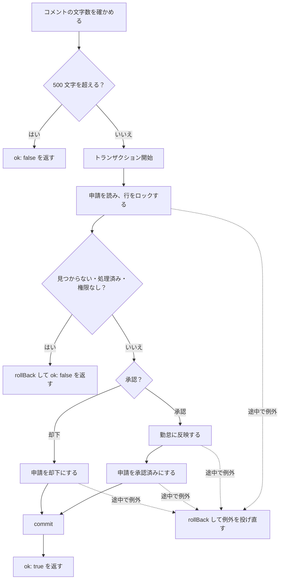

# `src/approvals.php` を読む（承認範囲と、承認・却下のトランザクション）

## このファイルの役割

承認について、**「誰が、どの申請を処理できるか」「一覧の1件をどう見せるか」「承認・却下をどう安全に行うか」を決める**ファイル。画面（`approvals/index.php`）と API（`api/approvals.php`）の両方から呼ばれる。

- HTML は出さない。SQL も書かない（SQL は `src/queries/attendance_requests.php` と `src/queries/attendances.php` の関数を呼ぶ）。
- 承認できるのは管理者（`manager`）だけ。範囲は「自分の部署（`department`）」か「全社（`all`）」。自分の申請は承認できない（D-016・D-024・D-025）。
- `canReview()` と `approvalItemView()` は、配列を受け取って答えを返すだけなので、DB が無くてもテストできる（`tests/ApprovalsTest.php`）。`reviewRequest()` は DB を使うテストで確かめる（`tests/ApprovalsDbTest.php`）。

## 全体の構成

| 行のあたり | 中身 |
| --- | --- |
| 先頭 | 読み込みと、定数（処理済みの件数、コメントの文字数） |
| 承認範囲 | `approvalDepartmentId()`：一覧の取得に使う部署 ID |
| 承認範囲 | `canReview()`：この申請を処理してよいか |
| 表示 | `approvalItemView()`：一覧の1件を画面用の形にする |
| 処理 | `reviewRequest()`：承認・却下を1つのトランザクションで行う（このファイルの中心） |

[src_attendance.md](./src_attendance.md) と同じく、**上から読むと、部品 → 組み立て の順**になっている。

---

## 1. 読み込みと定数

```php
include_once(__DIR__ . '/requests.php');
include_once(__DIR__ . '/queries/attendances.php');

// 処理済みの一覧に出す件数（D-064）
const APPROVAL_PROCESSED_LIMIT = 50;

const APPROVAL_COMMENT_MAX_LENGTH = 500;
```

- `src/requests.php` から、申請の表示の関数（`requestTypeLabel()`・`requestChanges()`）と定数（`REQUEST_TIME_FIELDS`・`REQUEST_STATUS_LABELS`）を使う。`src/requests.php` は、申請の SQL の関数（`src/queries/attendance_requests.php`）と `src/attendance.php`（`formatClock()`）も読み込むので、ここではそれらも使える。
- `src/queries/attendances.php` からは、承認で勤怠に反映する関数（`upsertAttendanceTimes()`・`upsertOvertimeEnd()`）を使う。
- `APPROVAL_COMMENT_MAX_LENGTH = 500` は、DB の `review_comment` の列（`VARCHAR(500)`）と同じ長さ。画面の `maxlength` にも、この定数を使う。数を1か所に置いておけば、画面・サーバーの確認・DB が食い違わない。

## 2. `approvalDepartmentId()`：一覧の取得に使う部署 ID

```php
function approvalDepartmentId(array $user): ?int {
    if ($user['approval_scope'] === 'all') {
        return null;
    }
    if ($user['department_id'] === null) {
        throw new RuntimeException('管理者の部署を取得できません: ' . $user['employee_id']);
    }
    return $user['department_id'];
}
```

- `$user` は `requireLogin()`／`currentUser()` が返した、ログイン中の利用者。
- 戻り値の型 `?int` は「整数か `null`」。一覧の SQL（`fetchPendingRequests()` など）は、**`null` なら部署で絞らない（全社）**、整数ならその部署の申請だけにする。
- 承認範囲が「部署」なのに部署 ID が無い（`null`）ときは、例外にして止める。

> **ここが重要**：この関数の `null` は「全社」という意味だ。もし部署 ID が無いときに、うっかり `null` を返すと、**部署の管理者に全社の申請が見えてしまう**（範囲が広がる方向の誤り）。データがおかしいときは、黙って何かを返さず、例外で止める。安全な側に倒す、という考え方。

## 3. `canReview()`：この申請を処理してよいか

```php
// この管理者が、この申請を承認・却下できるか（$request は fetchRequestForUpdate() の行。department_id は申請者の部署）
function canReview(array $user, array $request): bool {
    if ($user['role'] !== ROLE_MANAGER || $request['employee_id'] === $user['employee_id']) {
        return false;
    }
    return $user['approval_scope'] === 'all' || (int) $request['department_id'] === $user['department_id'];
}
```

- 断る条件を先に書き、`return false;` ですぐ抜ける（早期リターン）。
  - 管理者でない（社員・システム管理者）。
  - 申請者が自分（`employee_id` が同じ）。社員 ID はどちらも DB の同じ種類の列（文字列）から来るので、`===` で比べられる。
- 残りは承認範囲。「全社」なら、どの申請でもよい。「部署」なら、申請者の部署 ID と管理者の部署 ID が同じときだけ。
- `(int) $request['department_id']`：DB から読んだ値を、整数にそろえてから比べる。`$user['department_id']` は `currentUser()` で整数にしてある。`===` は型も比べるので、片方が `'3'`（文字列）、片方が `3`（整数）だと、同じ部署でも `false` になってしまう。**`===` で比べるときは、型をそろえておく**。

> **ここが重要**：一覧の SQL（`fetchPendingRequests()`）も、同じ条件（自分の申請を除く・部署で絞る）で申請を選んでいる。それでも、**承認・却下のたびに `canReview()` で確かめ直す**。一覧の条件は「見せる範囲」でしかなく、API には誰でも好きな `request_id` を送れるからだ（ほかの部署の申請の ID を送る、など）。「送られてきた ID のものを、この人が触ってよいか」をサーバーで毎回確かめるのは、Web アプリの基本の守り。

## 4. `approvalItemView()`：一覧の1件を、画面用の形にする

```php
function approvalItemView(array $row, string $standardEnd): array {
    $weekdays = ['日', '月', '火', '水', '木', '金', '土'];
    $time = strtotime($row['target_date']);
    $view = [
        'id' => (int) $row['id'],
        'name' => $row['name'],
        'department' => $row['department_name'],
        'type' => requestTypeLabel($row),
        'targetDate' => date('n/j', $time) . '（' . $weekdays[(int) date('w', $time)] . '）',
        'changes' => requestChanges($row),
        'reason' => $row['reason'] ?? '',
        'createdAt' => date('n/j H:i', strtotime($row['created_at'])),
        'reference' => '',
    ];
```

- `$row` は、一覧の SQL（`fetchPendingRequests()`・`fetchProcessedRequests()`）が返した1行。
- `strtotime('2026-10-14')`：日付の文字列を、タイムスタンプ（1970年からの秒数）に変える。それを `date()` で好きな形にする。
  - `'n/j'`：月と日を、先頭の 0 なしで（`10/4`）。
  - `'w'`：曜日の番号（日曜が 0、土曜が 6）。`$weekdays` の何番目かで、漢字の曜日にする。→ `'10/14（水）'` のような形。
- `requestTypeLabel()`（`src/requests.php`）：残業の申請なら「残業」。それ以外は、申請した時点の勤怠の値（`original_*`）が1つでもあれば「修正」、全部 `null`（その日の記録が無かった）なら「新規登録」。
- `requestChanges()`（`src/requests.php`）：申請した時点の値（`original_*`）と申請の値（`requested_*`）を比べ、**違う項目だけ**を `['label' => '退勤', 'before' => '17:30', 'after' => '18:45']` の形で返す。利用者の記録表示と同じ関数を使うので、管理者と社員で、同じ申請が同じように見える。
- `'reason' => $row['reason'] ?? ''`：理由は書かれていないと `null`。画面で扱いやすいように `''` にそろえる。

### 残業の申請だけ：判断の材料を添える

```php
    // 残業は、判断の材料として標準終了時刻と今の退勤時刻を添える（差異 12）
    if ($row['request_type'] === 'overtime' && array_key_exists('current_check_out_at', $row)) {
        $view['reference'] = '標準終了 ' . substr($standardEnd, 0, 5) . '・今の退勤 ' . formatClock($row['current_check_out_at']);
    }
```

- 「残業終了 なし → 19:30」だけでは、妥当か判断しにくい。そこで「標準終了 18:00・今の退勤 19:45」を添える。
- `current_check_out_at`（その日の今の退勤時刻）は、未処理の一覧（`fetchPendingRequests()`）だけが取得する列。処理済みの一覧の行には、このキーが無い。
- **`isset()` ではなく `array_key_exists()` を使っている**のがポイント。
  - `isset($row['x'])` は、キーがあっても値が `null` なら `false` になる。
  - `array_key_exists('x', $row)` は、キーさえあれば `true`。
  - その日の勤怠が無いと、`current_check_out_at` は `null` になる（LEFT JOIN のため）。`isset()` だと「未処理なのに勤怠が無い」場合と「処理済み（列が無い）」場合を区別できない。`array_key_exists()` なら、未処理の行で値が `null` のときも添えられ、`formatClock(null)` で「今の退勤 --:--」と出る。
- `substr($standardEnd, 0, 5)`：`'18:00:00'` → `'18:00'`。

### 処理済みの行だけ：結果を足す

```php
    // 処理済み：状態、処理した管理者と日時、却下コメント（差異 13）
    if (isset($row['status']) && $row['status'] !== 'pending') {
        $view['status'] = $row['status'];
        $view['statusLabel'] = REQUEST_STATUS_LABELS[$row['status']];
        $view['reviewerName'] = $row['reviewer_name'] ?? '';
        $view['reviewedAt'] = $row['reviewed_at'] === null ? '' : date('n/j H:i', strtotime($row['reviewed_at']));
        $view['reviewComment'] = $row['review_comment'] ?? '';
    }
    return $view;
}
```

- 未処理の一覧の SQL は `status` の列を取得しないので、`isset($row['status'])` が `false` になり、ここには入らない。処理済みの一覧の行だけが、結果のキーを持つ。
- `REQUEST_STATUS_LABELS`（`src/requests.php`）：`'approved' => '承認済み'`、`'rejected' => '却下'`。
- `reviewer_name` は、処理した管理者の氏名（SQL で `employees` をもう一度 LEFT JOIN して取る）。無いときに備えて `?? ''`。
- 1つの関数で、未処理・処理済みの両方の行を扱える。`approvals/index.php` は、タブによって読むキーを変えるだけでよい。

## 5. `reviewRequest()`：承認・却下（このファイルの中心）

流れを先に示す。



### 入口の確認（トランザクションの前）

```php
function reviewRequest(PDO $pdo, array $user, int $requestId, string $decision, string $comment): array {
    if ($decision !== 'approve' && $decision !== 'reject') {
        throw new InvalidArgumentException('知らない操作です: ' . $decision);
    }
    $comment = trim($comment);
    if (mb_strlen($comment) > APPROVAL_COMMENT_MAX_LENGTH) {
        return ['ok' => false, 'errors' => ['comment' => 'コメントは ' . APPROVAL_COMMENT_MAX_LENGTH . ' 文字までにしてください。']];
    }
```

- `$decision` は API で確かめ済みだが、ほかから呼ばれたときのために、ここでも確かめる。知らない値は**プログラムの誤り**なので例外にする（`actionMode()` の最後の `throw` と同じ考え方）。
- `mb_strlen()`：**文字の数**を数える。`strlen()` はバイトの数なので、日本語（1文字が 3 バイト）だと3倍に数えてしまう。DB の `VARCHAR(500)` も文字の数なので、`mb_strlen()` で合わせる。
- 文字数の確認は、DB に触る前に行う。ロックを取ってから断るより、無駄が無い。

### トランザクションの開始と、申請のロック

```php
    $pdo->beginTransaction();
    try {
        $request = fetchRequestForUpdate($pdo, $requestId);
```

- `beginTransaction()`：ここから `commit()` までの DB の変更を、**1つのまとまり**にする。全部成功するか、全部取り消すか、のどちらかになる。
- `fetchRequestForUpdate()`（依頼者が書いた SQL）は、申請を1件読むときに、SQL の末尾に **`FOR UPDATE`** を付けている。読んだ行に**ロック**をかけ、このトランザクションが終わるまで、ほかの人がその行を変えたり、`FOR UPDATE` で読んだりできないようにする。
- 返る行には、申請の値（`requested_*`）・状態（`status`）・申請者の氏名（`name`）と部署 ID（`department_id`）が入る。

> **ここが重要**：2人の管理者が、同じ申請の「承認」を同時に押した場合を考える。
>
> | 順番 | 管理者 A | 管理者 B |
> | --- | --- | --- |
> | 1 | `FOR UPDATE` で読む → 申請中。ロックを取る | |
> | 2 | 勤怠に反映、承認済みにする | `FOR UPDATE` で読もうとする → **A が終わるまで待つ** |
> | 3 | `commit`（ロックが外れる） | |
> | 4 | | 読める → **承認済み**になっている → 「すでに処理されています」 |
>
> `FOR UPDATE` を付けて読むと、待ったあとに、**ほかの人が確定した最新の値**を読む（InnoDB の動き）。もし `FOR UPDATE` が無ければ、A と B が両方とも「申請中」と読み、両方とも勤怠に反映してしまう。**「読んで確かめてから書く」処理は、読むところでロックを取らないと、同時に動いたときに確かめた意味がなくなる**。

### 処理してよいかを確かめる

```php
        $error = null;
        if ($request === null) {
            $error = 'この申請は見つかりません。取り消された可能性があります。画面を読み込み直してください。';
        } elseif ($request['status'] !== 'pending') {
            $error = 'この申請は、すでに処理されています。画面を読み込み直してください。';
        } elseif (!canReview($user, $request)) {
            $error = 'この申請を処理する権限がありません。';
        }
        if ($error !== null) {
            $pdo->rollBack();
            return ['ok' => false, 'errors' => ['form' => $error]];
        }
```

- 3つの場合を、順に調べる。
  - 見つからない：社員が申請を取り消した（申請中の申請は、取り消すと削除される。D-063）か、ありえない ID が送られた。
  - 申請中でない：ほかの管理者が先に処理した（上の表の B）。
  - 権限が無い：`canReview()` が `false`（範囲外・自分の申請）。
- どれかに当たったら、何も変えずに `rollBack()` してロックを外し、`ok: false` を返す。
- 文を `$error` に入れてから、まとめて1か所で返している。`rollBack()` を書く場所が1つで済む。
- `return` は `try` の中にあるが、`catch` には行かない（例外ではないので）。`rollBack()` を先に呼んでから `return` するのは、そのため。

### 承認：勤怠に反映する

```php
        if ($decision === 'approve') {
            if ($request['request_type'] === 'overtime') {
                upsertOvertimeEnd($pdo, $request['employee_id'], $request['target_date'], $request['requested_overtime_end_at']);
            } else {
                // 修正・新規登録は、4つの時刻をすべて申請の値にする（DB設計書 P-4）
                $times = [];
                foreach (array_keys(REQUEST_TIME_FIELDS) as $field) {
                    $times[$field] = $request['requested_' . $field];
                }
                upsertAttendanceTimes($pdo, $request['employee_id'], $request['target_date'], $times);
            }
```

- 残業の申請：その日の勤怠の `overtime_end_at`（承認済みの残業終了時刻）を、申請の値にする。
- 修正・新規登録：`REQUEST_TIME_FIELDS` のキー（`check_in_at`・`break_start_at`・`break_end_at`・`check_out_at`）で回し、`'requested_' . $field` で申請の列の名前を作って、4つの時刻の配列にする。列の名前を1つずつ書かずに済み、項目の一覧を `REQUEST_TIME_FIELDS` の1か所にまとめておける。
- 申請は「その日の4つの時刻の全体」を持つ（変えない項目は今の値、消したい項目は `null`）。だから承認では、**4つとも申請の値で置き換える**だけでよい（DB設計書 P-4）。差分を計算しないので、作りが単純。
- どちらの関数も、依頼者が書いた **`INSERT … ON DUPLICATE KEY UPDATE`** の SQL。その日の行が無ければ追加し（新規登録の申請はこちら）、あれば更新する。勤怠の「1人1日1行」の一意制約を使って、追加か更新かを DB に決めさせている。

### 申請の状態を変える

```php
            updateRequestStatus($pdo, $requestId, 'approved', $user['employee_id'], null);
            $message = $request['name'] . ' さんの申請を承認し、勤怠に反映しました。';
        } else {
            updateRequestStatus($pdo, $requestId, 'rejected', $user['employee_id'], $comment === '' ? null : $comment);
            $message = $request['name'] . ' さんの申請を却下しました。';
        }
        $pdo->commit();
```

- `updateRequestStatus()`（依頼者が書いた SQL）：状態・処理した管理者（`reviewer_id`）・コメント・処理した日時（`NOW()`）を記録する。
- 承認のコメントは `null`。却下のコメントは、空なら `null`、書かれていればその文。「書かなかった」を空文字ではなく `null` で記録する。
- 却下では、勤怠は変えない。申請の状態だけを変える。
- 最後に `commit()`：ここで初めて、勤怠の変更と申請の状態の変更が**同時に**確定し、ロックも外れる。
- `updateRequestStatus()` の SQL には `WHERE id = :id AND status = 'pending'` が付いていて、処理済みの申請は二重に更新しない作りになっている。ここではロックの中で「申請中」を確かめ済みなので、更新した件数までは見ていない。

> **ここが重要**：承認は「勤怠を書き換える」と「申請を承認済みにする」の2つの変更でできている。もし勤怠を書き換えたあとで、申請の更新が失敗したら、**勤怠だけ変わって、申請は申請中のまま**、という食い違った状態が残る（もう一度承認すると、二重に反映される）。トランザクションで包めば、途中で失敗しても両方とも元に戻る。「2つ以上の変更が、そろっていないと困る」ときは、トランザクションにする。

### 途中で失敗したとき

```php
    } catch (Throwable $e) {
        // 途中で失敗したら、すべて元に戻す
        if ($pdo->inTransaction()) {
            $pdo->rollBack();
        }
        throw $e;
    }
    return ['ok' => true, 'message' => $message];
}
```

- `Throwable`：PHP の例外（`Exception`）と、型の誤りなどのエラー（`Error`）の両方を受け止められる、いちばん広い型。何が起きても、ロールバックを確実に行うため。
- `$pdo->inTransaction()`：トランザクションの途中かどうか。`commit()` のあとや、すでに終わっているときに `rollBack()` を呼ぶとエラーになるので、確かめてから呼ぶ。
- `throw $e;`：元に戻したら、**例外をそのまま投げ直す**。ここで握りつぶして `ok: false` にすると、DB の障害などが「ふつうの断り」に見えてしまい、気付けない。投げ直された例外は、`src/errors.php` がログに書き、利用者には 500 と定型の文を返す。
- 成功したときだけ、`try`〜`catch` を抜けたあとの `return` まで来る。

> **ここが重要**：トランザクションの「開始 → `try` → 最後に `commit` → `catch` で `rollBack` して投げ直す」は、決まった形として覚えてよい。依頼者が書いた SQL の関数（`fetchRequestForUpdate()` など）の中には、トランザクションを書かない。**トランザクションの始めと終わりは、呼ぶ側（この関数）が1か所で決める**。そうしないと、関数の中で勝手に `commit()` されて、まとまりが崩れる。

### 自分の申請の承認を防ぐ、DB の守り

- `canReview()` で自分の申請は断っているが、DB の表（`attendance_requests`）にも、`reviewer_id IS NULL OR reviewer_id <> employee_id` という CHECK 制約がある。アプリに誤りがあって自分の申請を承認しようとしても、`updateRequestStatus()` が DB のエラーになり、上の `catch` で全部元に戻る。
- アプリの確認（分かりやすい文を返す）と、DB の制約（最後の守り）の二重にしている。考え方は、出勤の一意制約（[src_attendance.md](./src_attendance.md)）と同じ。

---

## まとめ：このファイルから学べること

| 書き方 | このファイルでの例 |
| --- | --- |
| 送られた ID は毎回確かめる | 一覧に出ていても、`canReview()` で確かめ直す |
| おかしいデータは安全な側に倒す | 部署 ID が無ければ `null`（全社）を返さず、例外 |
| `===` の前に型をそろえる | `(int) $request['department_id']` |
| 2つ以上の変更はトランザクション | 勤怠の反映と、申請の状態の更新 |
| 読んで確かめてから書くなら、読むときにロック | `SELECT … FOR UPDATE` で、同時の承認を1回にする |
| 失敗したら元に戻して、投げ直す | `catch (Throwable $e)` → `rollBack()` → `throw $e;` |
| トランザクションの範囲は呼ぶ側が決める | SQL の関数の中には `commit()` を書かない |
| DB の制約を最後の守りにする | 自分の申請の承認を防ぐ CHECK 制約 |
| `null` かもしれない列は `array_key_exists()` | `current_check_out_at` があるかどうか |
| 同じ表示は同じ関数で作る | `requestChanges()` を社員の画面と共有 |

## 関連するファイル

- 呼ぶ側：[approvals_index.md](./approvals_index.md)（一覧の表示）、[api_approvals.md](./api_approvals.md)（承認・却下の受付）
- 呼ばれる側：[src_queries_attendance_requests.md](./src_queries_attendance_requests.md)（`fetchRequestForUpdate()`・`updateRequestStatus()`、一覧の SQL）、[src_queries_attendances.md](./src_queries_attendances.md)（`upsertAttendanceTimes()`・`upsertOvertimeEnd()`）、[src_requests.md](./src_requests.md)（`requestTypeLabel()`・`requestChanges()`・定数）、[src_attendance.md](./src_attendance.md)（`formatClock()`）
- ログイン中の利用者の形（部署 ID・承認範囲）：[src_auth.md](./src_auth.md)
- 表の定義（CHECK 制約・申請中の重複を防ぐ一意制約）：`docs/db/schema.sql`
- テスト：`tests/ApprovalsTest.php`（承認範囲の判断と表示の組み立て）、`tests/ApprovalsDbTest.php`（実際の DB で、反映・却下・断り・途中で失敗したときに元に戻ること）
- 決定事項：[決定事項.md](../../決定事項.md)（D-016・D-024・D-025・D-063・D-064）
