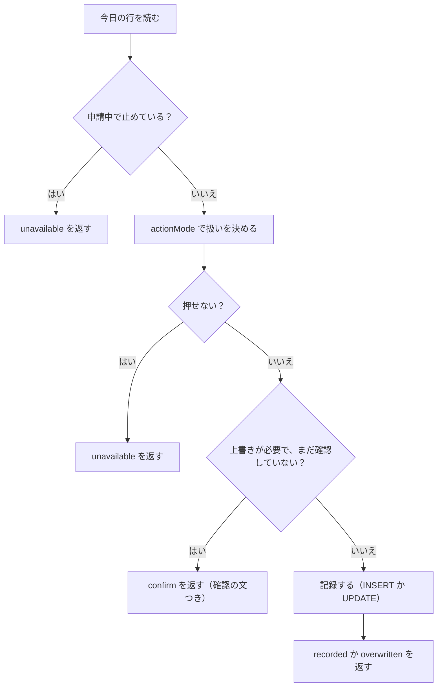

# `src/attendance.php` を読む（出退勤のルール）

## このファイルの役割

メイン画面の出勤・退勤・休憩のボタンについて、**「今どの状態か」「押せるか」「押したら何をするか」を決める**ファイル。画面（`index.php`）と API（`api/attendance.php`）の両方から呼ばれる。

- HTML は出さない。SQL も書かない（SQL は `src/queries/attendances.php` の関数を呼ぶ）。
- ほとんどの関数が「勤怠の行（配列）を受け取って、答えを返すだけ」になっている。DB が無くてもテストできる（`tests/AttendanceTest.php`）。

## 全体の構成

| 行のあたり | 中身 |
| --- | --- |
| 先頭 | 定数（ボタンの名前、状態の名前、押したときの扱い） |
| 小さな関数 | `workDateOf()`・`minuteTimestamp()`・`formatClock()`：日付・時刻の形を作る |
| 判断する関数 | `isOnBreak()`・`attendanceStatus()`・`actionMode()`・`overtimeAvailable()` |
| 表示を作る関数 | `attendanceView()`：画面に出す値をまとめる |
| 処理する関数 | `performAttendanceAction()`：ボタンを押したときの全部の流れ |

下の関数ほど、上の関数を組み合わせて使う。**上から読むと、部品 → 組み立て の順に理解できる**。

---

## 1. 定数

```php
const ATTENDANCE_ACTION_LABELS = [
    'check_in' => '出勤',
    'check_out' => '退勤',
    'break_start' => '休憩開始',
    'break_end' => '休憩終了',
];
```

- `const` で配列の定数を作れる（PHP 5.6 以降）。キーが「プログラムの中での名前」、値が「画面に出す名前」。
- この配列は、**「受け付けてよい操作の一覧」**も兼ねている。API は `isset(ATTENDANCE_ACTION_LABELS[$action])` で、送られてきた `action` がこの4つのどれかを確かめる（それ以外は 400）。一覧を1か所にまとめておくと、操作を増やすときも、ここだけ直せばよい。

```php
const ACTION_RECORD = 'record';            // そのまま記録する
const ACTION_OVERWRITE = 'overwrite';      // 上書き確認のあとで記録する
const ACTION_UNAVAILABLE = 'unavailable';  // 押せない
```

> **ここが重要**：「押したときの扱い」を文字列で直接書かず、定数にしている。`'overwirte'` のように打ち間違えると、文字列なら気付かずに動いてしまうが、定数名を間違えれば PHP がエラーにしてくれる。

## 2. 日付・時刻の小さな関数

```php
function workDateOf(int $timestamp): string {
    return date('Y-m-d', $timestamp);
}

function minuteTimestamp(int $timestamp): string {
    return date('Y-m-d H:i:00', $timestamp);
}

function formatClock(?string $datetime): string {
    return $datetime === null ? '--:--' : substr($datetime, 11, 5);
}
```

- `$timestamp` は「1970年1月1日からの秒数」（`time()` の値）。`date()` で好きな形の文字列にする。
- `minuteTimestamp()` は、書式の秒の部分を `:00` と**文字で固定**して、秒を切り捨てている。09:01:45 に押しても `09:01:00` で記録される。
- `?string` は「文字列か `null`」という型（nullable 型）。勤怠の時刻の列は空（NULL）のことがあるので、この型で受け取る。
- `substr($datetime, 11, 5)`：`'2026-10-15 09:01:00'` の、先頭を 0 文字目として数えた 11 文字目（`09` の `0`）から5文字 → `'09:01'`。

> **なぜ関数にするのか**：`date('Y-m-d', …)` は1行だが、「勤務日は押した日（0時で切り替え）」というルールを、`workDateOf()` という名前で表している。将来「朝5時で切り替え」に変わっても、この関数だけ直せばよい。

## 3. 状態を判断する関数

```php
function isOnBreak(?array $attendance): bool {
    return $attendance !== null
        && $attendance['break_start_at'] !== null
        && $attendance['break_end_at'] === null
        && $attendance['check_out_at'] === null;
}
```

- 引数の `$attendance` は、`fetchAttendance()` で読んだ今日の行（`['check_in_at' => …, 'check_out_at' => …, …]`）。まだ出勤していない日は行が無いので `null`。
- **`$attendance !== null &&` を最初に書く**のがポイント。`&&` は左から順に調べ、`false` が出たらそこで止まる（短絡評価）。`null` のときに `$attendance['…']` を読みに行かないので、エラーにならない。

```php
function attendanceStatus(?array $attendance): string {
    if ($attendance !== null && $attendance['check_out_at'] !== null) {
        return 'finished';
    }
    if ($attendance === null || $attendance['check_in_at'] === null) {
        return 'not_started';
    }
    return isOnBreak($attendance) ? 'on_break' : 'working';
}
```

- **早期リターン**：条件に当てはまったら、すぐ `return` する。`if … else if … else` を深く重ねないので、読みやすい。
- 調べる順番に意味がある。まず「退勤済み」を調べ、次に「未出勤」、残りが「休憩中」か「勤務中」。

## 4. `actionMode()`：ボタンを押せるか（このファイルの中心）

```php
function actionMode(?array $attendance, string $action): string {
    $checkIn = $attendance['check_in_at'] ?? null;
    $checkOut = $attendance['check_out_at'] ?? null;
    $breakStart = $attendance['break_start_at'] ?? null;
```

- `??`（null 合体演算子）：左が「無い」か `null` なら、右の値を使う。`$attendance` が `null` でも `null['check_in_at']` を読みに行ってエラーになることはなく、`null` が入る。3行で「無ければ null」をまとめて用意している。

```php
    switch ($action) {
        case 'check_in':
            // 休憩・退勤のあとに出勤を変えると、時刻の前後が逆になるため押せない（D-059）
            if ($checkOut !== null || $breakStart !== null) {
                return ACTION_UNAVAILABLE;
            }
            return $checkIn === null ? ACTION_RECORD : ACTION_OVERWRITE;
        case 'check_out':
            if ($checkIn === null || isOnBreak($attendance)) {
                return ACTION_UNAVAILABLE;
            }
            return $checkOut === null ? ACTION_RECORD : ACTION_OVERWRITE;
        case 'break_start':
            // 休憩は1日1回（D-007・D-042）
            return ($checkIn !== null && $checkOut === null && $breakStart === null) ? ACTION_RECORD : ACTION_UNAVAILABLE;
        case 'break_end':
            return isOnBreak($attendance) ? ACTION_RECORD : ACTION_UNAVAILABLE;
    }
    throw new InvalidArgumentException('知らない操作です: ' . $action);
}
```

- `case` の中で `return` しているので、`break` は要らない（`return` した時点で関数を抜ける）。
- 出勤・退勤は「まだ記録が無ければ記録、あれば上書きの確認」（BR-001）。休憩は1日1回なので、上書きはしない。
- 最後の `throw`：4つのどれでもない `$action` が来たら、プログラムの誤りなので例外にする。黙って何かを返すと、誤りに気付けない。

> **ここが重要**：このシステムでは、**「押せるか」の判断をこの関数1か所でしか行わない**。画面のボタンの `disabled` も、API の受付も、すべてこの関数の答えを使う。判断が1か所なら、ルールを変えるときに直し漏れが起きない。画面の `disabled` は見た目のためで、API でも必ずこの関数で確かめ直す（JavaScript をいじれば、押せないボタンも押せてしまうため）。

ルールの一覧（`actionMode()` の答え）：

| 今の状態 | 出勤 | 退勤 | 休憩開始 | 休憩終了 |
| --- | --- | --- | --- | --- |
| 未出勤 | 記録 | × | × | × |
| 勤務中（休憩前） | 上書き | 記録 | 記録 | × |
| 休憩中 | × | × | × | 記録 |
| 勤務中（休憩後） | × | 記録 | × | × |
| 退勤済み | × | 上書き | × | × |

## 5. `overtimeAvailable()`：簡単残業申請を押せるか

```php
function overtimeAvailable(?array $attendance, string $standardEnd): bool {
    $checkOut = $attendance['check_out_at'] ?? null;
    return $checkOut !== null && substr($checkOut, 11) > $standardEnd;
}
```

- `substr($checkOut, 11)` で `'2026-10-15 19:30:00'` → `'19:30:00'`。これを `'18:00:00'`（標準終了時刻）と比べる。
- **時刻を文字列のまま `>` で比べている**。`HH:MM:SS` のように桁数がそろった形なら、文字列の大小と時刻の前後が一致するので、これで正しく比べられる（`'09:00:00' < '18:00:00'`）。桁がそろっていない形（`'9:00'`）では使えないので注意。

## 6. `attendanceView()`：画面に出す値をまとめる

```php
function attendanceView(?array $attendance, ?string $standardEnd = null, bool $locked = false): array {
```

- `= null`・`= false` は**引数の既定値**。呼ぶときに省略すると、この値になる。記録表示（6章）は `attendanceView($row)` と1つだけ渡し、メイン画面は3つ渡す。

```php
    $buttons = [];
    foreach (array_keys(ATTENDANCE_ACTION_LABELS) as $action) {
        $buttons[$action] = !$locked && actionMode($attendance, $action) !== ACTION_UNAVAILABLE;
    }
```

- 4つのボタンそれぞれについて、`actionMode()` に聞いて「押せるか（true／false）」を作る。ここでも判断は `actionMode()` に任せている。
- `!$locked &&`：今日の修正が申請中（D-063）なら、`actionMode()` の答えにかかわらず、全部押せなくする。

```php
    return [
        'status' => $status,
        'statusLabel' => ATTENDANCE_STATUS_LABELS[$status],
        'checkIn' => formatClock($attendance['check_in_at'] ?? null),
        'checkOut' => formatClock($attendance['check_out_at'] ?? null),
        'break' => $breakLabel,
        'buttons' => $buttons,
        'locked' => $locked,
    ];
}
```

> **ここが重要**：この配列が、**PHP と JavaScript の「約束の形」**になっている。`index.php` は最初の表示にこれを使い、同じものを JSON にして `data-view` に埋め込む。API も、処理のあとに同じ形で返す。JavaScript（`js/main.js` の `render()`）は、この形の値を受け取って画面を書き換えるだけ。表示の作り方が PHP の1か所にまとまっているので、最初の表示と、ボタンを押したあとの表示が食い違わない。

## 7. `performAttendanceAction()`：ボタンを押したときの全部の流れ

流れを先に示す。



### 確認の往復（上書き）

```php
    if ($mode === ACTION_OVERWRITE && !$overwrite) {
        $current = $action === 'check_in' ? $attendance['check_in_at'] : $attendance['check_out_at'];
        return [
            'result' => 'confirm',
            'confirm' => [
                'title' => $label . 'を上書きしますか？',
                'body' => '本日の' . $label . 'は、すでに ' . formatClock($current) . ' で記録されています。今の時刻で上書きしますか？',
            ],
            'view' => attendanceView($attendance, $standardEnd),
        ];
    }
```

- 1回目の POST では `$overwrite` が `false` なので、記録せずに「確認が要る」と返す。画面が確認のウィンドウを出し、「上書きする」が押されたら、`overwrite=1` を付けて**もう一度 POST** する。2回目は `$overwrite` が `true` なので、記録まで進む。
- サーバーは「確認を出したかどうか」を覚えていない。毎回、送られてきた `overwrite` と、その時点の DB の状態だけで判断する（状態を持たないので、作りが単純になる）。

### 出勤の記録と、同時に押されたとき

```php
        case 'check_in':
            if ($attendance === null) {
                try {
                    insertCheckIn($pdo, $employeeId, $workDate, $time);
                } catch (PDOException $e) {
                    // 別の画面で、同時に出勤が記録された（一意制約の違反）
                    if (($e->errorInfo[1] ?? null) !== 1062) {
                        throw $e;
                    }
                    return [
                        'result' => 'conflict',
                        …
                        'view' => attendanceView(fetchAttendance($pdo, $employeeId, $workDate), $standardEnd),
                    ];
                }
            } else {
                updateCheckIn($pdo, $employeeId, $workDate, $time);
            }
            break;
```

- 今日の行が無ければ INSERT、あれば UPDATE。
- 2つのタブで同時に「出勤」を押すと、両方とも「行が無い」と判断して INSERT する。`attendances` の「1人1日1行」の一意制約で、後のほうは MySQL のエラー番号 `1062` になる。
- `catch` で **1062 のときだけ**受け止めて `conflict` を返し、それ以外のエラー（DB が止まった など）は `throw $e;` で投げ直す。何でも受け止めてしまうと、本当の障害を隠してしまう。

> **ここが重要**：「先に SELECT で調べてから INSERT」だけでは、同時に押されたときに防げない（調べた直後に、別のタブが INSERT するかもしれない）。**最後の守りは DB の一意制約**で、アプリはそのエラーを受け止めて、分かりやすい結果に変えている。この考え方は、申請の重複（BR-002）や、部署名・メールアドレスの重複でも同じ。

### 結果を返す

```php
    return [
        'result' => $result,
        'message' => $message,
        'view' => attendanceView(fetchAttendance($pdo, $employeeId, $workDate), $standardEnd),
    ];
```

- 記録したあと、**DB をもう一度読んで**から表示を作る。記録した値を手元で組み立てるのではなく、DB の本当の状態を返すので、表示がずれない。

---

## まとめ：このファイルから学べること

| 書き方 | このファイルでの例 |
| --- | --- |
| 判断は1か所にまとめる | 押せるかは `actionMode()` だけが決める |
| サーバーで確かめ直す | 画面の `disabled` を信用しない |
| 同時の操作は DB の制約で守る | 1人1日1行の一意制約と、1062 の受け止め |
| 想定外のエラーは隠さない | 1062 以外は `throw $e;` |
| 表示の形を1つにする | `attendanceView()` を画面・JSON の両方で使う |
| 状態を持たない往復 | 上書きの確認は `overwrite=1` を付けて送り直す |
| DB を使わない関数に分ける | `actionMode()` などは配列を受け取るだけなので、テストしやすい |

## 関連するファイル

- 呼ぶ側：`index.php`（最初の表示）、`api/attendance.php`（ボタンの受付）
- 呼ばれる側：`src/queries/attendances.php`（`fetchAttendance()`・`insertCheckIn()`・`updateCheckIn()` など）
- 画面の動き：`js/main.js`（`render()` が `attendanceView()` の形を受け取る）
- テスト：`tests/AttendanceTest.php`（状態ごとに、どのボタンが押せるか）
