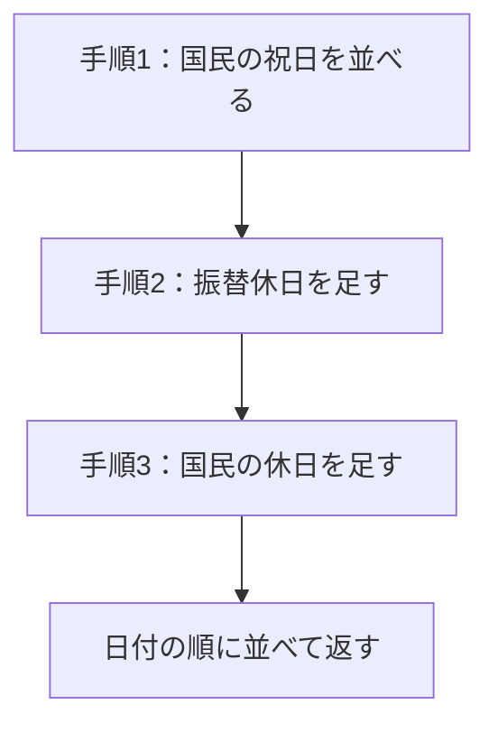

# `src/holidays.php` を読む（祝日の計算）

## このファイルの役割

**日本の祝日・休日を、法律（国民の祝日に関する法律）のルールで計算する**ファイル。記録表示のカレンダーで、祝日名を出したり、休日の背景色を付けたりするのに使う（`src/records.php` の `buildCalendar()` から呼ばれる）。

- 祝日を DB に持たず、プログラムで計算する（D-044）。毎年、祝日の表を入れ直す手間が無い。
- HTML も SQL も無い。年（整数）を受け取って、`['2026-01-01' => '元日', …]` を返すだけ。
- 計算できるのは 2000〜2099 年。春分・秋分の日の計算式が使える範囲で、記録表示で使う年はこれより狭い。
- 答えが正しいかは、`tests/HolidaysTest.php` で、内閣府の祝日一覧を元にした公開データ（開発のときだけ使う）と、2000〜2050 年の全部の日を照らし合わせて確かめている。

## 全体の構成

| 行のあたり | 中身 |
| --- | --- |
| 先頭 | 定数（計算できる年の範囲） |
| `japaneseHolidays()` | その年の祝日・休日を返す（このファイルの中心） |
| `nthMonday()` | その月の第 n 月曜日 |
| `vernalEquinoxDay()`・`autumnalEquinoxDay()` | 春分の日・秋分の日の計算式 |

`japaneseHolidays()` は、次の3段階で祝日を足していく。



順番に意味がある。振替休日は「祝日が日曜日か」で決まり、国民の休日は「前後の日が休みか」で決まるので、先に祝日がそろっていないと計算できない。

---

## 1. 定数

```php
const HOLIDAYS_MIN_YEAR = 2000;
const HOLIDAYS_MAX_YEAR = 2099;
```

- 計算できる年の範囲。`src/records.php` の `resolveMonth()` も `HOLIDAYS_MIN_YEAR` を使い、2000 年より前の月は表示しないようにしている。範囲を1か所で決めているので、両方がずれない。

## 2. `japaneseHolidays()`：始めの確認と、日付を作る小さな関数

```php
function japaneseHolidays(int $year): array {
    if ($year < HOLIDAYS_MIN_YEAR || $year > HOLIDAYS_MAX_YEAR) {
        throw new InvalidArgumentException('祝日を計算できない年です: ' . $year);
    }

    $date = fn (int $month, int $day) => sprintf('%04d-%02d-%02d', $year, $month, $day);
    $holidays = [];
```

- 範囲の外の年は、例外にする。計算式が合わない年に、黙って間違った祝日を返すより、止めたほうが誤りに気付ける。
- `$date = fn (…) => …`：**アロー関数**を変数に入れている。`$date(1, 1)` と呼ぶと `'2026-01-01'` を返す。
  - アロー関数は、外側の変数（ここでは `$year`）を**自動で使える**。ふつうの無名関数（`function () use ($year) { … }`）のように `use` を書かなくてよい。
  - `sprintf('%04d-%02d-%02d', …)`：数を、4桁・2桁・2桁（足りなければ前を 0 で埋める）にする。
- `$holidays` は「日付 → 名前」の配列。キーが日付なので、同じ日を2回入れても1つにまとまり、`isset($holidays['2026-05-04'])` で「その日が祝日か」をすぐに調べられる。

## 3. 国民の祝日を並べる

```php
    // 1. 国民の祝日
    $holidays[$date(1, 1)] = '元日';
    $holidays[nthMonday($year, 1, 2)] = '成人の日';
    $holidays[$date(2, 11)] = '建国記念の日';
    if ($year >= 2020) {
        $holidays[$date(2, 23)] = '天皇誕生日';
    }
    $holidays[$date(3, vernalEquinoxDay($year))] = '春分の日';
    $holidays[$date(4, 29)] = $year >= 2007 ? '昭和の日' : 'みどりの日';
    $holidays[$date(5, 3)] = '憲法記念日';
    if ($year >= 2007) {
        $holidays[$date(5, 4)] = 'みどりの日';
    }
    $holidays[$date(5, 5)] = 'こどもの日';
```

祝日は、決まり方が3種類ある。

| 決まり方 | 例 | 書き方 |
| --- | --- | --- |
| 日付が決まっている | 元日（1/1）、建国記念の日（2/11） | `$date(1, 1)` |
| 「第 n 月曜日」（ハッピーマンデー） | 成人の日（1月の第2月曜日） | `nthMonday($year, 1, 2)` |
| 計算式で決まる | 春分の日、秋分の日 | `vernalEquinoxDay($year)` |

- 法律が変わった年で、`if` や三項演算子で分けている。
  - 天皇誕生日：2020 年から 2/23。2018 年までは 12/23（下のほうで足す）。**2019 年は天皇誕生日が無い**（どちらの条件にも当てはまらない）。
  - 4/29：2007 年から「昭和の日」、それより前は「みどりの日」。
  - 5/4：2007 年から「みどりの日」。それより前は、祝日（5/3 と 5/5）にはさまれた「国民の休日」だった（3段階目のルールで、自動で出てくる）。

```php
    // 海の日・山の日・スポーツの日（2020・2021 年は、オリンピックのため移動）
    if ($year === 2020) {
        $holidays[$date(7, 23)] = '海の日';
        $holidays[$date(7, 24)] = 'スポーツの日';
        $holidays[$date(8, 10)] = '山の日';
    } elseif ($year === 2021) {
        $holidays[$date(7, 22)] = '海の日';
        $holidays[$date(7, 23)] = 'スポーツの日';
        $holidays[$date(8, 8)] = '山の日';
    } else {
        $holidays[$year >= 2003 ? nthMonday($year, 7, 3) : $date(7, 20)] = '海の日';
        if ($year >= 2016) {
            $holidays[$date(8, 11)] = '山の日';
        }
        $holidays[nthMonday($year, 10, 2)] = $year >= 2020 ? 'スポーツの日' : '体育の日';
    }
```

- 東京オリンピックの年（2020・2021 年）は、3つの祝日が特別に移動したので、日付をそのまま書いている。ルールで計算できない「特例」は、無理に式にせず、そのまま書くのがいちばん分かりやすい。
- それ以外の年：
  - 海の日：2003 年から7月の第3月曜日、それより前は 7/20。
  - 山の日：2016 年から 8/11。
  - 10月の第2月曜日：2020 年から「スポーツの日」、それより前は「体育の日」。
- `$holidays[条件 ? A : B] = …`：**キー（日付）のほうを三項演算子で選んでいる**。名前は同じ「海の日」で、日付だけが年で変わるため。

```php
    $holidays[$year >= 2003 ? nthMonday($year, 9, 3) : $date(9, 15)] = '敬老の日';
    $holidays[$date(9, autumnalEquinoxDay($year))] = '秋分の日';
    $holidays[$date(11, 3)] = '文化の日';
    $holidays[$date(11, 23)] = '勤労感謝の日';
    if ($year <= 2018) {
        $holidays[$date(12, 23)] = '天皇誕生日';
    }

    // 2019 年だけの祝日（天皇の即位）
    if ($year === 2019) {
        $holidays[$date(5, 1)] = '即位の日';
        $holidays[$date(10, 22)] = '即位礼正殿の儀';
    }
```

- 敬老の日：2003 年から9月の第3月曜日、それより前は 9/15。
- 2019 年だけの休日（5/1・10/22）も、特例としてそのまま書く。5/1 が休みになったので、4/30（4/29 と 5/1 の間）と 5/2（5/1 と 5/3 の間）も、3段階目のルールで「国民の休日」になる。その年のゴールデンウィークが10連休になったのは、このため。

## 4. 振替休日を足す

```php
    // 2. 振替休日：祝日が日曜日のときは、その後の最も近い「祝日でない日」が休日（2006 年までは、翌日の月曜日のみ）
    $substitutes = [];
    foreach (array_keys($holidays) as $day) {
        if (date('w', strtotime($day)) !== '0') {
            continue;
        }
        $next = date('Y-m-d', strtotime($day . ' +1 day'));
        if ($year >= 2007) {
            while (isset($holidays[$next])) {
                $next = date('Y-m-d', strtotime($next . ' +1 day'));
            }
        } elseif (isset($holidays[$next])) {
            continue;
        }
        if (substr($next, 0, 4) === (string) $year) {
            $substitutes[$next] = '振替休日';
        }
    }
    $holidays += $substitutes;
```

- `array_keys($holidays)`：祝日の日付だけの配列。1つずつ調べる。
- `date('w', …)` は曜日の番号を**文字列**で返す（日曜は `'0'`）。だから `!== '0'` と、文字列で比べている（`!== 0` と書くと、型が違うので、いつも「違う」になってしまう）。日曜でなければ `continue` で次の日へ。
- 日曜の祝日なら、次の日（`$next`）を休みにする。
  - 2007 年から：次の日も祝日なら、祝日でない日まで進む（`while`）。例：2026 年は 5/3（憲法記念日）が日曜。5/4・5/5 も祝日なので、**5/6 が振替休日**になる。
  - 2006 年まで：振替休日になるのは翌日（月曜日）だけ。翌日が祝日なら、振替休日は無い（`continue`）。
- `substr($next, 0, 4) === (string) $year`：この関数は「その年の分」を返すので、翌年にはみ出した日は入れない。今の祝日では、年末に日曜の祝日から翌年へはみ出すことは無いので、念のための確かめ。
- 見つけた振替休日は、いったん `$substitutes` に集めておき、最後にまとめて足す。調べている途中で `$holidays` を書き換えないので、どの順に調べても結果が変わらない。

```php
    $holidays += $substitutes;
```

- 配列の `+`（和）は、**左に無いキーだけを右から足す**（同じキーがあれば、左が残る）。ここでは、振替休日の日は必ず祝日でない日なので、そのまま全部足される。

## 5. 国民の休日を足す

```php
    // 3. 国民の休日：前の日と次の日が祝日で、その日が祝日でない日（2006 年までは、日曜日を除く）
    $citizens = [];
    foreach (array_keys($holidays) as $day) {
        $middle = date('Y-m-d', strtotime($day . ' +1 day'));
        $after = date('Y-m-d', strtotime($day . ' +2 day'));
        if (isset($holidays[$after]) && !isset($holidays[$middle]) && ($year >= 2007 || date('w', strtotime($middle)) !== '0')) {
            $citizens[$middle] = '国民の休日';
        }
    }
    $holidays += $citizens;
```

- 休みの日（`$day`）から見て、2日後（`$after`）も休みで、1日後（`$middle`）が休みでなければ、1日後を「国民の休日」にする。「前の日と次の日が休み」を、前の日の側から調べている。
- 2006 年までは、その日が日曜日なら国民の休日にしない（`date('w', …) !== '0'`）。
- 例：2026 年は、9/21（敬老の日・月曜）と 9/23（秋分の日・水曜）の間の **9/22 が国民の休日**になる。この年の9月は、土日と合わせて5連休になる。
- 例：2003 年は、5/3 と 5/5 の間の 5/4 が日曜日だったので、国民の休日にならない（2006 年までのルール）。

```php
    ksort($holidays);
    return $holidays;
}
```

- `ksort()`：キー（日付）の順に並べ替える。振替休日・国民の休日は、あとから末尾に足したので、このままだと日付の順になっていない。`'Y-m-d'` の文字列は、文字の順に並べれば日付の順になる。

2026 年の結果（全部で18日）：

| 日付 | 名前 | 日付 | 名前 |
| --- | --- | --- | --- |
| 1/1 | 元日 | 5/6 | 振替休日 |
| 1/12 | 成人の日 | 7/20 | 海の日 |
| 2/11 | 建国記念の日 | 8/11 | 山の日 |
| 2/23 | 天皇誕生日 | 9/21 | 敬老の日 |
| 3/20 | 春分の日 | 9/22 | 国民の休日 |
| 4/29 | 昭和の日 | 9/23 | 秋分の日 |
| 5/3 | 憲法記念日 | 10/12 | スポーツの日 |
| 5/4 | みどりの日 | 11/3 | 文化の日 |
| 5/5 | こどもの日 | 11/23 | 勤労感謝の日 |

> **ここが重要**：祝日を「表」で持つと、毎年だれかが入れ直さないといけない（忘れると、カレンダーの祝日が出なくなる）。法律のルールをそのまま式にしておけば、**何年先でも自動で正しい**。ただし、ルールで計算すると「計算が正しいか」が心配になる。そこで、公開データと 2000〜2050 年の全部の日を照らし合わせるテストを用意して、正しさを保証している。法律が変わって祝日が増えたときは、このファイルを直し、テストで確かめる。

## 6. `nthMonday()`：その月の第 n 月曜日

```php
function nthMonday(int $year, int $month, int $n): string {
    $firstWeekday = (int) date('w', mktime(0, 0, 0, $month, 1, $year));
    $firstMonday = 1 + (8 - $firstWeekday) % 7;
    return sprintf('%04d-%02d-%02d', $year, $month, $firstMonday + 7 * ($n - 1));
}
```

- `mktime(時, 分, 秒, 月, 日, 年)`：日時からタイムスタンプを作る（引数の順番が「月, 日, 年」なので注意）。その月の1日の曜日（0〜6）を求める。
- `1 + (8 - 曜日) % 7`：1日の曜日から、最初の月曜日の日付を出す式。`%` は割った余り。

| 1日の曜日 | 番号 | `1 + (8 - 番号) % 7` | 最初の月曜日 |
| --- | --- | --- | --- |
| 日 | 0 | 1 + 8 % 7 = 1 + 1 | 2日 |
| 月 | 1 | 1 + 7 % 7 = 1 + 0 | 1日 |
| 火 | 2 | 1 + 6 % 7 = 1 + 6 | 7日 |
| 木 | 4 | 1 + 4 % 7 = 1 + 4 | 5日 |

- 第 n 月曜日は、最初の月曜日から `7 * (n - 1)` 日後。
- 例：`nthMonday(2026, 9, 3)`（敬老の日）。2026年9月1日は火曜日（2）なので、最初の月曜日は7日。第3月曜日は 7 + 14 = **21日**。

## 7. `vernalEquinoxDay()`・`autumnalEquinoxDay()`：春分の日・秋分の日

```php
function vernalEquinoxDay(int $year): int {
    return (int) floor(20.8431 + 0.242194 * ($year - 1980) - floor(($year - 1980) / 4));
}

function autumnalEquinoxDay(int $year): int {
    return (int) floor(23.2488 + 0.242194 * ($year - 1980) - floor(($year - 1980) / 4));
}
```

- 春分・秋分の日は、法律では日付が決まっておらず、太陽の動き（天文の計算）で決まる。正式には前の年に発表されるが、1980〜2099 年は、この式でよく合うことが知られている。
- `0.242194` は、1年がちょうど 365 日より約 0.2422 日長いぶん、春分の時刻が毎年少しずつ遅れることを表す。`floor((年 - 1980) / 4)` は、うるう年で1日戻るぶんを引いている。
- `floor()`：小数を切り捨てる。結果は小数の型（float）なので、`(int)` で整数にする。

計算の例（2026 年。`2026 - 1980 = 46`、`floor(46 / 4) = 11`）：

| | 式 | 結果 |
| --- | --- | --- |
| 春分の日 | `floor(20.8431 + 0.242194 × 46 − 11)` ＝ `floor(20.984…)` | **3月20日** |
| 秋分の日 | `floor(23.2488 + 0.242194 × 46 − 11)` ＝ `floor(23.389…)` | **9月23日** |

> **ここが重要**：この式が使えるのは 1980〜2099 年。だから、ファイルの先頭で計算できる年を 2000〜2099 年に決め、範囲の外は例外にしている。「どこまで正しいか」が分かっている式は、その範囲を**定数と例外で守る**のが大事。

---

## まとめ：このファイルから学べること

| 書き方 | このファイルでの例 |
| --- | --- |
| 変わるデータは、ルールで計算する | 祝日を DB に持たず、法律のルールで計算する（D-044） |
| 特例は、無理に式にしない | 2019・2020・2021 年は、日付をそのまま書く |
| 計算の順番を守る | 祝日 → 振替休日 → 国民の休日 |
| 途中で元の配列を書き換えない | `$substitutes`・`$citizens` に集めて、最後に `+=` |
| 日付をキーにする | `isset($holidays[$next])` ですぐに調べられる |
| 型に気を付けて比べる | `date('w', …)` は文字列なので `!== '0'` |
| 使える範囲を定数と例外で守る | `HOLIDAYS_MIN_YEAR`〜`HOLIDAYS_MAX_YEAR` の外は例外 |
| 計算はテストで保証する | 公開データと 2000〜2050 年を照らし合わせる |

## 関連するファイル

- 呼ぶ側：`src/records.php`（`buildCalendar()` が `japaneseHolidays()` を、`resolveMonth()` が `HOLIDAYS_MIN_YEAR` を使う） → [src_records.md](./src_records.md)
- 祝日を表示する画面：`records/index.php` → [records_index.md](./records_index.md)
- テスト：`tests/HolidaysTest.php`（公開データとの照らし合わせ、2026 年の例、範囲の外の年）
- 決めたこと：[決定事項.md](../../決定事項.md) の D-044、[DB設計書.md](../../DB設計書.md) の「祝日の扱い」
